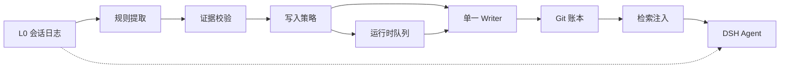

# dsh-memory

[GitHub](https://github.com/xfastres/deepseek-memory) · DeepSeek Harness（DSH）的原生长期记忆插件。

它把用户确认过的事实写进本机 Git 账本，并在后续对话里按需注入，而不是把整段聊天压成摘要。正式记忆必须能指回会话证据（`session_id` + `event_seq`），变更可追溯、可撤回、可纠正。提取、检索或存储失败时，主对话必须还能用。

## 它做什么

- 从已完成的用户原话里提出候选（默认靠中文规则，精度优先）
- 用户在「记忆」面板里接受、编辑、撤回、标记有误
- 正式记忆写入 `~/.dsh/dsh-memory/ledger`，一条变更一次 Git 提交
- 在 `agent/pre-step` 刷新快照，经 `systemPrompt.context` 注入相关记忆
- 模型可搜索记忆、可提出修改，但不能批准自己的提案

## 它不做什么

- 不是聊天总结器，不把 AI 回复当成用户偏好的唯一证据
- 不编造 `event_seq`：证据解析失败就不写
- 默认不自动写入账本（提取可以排队，自动接受需用户打开）
- L2 场景 / L3 人设是可重算的视图，不是第二套事实库；人设不进 prompt

## 仓库结构

```
packages/dsh-memory/           DSH Cordis 插件（Host + Client）
  index.js                     Host：路由、工具、pre-step、注入
  client.js                    Client：记忆面板
  host/                        提取、策略、账本服务、HTTP、运行时库
  cordis.patch.yml             把插件插入 composition
packages/provider-git-ledger/  Git 账本：唯一 Writer
packages/l0-conversation/      L0 只读模型：事件 → 轮次时间线
docs/                          文档（按用途分类，见下）
```

`@local/dsh-memory` 零运行时 npm 依赖。账本需要本机 `git`；检索探测 `node:sqlite` 的 FTS5 trigram（中文无分词器也能召回）。

## 工作原理

实线是记忆路径。虚线是主对话本身：Agent 继续读 L0，记忆失败不得打断它。Git 账本是唯一正式事实源。



两套存储，职责不同：

| 位置 | 存什么 |
|---|---|
| `~/.dsh/dsh-memory/ledger/` | 正式记忆与版本历史（Git） |
| `~/.dsh/dsh-memory/runtime/` | 候选队列、异议、注入审计、模型提案 |
| `~/.dsh/dsh-memory/memory-settings.json` | 总开关、是否自动写入 |

## 要求

- [DeepSeek Harness](https://github.com/deepseek-ai) 桌面 Profile（已在 DSH 0.2.x / Electron 44 上验证）
- Node `>= 22.5`（跑测试）；Host 侧用 Electron 自带 Node
- 本机 `git` 在 PATH 上（账本每次变更都要 commit）

## 安装到 DSH

插件按 Bundle 加载，改 Host 代码后必须**重启 DSH**；只改 `client.js` 刷新页面即可。

1. 在 Profile 的 `package.json` 里用 link 指向本仓库的插件目录，例如：

```json
{
  "dependencies": {
    "@local/dsh-memory": "link:F:/deepseek-memory/packages/dsh-memory"
  }
}
```

2. 把 `@local/dsh-memory` 加进该 Profile 的 `dsh.profile.bundles` 列表。
3. 在 Profile 目录执行安装（使 link 生效），然后重启 DSH。
4. 侧边栏应出现「记忆」。面板里「测试 Host 连接」应返回 200；也可以让模型调用 `dsh_memory_ping`。

`packages/dsh-memory/cordis.patch.yml` 会把 Host 半边插入 composition，无需改 DSH 根配置（根 `cordis.yml` 在启动时会被写成空数组）。

## 工具

| 工具 | 作用 |
|---|---|
| `dsh_memory_ping` | 探测 Host 是否加载、SQLite/FTS5 是否可用 |
| `memory_search` | 只读检索当前可注入的记忆 |
| `memory_propose` | 提出新增/更新/合并/撤回，**不写账本**，等用户在面板接受 |

## HTTP

Host 在回环地址注册 `/api/dsh-memory/*`。请求必须来自回环 socket，且 Host 头为回环地址，并拒绝跨站。读写共用这道围栏（`isTrustedWrite = isTrustedRead`）。

常用路径：`/ping` `/state` `/history` `/changes` `/candidates` `/review` `/add` `/update` `/retract` `/objections` `/settings` `/proposals` `/injections` `/export` `/migrate`。

契约见 [docs/design/dsh-memory-host-api.md](docs/design/dsh-memory-host-api.md)。个别字段可能落后于代码，以 `packages/dsh-memory/host/http-app.js` 为准。

## 测试

Windows 下不要把目录传给 `node --test`，按文件跑：

```powershell
node --test --test-force-exit packages/dsh-memory/test/*.test.mjs
node --test packages/provider-git-ledger/test/*.js
node --test packages/l0-conversation/test/*.js
```

提取规则的离线评估（只测量，退出码恒为 0）：

```powershell
node packages/dsh-memory/eval/run-extraction-eval.mjs
```

2026-10-29 只读审计时：插件 375 + 账本 32 + L0 7，共 414 项通过。之后若加了测试，以当时命令输出为准。

## 设计约束

1. **证据优先**：active 记忆必须带 `source_refs`；结论强度不能超过证据。
2. **单一 Writer**：只有 `MemoryLedger.apply()` 写正式记忆；Client 不直接碰 Git。
3. **失败不影响对话**：插件每条注册单独 try；提取/写入是 fire-and-forget。
4. **异议优先**：用户标记有误后，该记忆立即退出普通检索和注入，不必等 Git 撤回。
5. **AI 不批准自己**：`memory_propose` 只进运行时队列。

记忆类型：`fact` `preference` `constraint` `decision` `goal` `event` `open_loop` `hypothesis`。提取规则里的 `instruction` 会映射为 `constraint`。

## 当前缺口

- Client 仍可能与 localStorage 并行保存一份副本；评审应以 Host 账本为准，否则会分叉
- 提取主要认中文显式说法（记住 / 决定 / 我更喜欢…）；英文和隐式偏好会漏
- 正式记忆目前都是 `global` scope，没有 workspace 隔离
- L2/L3 纯函数已有（`host/scenarios.js`、`host/persona.js`），界面尚未挂上
- 写入门禁（统一批准、`writesEnabled`）仍是设计稿，见 [write-gate](docs/design/write-gate/)

安全与测试基线见 [阶段 0 只读审计](docs/status/phase0-readonly-audit.md)。

## 文档

完整索引：[docs/README.md](docs/README.md)。按用途：

| 目录 | 用途 | 入口 |
|---|---|---|
| [docs/investigation/](docs/investigation/) | 宿主调查 | [原生插件调查](docs/investigation/dsh-native-memory-plugin-investigation.md) |
| [docs/design/](docs/design/) | 目标架构 | [v2.1 路线图](docs/design/dsh-memory-roadmap-v2.md) |
| [docs/status/](docs/status/) | 实现与审计 | [进度](docs/status/dsh-memory-v2-progress.md) · [审计](docs/status/phase0-readonly-audit.md) |
| [docs/ops/](docs/ops/) | 本机验收 | [隔离验收](docs/ops/dsh-memory-phase4-acceptance.md) |

`docs/status/dsh-memory-plugin-report.md` 是 2026-10-28 的快照，内容已过时。

## 许可

本仓库当前为私有本地包（`private: true`），未声明开源许可证。
