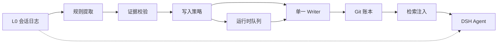

# dsh-memory

[GitHub](https://github.com/xfastres/deepseek-memory) · DeepSeek Harness（DSH）的原生长期记忆插件。

它把用户确认过的事实写进本机 Git 账本，并在后续对话里按需注入，而不是把整段聊天压成摘要。正式记忆必须能指回会话证据（`session_id` + `event_seq`），变更可追溯、可撤回、可纠正。提取、检索或存储失败时，主对话必须还能用。

## 它做什么

- 从已完成的用户原话里提出候选（默认靠中文规则，精度优先）
- 用户在「记忆」面板里接受、编辑、撤回、标记有误；写账本要带页面从 `/state` 拿到的令牌
- 正式记忆写入 `~/.dsh/dsh-memory/ledger`，一条变更一次 Git 提交
- 在 `agent/pre-step` 刷新快照，经 `systemPrompt.context` 注入相关记忆
- 模型可搜索记忆、可提出修改，但不能批准自己的提案

## 它不做什么

- 不是聊天总结器，不把 AI 回复当成用户偏好的唯一证据
- 不编造 `event_seq`：证据解析失败就不写
- 默认不自动写入账本（提取可以排队，自动接受需用户打开）
- L2 场景 / L3 人设是可重算的视图，不是第二套事实库；人设不进 prompt

## 仓库结构

```
packages/dsh-memory/           DSH Cordis 插件（Host + Client）
  index.js                     Host：路由、工具、pre-step、注入
  client.js                    Client：记忆面板
  host/                        提取、策略、账本服务、HTTP、运行时库
  cordis.patch.yml             把插件插入 composition
packages/provider-git-ledger/  Git 账本：唯一 Writer
packages/l0-conversation/      L0 只读模型：事件 → 轮次时间线
docs/                          文档（按用途分类，见下）
```

`@local/dsh-memory` 零运行时 npm 依赖。账本需要本机 `git`；检索探测 `node:sqlite` 的 FTS5 trigram（中文无分词器也能召回）。

## 工作原理

实线是记忆路径。虚线是主对话本身：Agent 继续读 L0，记忆失败不得打断它。Git 账本是唯一正式事实源。



两套存储，职责不同：

| 位置 | 存什么 |
|---|---|
| `~/.dsh/dsh-memory/ledger/` | 正式记忆与版本历史（Git） |
| `~/.dsh/dsh-memory/runtime/` | 候选队列、异议、注入审计、模型提案 |
| `~/.dsh/dsh-memory/memory-settings.json` | 总开关、是否自动写入 |

## 要求

- [DeepSeek Harness](https://github.com/deepseek-ai) 桌面 Profile（已在 DSH 0.2.x / Electron 44 上验证）
- Node `>= 22.5`（跑测试）；Host 侧用 Electron 自带 Node
- 本机 `git` 在 PATH 上（账本每次变更都要 commit）

## 安装到 DSH

插件按 Bundle 加载，改 Host 代码后必须**重启 DSH**；只改 `client.js` 刷新页面即可。

1. 在 Profile 的 `package.json` 里用 link 指向本仓库的插件目录，例如：

```json
{
  "dependencies": {
    "@local/dsh-memory": "link:F:/deepseek-memory/packages/dsh-memory"
  }
}
```

2. 把 `@local/dsh-memory` 加进该 Profile 的 `dsh.profile.bundles` 列表。
3. 在 Profile 目录执行安装（使 link 生效），然后重启 DSH。
4. 侧边栏应出现「记忆」。面板里「测试 Host 连接」应返回 200；也可以让模型调用 `dsh_memory_ping`。

`packages/dsh-memory/cordis.patch.yml` 会把 Host 半边插入 composition，无需改 DSH 根配置（根 `cordis.yml` 在启动时会被写成空数组）。

## 工具

| 工具 | 作用 |
|---|---|
| `dsh_memory_ping` | 探测 Host 是否加载、SQLite/FTS5 是否可用 |
| `memory_search` | 只读检索当前可注入的记忆 |
| `memory_propose` | 提出新增/更新/合并/撤回，**不写账本**，等用户在面板接受 |

## HTTP

Host 在回环地址注册 `/api/dsh-memory/*`。读、写都要求回环 socket、回环 Host，并拒绝跨站。

写请求另外要带 `x-dsh-memory-token`，令牌由 `GET /state` 发给同源页面。跨站页面读不到 `/state` 响应体，自定义头会触发 Host 不放行的预检，所以不能替用户改账本。本机进程仍能读到令牌，它不是对抗本机恶意程序的凭据。

正式写入（`/add` `/update` `/retract` `/review` `/migrate` 以及接受提案）在缺少 `sessionQuery` 时返回 `503 evidence-unavailable`，不再静默跳过证据校验。`/update`、`/retract` 和 merge 必须带非空 `expectedBaseChangeId`，否则 `400 missing-base`。

常用路径：`/ping` `/state` `/history` `/changes` `/candidates` `/review` `/add` `/update` `/retract` `/objections` `/settings` `/proposals` `/injections` `/export` `/migrate`。

契约见 [docs/design/dsh-memory-host-api.md](docs/design/dsh-memory-host-api.md)。个别字段可能落后于代码，以 `packages/dsh-memory/host/http-app.js` 为准。

## 观察一条消息的流转

三个只读脚本，用来回答「我发一句话，记忆到底做了什么、往 prompt 里注入了什么」。它们不写账本、不改状态，并直接复用 `host/retrieval.js` 的渲染逻辑，所以打印出来的注入原文与真正进入 prompt 的一字不差。

### 实时流水（推荐）—— `scripts/memory-flow-live.mjs`

一发消息就实时打印：消息进来 → 提取 → 候选 → 快照 → 注入 → 面板调用，每一步都带真实数据。

需要先开埋点（**只在启动 DSH 的环境里设置，然后重启 DSH**）：

```powershell
$env:DSH_MEMORY_TRACE = '1'
```

然后：

```powershell
node scripts/memory-flow-live.mjs                # 跟随最新事件
node scripts/memory-flow-live.mjs --from-start   # 回放全部历史
node scripts/memory-flow-live.mjs --compact      # 一行一事件
```

事件类型：

| 事件 | 含义 |
|---|---|
| `pre-step:enter` | 消息进入，带会话/轮次/消息数 |
| `observe` | 观察到的原文、lookup 路径、提取到的候选数 |
| `candidate` | 候选入队（id、类型、置信度、规则） |
| `candidate:policy` | 候选策略决策（自动接受 / 待审 / 冲突） |
| `snapshot` | 快照刷新（记忆数、被屏蔽数、head） |
| `constraints` | 约束解析结果 |
| `inject` | **真正注入 prompt 的原文**、选中/排除每条及原因、池占用 |
| `http` | 面板操作：路由、耗时、状态码 |
| `propose` | AI 提案入队（不写账本） |
| `search` | `memory_search` 调用结果 |

埋点是 append-only 的 `trace.jsonl`（8 MiB 上限，超出轮转一次），每次写盘失败只记 drop 计数，绝不打断对话。

### `scripts/memory-flow-trace.mjs` —— 按 14 步打印真实数据

```powershell
# 跟踪最近一轮
node scripts/memory-flow-trace.mjs

# 预演：指定一句话，走完整个流程
node scripts/memory-flow-trace.mjs --query "记住：我习惯用 pwsh 而不是 bash"

# 常驻，每轮新注入就重新追踪
node scripts/memory-flow-trace.mjs --live

# 看指定轮次 / 指定端口
node scripts/memory-flow-trace.mjs --turn 8 --port 43337
```

每一步都打真实数据，而不是示意图：

| 步 | 内容 |
|---|---|
| 1 | `agent/pre-step` 瀑布钩子签名 |
| 2 | `observe()` 取到的原文、字数、scope 形状、观察路径 |
| 3 | `extractCandidates()` 切句结果、每句是否被拒、候选的 rule/confidence |
| 4 | `turnUserMessageSeq()` 账本里真实的 `source_refs`（seq、会话、引文哈希） |
| 5 | `proposeForReview()` 候选队列真实条数、`enabled`/`autoAccept` |
| 6 | `handleCorrection()` 异议条数与被屏蔽记忆 |
| 7 | `ensureFresh()` 快照时间、TTL、快照记忆数 |
| 8 | `refreshConstraints()` 配置加载状态、fallback、约束预算 |
| 9 | `flushInjections()` 落盘结果、累计写入、calls/empty/records |
| 10 | `ensureContext()` provider 是否注册、调用次数、`skipped` 原因 |
| 11 | `buildText()` 查询切词、lookup 路径、每条的打分与排除原因 |
| 12 | `formatInjection()` 最终注入原文方框 + 长度校验 |
| 13 | prompt 发给模型、回复不进记忆的原因 |
| 14 | 接受候选后的四道闸门与真实 `changes` 历史 |

### `scripts/memory-flow-watch.mjs` —— 轻量监听

只要「这一轮注入了哪几条、占多少预算、最终原文是什么」时用它：

```powershell
node scripts/memory-flow-watch.mjs          # 常驻监听
node scripts/memory-flow-watch.mjs --once   # 只看最近一轮
node scripts/memory-flow-watch.mjs --all    # 历史全打一遍
node scripts/memory-flow-watch.mjs --query "你叫什么名字？"   # 预演
```

三个脚本都自动探测端口（`--port` 可指定），并在找不到 Host 或埋点未开时明确报错而不是静默失败。

完整的数据流转说明见 [docs/message-flow.md](docs/message-flow.md)。

## 测试

Windows 下不要把目录传给 `node --test`，按文件跑：

```powershell
node --test --test-force-exit packages/dsh-memory/test/*.test.mjs
node --test packages/provider-git-ledger/test/*.js
node --test packages/l0-conversation/test/*.js
```

提取规则的离线评估（只测量，退出码恒为 0）：

```powershell
node packages/dsh-memory/eval/run-extraction-eval.mjs
```

阶段 1 安全边界验收时：插件约 400、账本 31、L0 7。只读审计基线（414）见 [phase0](docs/status/phase0-readonly-audit.md)。以当时 `node --test` 输出为准。

## 设计约束

1. **证据优先**：active 记忆必须带 `source_refs`；结论强度不能超过证据。
2. **单一 Writer**：只有 `MemoryLedger.apply()` 写正式记忆；Client 不直接碰 Git。
3. **失败不影响对话**：插件每条注册单独 try；提取/写入是 fire-and-forget。
4. **异议优先**：用户标记有误后，该记忆立即退出普通检索和注入，不必等 Git 撤回。
5. **AI 不批准自己**：`memory_propose` 只进运行时队列。

记忆类型：`fact` `preference` `constraint` `decision` `goal` `event` `open_loop` `hypothesis`。提取规则里的 `instruction` 会映射为 `constraint`。

## 当前缺口

- Client 仍有一份 localStorage 副本，界面已标明「未进账本」；正式记忆以 Git 账本为准
- 提取主要认中文显式说法（记住 / 决定 / 我更喜欢…）；英文和隐式偏好会漏
- 正式记忆目前都是 `global` scope，没有 workspace 隔离
- L2/L3 纯函数已有（`host/scenarios.js`、`host/persona.js`），界面尚未挂上
- `MemoryWriter` 的 gated ADD 已实现，默认 `writesEnabled: false`，生产 HTTP 仍走加固后的旧入口，尚未切到统一写入路径

阶段 0 审计见 [phase0-readonly-audit.md](docs/status/phase0-readonly-audit.md)。阶段 1 写围栏、证据闸门、抑制 fail-closed 的修复与活体验收见 [phase1-security-boundary-report.md](docs/status/phase1-security-boundary-report.md) 和 [phase1-acceptance-report.md](docs/status/phase1-acceptance-report.md)。

## 文档

完整索引：[docs/README.md](docs/README.md)。按用途：

| 目录 | 用途 | 入口 |
|---|---|---|
| [docs/investigation/](docs/investigation/) | 宿主调查 | [原生插件调查](docs/investigation/dsh-native-memory-plugin-investigation.md) |
| [docs/design/](docs/design/) | 目标架构 | [v2.1 路线图](docs/design/dsh-memory-roadmap-v2.md) |
| [docs/status/](docs/status/) | 实现与审计 | [进度](docs/status/dsh-memory-v2-progress.md) · [阶段 0](docs/status/phase0-readonly-audit.md) · [阶段 1](docs/status/phase1-security-boundary-report.md) |
| [docs/ops/](docs/ops/) | 本机验收 | [隔离验收](docs/ops/dsh-memory-phase4-acceptance.md) |

`docs/status/dsh-memory-plugin-report.md` 是 2026-10-28 的快照，内容已过时。

## 许可

本仓库当前为私有本地包（`private: true`），未声明开源许可证。
