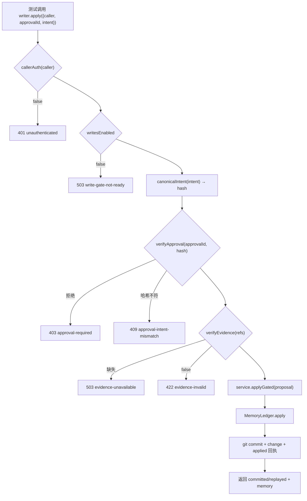

# M1 最小写入链路：只读核查与实施计划

- 状态：**计划稿，等待审查；尚未修改任何代码**
- 基线：[Rev.9](phase1-write-gate-design-rev9.md)
- 本轮：只读核查 + M1 计划；不改业务代码、配置或现有文档；不执行 Step 0；不运行测试；不提交 Git
- 证据标记：**[代码]** 源码；**[测试]** 已有测试断言；**[未运行]** 本轮没跑；**[设计]** 计划决定

---

## 1. 只读核查结果

### 1.1 Rev.9 组件是否存在

| 组件 | 结论 | 证据 |
|---|---|---|
| `MemoryWriter` | **不存在** | 全仓 grep `MemoryWriter` 0 命中 |
| `ApprovalStore` | **不存在** | grep `ApprovalStore` 0 命中 |
| `writesEnabled` | **不存在** | grep `writesEnabled` 0 命中 |
| `canonicalIntent` / `normalizeSourceRefs` | **不存在** | grep 0 命中；账本里只有 `dedupeRefs` **[代码]** `provider-git-ledger/src/ledger.js:450` |
| 批准状态机（granted/committing/consumed/needs-manual/revoked） | **不存在** | runtime-store 只有候选、提案、异议、注入记录 **[代码]** `host/runtime-store.js` |
| 启动对账 | **不存在** | 无相关模块 |
| 权威写入内核 | 已存在 | `MemoryLedger.apply` **[代码]** `ledger.js:198` |
| 跨进程锁 | 已存在 | `RepoLock` **[代码]** `lock.js` |
| 幂等回执 | 已存在 | `receiptFor` + 锁内重查 **[代码]** `ledger.js:212-231` |
| 脏工作区拒绝 | 已存在 | `statusPorcelain` + `dirty` 抛错 **[代码]** `ledger.js:234-241` |
| runtime 原子写/损坏拒绝/并发串行 | 已存在 | 临时文件 + `rename`；`mutate` 串行 **[代码]** `runtime-store.js:163-179` |
| 证据校验 | 已存在，但条件式 | `session-evidence.verify` **[代码]** `session-evidence.js:134`；`ledger-service.apply` 只在有 verifier 时检查 **[代码]** `ledger-service.js:212-220` |
| HTTP 认证 | 不存在 | `isTrustedWrite = isTrustedRead` **[代码]** `http-app.js:78` |
| Hindsight | **不存在** | 全仓 grep `hindsight` 0 命中 |

### 1.2 已有测试覆盖（本轮未重新运行）

| 能力 | 测试证据 | 状态 |
|---|---|---|
| ADD 提交、change、回执 | `provider-git-ledger/test/ledger.test.js` T1 | **[测试]** 阶段 0 跑过 32/32 |
| 同幂等键重放不二次提交 | `ledger.test.js` T3 | **[测试]** |
| 提交失败不留记录/回执 | `ledger.test.js` T4 | **[测试]** |
| 脏工作区拒绝 | `ledger.test.js` T7、`hardening.test.js` H1 | **[测试]** |
| 跨进程锁、争用、过期锁、只允许 owner 释放 | `hardening.test.js` H2–H2f | **[测试]** |
| 重启后从 Git 重建 | `ledger.test.js` T10、`hardening.test.js` H3 | **[测试]** |
| runtime 损坏拒绝、并发串行 | `runtime-store.test.mjs:125,141` | **[测试]** |
| 证据缺失/会话不可读被拒 | `http-app.test.mjs:101-111,325-341,901-916` | **[测试]** |
| MemoryWriter / ApprovalStore / canonical / writesEnabled | 无 | **无测试** |

### 1.3 与 Rev.9 的差距

| Rev.9 要求 | 现状 | 本轮是否处理 |
|---|---|---|
| 六道门禁 + MemoryWriter 唯一入口 | 无 MemoryWriter；现有 `ledger-service.apply` 直接写 | **M1 只做最小门禁 + Writer** |
| `writesEnabled=false` | 无开关 | M1 给 Writer 加构造参数，默认 false；**不改生产路由** |
| 认证（CallerAuth） | 无 | M1 用注入的测试 verifier，不接 DSH |
| 批准绑定意图哈希 | 无 | M1 注入测试 approval verifier + canonical hash |
| ADD 证据（存在/类型/引文/正文） | 只有存在/类型/可选引文哈希；无正文匹配 | M1 只要求 verifier 返回 verified；正文匹配后续 |
| UPDATE/RETRACT 证据语义 | 无 | 不在 M1 |
| 批准状态持久化、崩溃恢复、对账 | 无 | 不在 M1 |
| 并发 `approval-in-progress` | 无 | 不在 M1（M1 用单写入测试） |
| 回执/`consumed` 失败处理 | 无 | 不在 M1 |
| 仓库 UUID | 无 | 不在 M1 |

---

## 2. M1 范围

### 2.1 唯一场景

**在隔离临时 Git 仓库中，通过 MemoryWriter 完成一次 ADD：**

- 调用者：测试注入的身份；
- 批准：测试注入的批准验证器，绑定 `canonicalIntent` 哈希；
- 证据：测试注入的 verifier，返回 `verified:true`；
- 门禁：认证、`writesEnabled`、批准、意图哈希、证据、基线（ADD 无）、幂等；
- 写入：`MemoryLedger.apply`；
- 结果：1 个 Git commit、change 含 `idempotency_key`、`applied/` 回执、state 中 active；
- 重放：同一批准再请求 → `replayed`，不新增 commit。

### 2.2 非目标（明确不做）

- 不改 `index.js` / `http-app.js`，不打开任何生产写入路径；
- 不接 DSH `connection` / `approval`；
- 不做持久化 ApprovalStore、崩溃恢复、启动对账；
- 不做 UPDATE / RETRACT / SUPERSEDE；
- 不做正文与用户消息的字面匹配；
- 不接 Hindsight；
- 不改 settings / autoAccept；
- 不新增依赖。

### 2.3 流程



---

## 3. 最小实现计划

### 3.1 新增文件

| 文件 | 内容 | 为什么最小 |
|---|---|---|
| `packages/provider-git-ledger/src/canonical.js` | `normalizeSourceRefs(refs)`、`canonicalIntent(intent)`、`intentHash(intent)`、`EvidenceConflictError` | 批准绑定需要；Host 与后续 Provider 共用一份 |
| `packages/dsh-memory/host/memory-writer.js` | `createMemoryWriter({ service, callerAuth, verifyApproval, verifyEvidence, writesEnabled=false })`；只支持 ADD；错误对象带 `status`/`error` | 门禁与写入的唯一 Host 入口 |
| `packages/dsh-memory/test/canonical.test.mjs` | 规范化、排序、冲突、哈希稳定性 | 独立可验证 |
| `packages/dsh-memory/test/memory-writer.test.mjs` | 门禁与写入场景 | 隔离临时仓库 |

### 3.2 修改文件

| 文件 | 改动 | 风险控制 |
|---|---|---|
| `packages/dsh-memory/host/ledger-service.js` | 新增 `applyGated(proposal)`：`open()` 后直接 `ledger.apply(proposal)`，返回完整结果（含 `commit`），**不**强制 `actor`/`user_confirmed`，**不**再跑 `verifyEvidence`（由 Writer 负责）。现有 `apply()` 原样保留，旧路由不受影响 | 只加方法，不改旧路径 |

**不改** `http-app.js`、`index.js`、`settings.js`、`runtime-store.js`。

### 3.3 关键接口（伪代码，非实现）

```
createMemoryWriter({ service, callerAuth, verifyApproval, verifyEvidence, writesEnabled = false })
  .apply({ caller, approvalId, intent })
    if (!callerAuth(caller)) throw err(401, 'unauthenticated')
    if (!writesEnabled) throw err(503, 'write-gate-not-ready')
    const normalized = normalizeSourceRefs(intent.source_refs)
    const hash = intentHash({ ...intent, source_refs: normalized })
    const approval = await verifyApproval(approvalId, hash)   // 必须绑定 hash
    if (!approval) throw err(403, 'approval-required')
    if (approval.intent_sha256 !== hash) throw err(409, 'approval-intent-mismatch')
    if (typeof verifyEvidence !== 'function') throw err(503, 'evidence-unavailable')
    const checked = await verifyEvidence(normalized)
    if (checked?.verified !== true) throw err(422, 'evidence-invalid')
    if (intent.change_type !== 'ADD') throw err(400, 'unsupported-change-type')
    return service.applyGated({
      change_type: 'ADD',
      idempotency_key: approvalId,
      content: intent.content,
      type: intent.type,
      scope: intent.scope,
      tags: intent.tags,
      entities: intent.entities,
      source_refs: normalized,
      source_kind: approval.source_kind ?? 'user-explicit',
      actor: approval.actor ?? 'user',
      user_confirmed: approval.user_confirmed === true,
      reason: intent.reason,
      owner_id: service.ownerId,
    })
```

`service.applyGated` 内部调用 `MemoryLedger.apply`。`owner_id` 由 service 提供，不由调用方传。

### 3.4 测试用例（最小集）

`canonical.test.mjs`：

1. 键顺序不同 → 哈希相同；
2. `source_refs` 换序 → 哈希相同；
3. 完全相同的 ref → 去重为一条；
4. 同 `session_id#event_seq` 不同 `quote_sha256` → 抛 `EvidenceConflictError`；
5. 缺失字段 vs `null` → 不同；
6. NFC vs NFD → 不同；
7. 未配对 surrogate → 拒绝；
8. `-0` / 非整数 → 拒绝。

`memory-writer.test.mjs`（临时 `mkdtemp` 仓库）：

1. 正常 ADD：`committed`；`git log` +1；change 含 `idempotency_key`；`applied/` 回执存在；state 有 active 记忆；`actor`/`user_confirmed` 来自批准；
2. 同一 `approvalId` 再提交：`replayed`；`git log` 仍 +1；
3. 同一 `approvalId` 不同意图：409；无新 commit；
4. 认证失败：401；无 commit；
5. `writesEnabled=false`：503；无 commit；
6. 无批准：403；无 commit；
7. 无 evidence verifier：503；无 commit；
8. 证据 `verified:false`：422；无 commit；
9. 证据冲突：422 `evidence-conflict`；无 commit；
10. 空正文：422 `empty-content`（Writer 在调用前检查 `content.trim()`）。

不做并发、崩溃、重启、HTTP 测试——这些属于 M2/M3。

### 3.5 验收标准

- 上述 18 条测试全过；
- `git log` 在正常 ADD 后只有 1 个新 commit，重放后不变；
- `applied/` 回执可由 `MemoryLedger.receiptFor(approvalId)` 读到；
- state 中记忆 `status:'active'`，`source_refs` 与写入一致；
- `actor`/`user_confirmed` 不由请求体决定；测试断言批准返回值决定；
- 现有 414 项测试不回归（M1 只加方法，不改旧路径）；
- 不修改生产写入开关，不接 HTTP。

### 3.6 验证命令（实施后执行）

```
node --test packages/dsh-memory/test/canonical.test.mjs
node --test packages/dsh-memory/test/memory-writer.test.mjs
node --test packages/provider-git-ledger/test/*.js
node --test --test-force-exit packages/dsh-memory/test/*.test.mjs
```

本轮不执行。

---

## 4. P0 阻塞项与后续项

### 4.1 不阻塞 M1（因为 M1 不接生产）

- CallerAuth 接 DSH：M2；
- 持久化 ApprovalStore：M2；
- 崩溃恢复/对账：M3；
- HTTP 路由改造：M3；
- UPDATE/RETRACT 证据语义：M4；
- 正文匹配：M4；
- Hindsight：后续独立阶段。

### 4.2 阻塞“打开生产写入”的 P0

在 `writesEnabled` 改为 true 之前必须完成：

1. CallerAuth（V1 验证）；
2. 持久化批准 + 意图绑定（M2）；
3. 崩溃恢复与 `needs-manual`（M3）；
4. 证据 fail-closed 接真实 resolver（M3）；
5. HTTP 路由全部走 MemoryWriter（M3）。

M1 只证明内核链路，不解除这些 P0。

---

## 5. Hindsight 边界

- 本轮不安装、不接入、不实现 retain/recall/reflect；仓库内 0 引用。
- 后续接入点（仅边界，不实施）：
  - retain：只能写候选/提案，不能写账本；写入必须经 MemoryWriter；
  - recall：只读检索，不改变 eligibility/异议过滤；
  - reflect：只读派生视图，不能成为第二事实源。
- Git 账本仍是唯一权威；SQLite 仍只是可重建索引。

---

## 6. 未验证与风险

- 本轮没有运行任何测试；所有“已有测试”结论来自阶段 0 的运行记录与源码阅读，不是本轮结果。
- `normalizeSourceRefs` 的冲突规则与现有 `dedupeRefs` 并存期间，旧 UPDATE 路径仍用旧规则；M1 不改旧路径，但要在 M2 统一。
- `service.applyGated` 绕过 `ledger-service.apply` 的 `verifyEvidence`；必须确保只有 MemoryWriter 调用它。M1 用命名和测试约束，M2 再加一致性测试。
- `writesEnabled` 默认 false 只存在于 MemoryWriter 构造参数；生产没有接线，所以不会误开。
- `actor`/`user_confirmed` 仍由批准返回值决定；M1 的测试批准器是假实现，不代表真实 DSH 审批。
- 未验证 `runtime.json` 原子写在崩溃下的表现；M1 不涉及状态持久化。

---

## 7. 停止点

未改业务代码、配置或现有文档；未提交；未运行测试；未执行 Step 0。等待审查 M1 计划后再实施。
