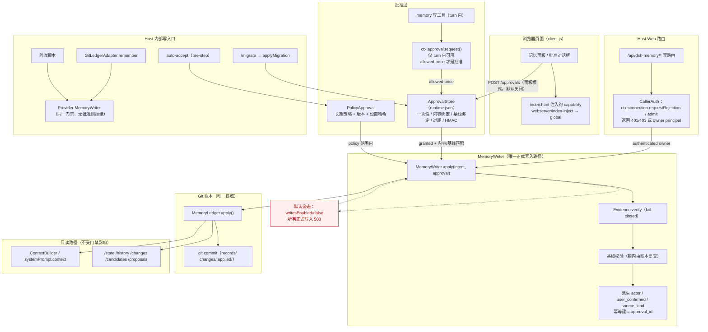

# dsh-memory 阶段 1 设计修订（Rev.2）：安全写入边界

- 状态：**设计修订稿，尚未实施**
- 修订对象：[阶段 1 设计评审稿 Rev.1](phase1-write-gate-design.md)（保留不改，本文件是其修订与补充）
- 依据：[阶段 0 只读审计](../../status/phase0-readonly-audit.md) + 本轮对 DSH Host 能力的实际 Inspect 结果
- 本阶段仍然只做设计：不修改业务代码、配置或现有文档；不提交 Git
- 新增事实来源标记：
  - **[代码]**：dsh-memory 仓库源码
  - **[DSH Inspect]**：对本机 DSH Host 的只读 Service/Event 契约查询（`cordis_inspect_query`，2026-10-29）
  - **[测试]**：仓库现有测试断言
  - **[文档]**：仅文档声明
  - **[待验证]**：本轮无法证明，列入第 2 节验证项，不得当作已存在能力

---

## 0. Rev.2 相对 Rev.1 的关键变化

1. **CallerAuth 有了原生实现**：DSH 提供 `ctx.connection.requestRejection()` / `admit()` / `authorizeIndex()` **[DSH Inspect]**，可以对任意 Web 路由复用 Host/Origin 检查与浏览器凭据认证，返回 401/403。Rev.1 的「自建 token」降级为后备方案，不再作为首选。
2. **UserApproval 有了原生原语，但不能无条件等同于「人类在场」**：DSH 提供 `ctx.approval.request()` **[DSH Inspect]**，返回 `allowed-once | rejected | cancelled | unavailable`，失败关闭，并把 ask/outcome 写入会话日志。但它依赖 `ApprovalPolicy`（`'ask' | 'never'`）、要求**有打开的 turn**、且由「composed answerers」决定。`'never'` 策略下它是否仍然询问、是否会直接放行，本轮**无法证明**。因此：
   - 原生审批只在**turn 内**（工具调用）可用，是强审批；
   - 面板在 turn 外无法获得原生审批；
   - **不得把页面手势或 token 文件自动视为等价强审批**。默认拒绝面板直接写正式记忆，除非部署显式选择弱模式并接受风险（第 7 节产品决策 P1）。
3. **M1 不再允许出现「已认证即可写入」的中间状态**。Rev.2 把 M1 定义为「门禁骨架 + 正式写入全局关闭」：`writesEnabled=false` 时所有正式写路由返回 503 `write-gate-not-ready`，直到 M2 的批准路径就绪才开启。认证只用于读与运行时操作，不用于放行正式写入。
4. **索引注入通道确认存在**：`webserver/index-inject` 是 emit 事件，可追加 `{kind:'global', name, value}` 行到 index.html **[DSH Inspect]**；而 index 本身由 `connection.authorizeIndex()` 认证 **[DSH Inspect]**。这使「Host 内存 capability 下发到页面」成为可实施方案（后备），但它的强度仍取决于「谁能读到认证后的 index」。
5. **批准与账本之间没有分布式事务**：Rev.2 明确用「批准状态机 + 账本 intent 文件 + 回执 + 幂等键」实现可恢复，而不是假装原子。

---

## 1. 修订后的架构图



关键点：

- **读路径与写路径分离**：`ContextBuilder`（`host/injection.js` 的 snapshot → prompt）只读账本快照，永不调用写门禁 **[代码]**。
- **写入只有一条**：所有箭头最终汇聚到 `MemoryWriter` → `MemoryLedger.apply`；Adapter 与脚本使用同一个 Writer 实现（Provider 侧），不再直接 `ledger.apply`。
- **认证与批准分离**：`CallerAuth` 只产生 principal，不产生写权限；`ApprovalStore`/`NATIVE`/`POLICY` 才产生批准。
- **默认拒绝**：`writesEnabled=false` 时任何正式写入都到不了账本。

---

## 2. A. 前置能力验证

### 2.1 已确认的 DSH 能力（本轮实测）

| 能力 | 契约 | 结论 |
|---|---|---|
| 浏览器请求认证 | `ctx.connection.requestRejection({headers}) → 401 \| 403 \| undefined`；`admit(request) → {peer} \| {rejection}`；`authorizeIndex()` 认证 index 请求并签发 cookie；`authenticatedUrl()` 注入 fresh process token | **[DSH Inspect]** 存在；可复用为 CallerAuth |
| 主体模型 | `PrincipalMap` 只有 `owner`；`PeerScope.principal` 为 owner；`browserPeer` 是「每个已认证浏览器连接共享的 owner Peer」 | **[DSH Inspect]** 单用户部署，无多用户 principal |
| 用户审批原语 | `ctx.approval.request({agent, toolName, callId?, reason?, displayReason?, signal?}) → 'allowed-once' \| 'rejected' \| 'cancelled' \| 'unavailable'` | **[DSH Inspect]** 存在；只有 `allowed-once` 是批准；失败/缺失 answerer → `unavailable`（fail-closed） |
| 审批策略 | `ApprovalPolicy = 'ask' \| 'never'`；`setPolicy(agent, policy)`；`overrideOf(session)` | **[DSH Inspect]** 存在；`'never'` 的确切语义**待验证** |
| 审批审计 | 「logs every ask/outcome pair to the requesting session」；要求 open turn，idle ask 直接 reject | **[DSH Inspect]** 存在；turn 外不可用 |
| index 注入 | `'webserver/index-inject'(table: IndexInjection[])` emit；`IndexInjection` 支持 `{kind:'global', name, value}`、`script`、`html`；`webServer.tapIndex` / `renderIndex` | **[DSH Inspect]** 存在；可用于把 Host 内存 capability 注入页面 |
| Web 路由 | `WebRoute {kind, path, handler(req: IncomingMessage, res)}`；handler 拿不到 peer/principal | **[DSH Inspect]** 存在；因此插件必须自己调用 `connection` 认证 |
| 现有插件围栏 | `isTrustedWrite = isTrustedRead`（回环 + Host + 非 cross-site） | **[代码]** `host/http-app.js:52-78` |

### 2.2 三种 CallerAuth 方案对比

#### 方案 A：DSH 原生连接认证（首选）

- 实现：写路由第一行调用 `ctx.connection.requestRejection({ headers: req.headers })`；返回 401/403 拒绝；`undefined` 才继续。需要 `connection` 依赖；缺失时回退到方案 B 或直接拒绝。
- **可信边界**：DSH 的 Host/Origin 检查 + 浏览器凭据（cookie / fresh process token）。`authorizeIndex` 会在 index 请求上签发 cookie；`authenticatedUrl` 注入进程级 token。
- **可抵御**：
  - 任意不带浏览器凭据的本机进程（`curl`、脚本、agent shell）；
  - 跨站页面（Origin/Host 检查）；
  - 其他用户/其他 profile；
  - 未认证的 index 抓取（拿不到 cookie，也拿不到注入的 token）。
- **无法抵御**：
  - 能读取浏览器 cookie/进程 token 的同用户进程（例如能访问浏览器 profile、调试端口、DSH 数据目录的进程）；
  - 已登录浏览器里的 XSS；
  - 同进程内被信任的其它插件（Host 是单一信任域）。
- **验证方法**：见 V1；**通过判定**：无凭据请求 401/403；带真实浏览器请求 200；伪造 `Origin`/`Host` 仍 401/403；`curl` 带页面 cookie 复制的请求能否成功（用于评估残余风险）。
- **结论**：这是**唯一**能同时满足「可认证」与「不需要自建秘密分发」的方案，作为首选。

#### 方案 B：Host 内存 capability + index 注入（后备）

- 实现：Host 启动生成 `randomUUID()`，仅存内存；监听 `webserver/index-inject`，追加 `{kind:'global', name:'__DSH_MEMORY_CAP__', value:{token}}`；页面读取后放入 `x-dsh-memory-cap` header；路由用 `timingSafeEqual` 比对；token 随 Host 重启轮换，不落盘。
- **可信边界**：能拿到**认证后 index.html** 的浏览器页面。index 本身由 `connection.authorizeIndex` 认证 **[DSH Inspect]**，所以未认证进程无法通过 HTTP 取得 token。
- **可抵御**：
  - 未认证本机进程（拿不到 index）；
  - 跨站页面（拿不到注入值）；
  - token 重放到其它 profile（boot 级随机）。
- **无法抵御**：
  - 能读取页面内存/DOM/调试端口的同用户进程；
  - 能读取 Host 进程内存的进程；
  - XSS；
  - 若 index 被缓存或注入值进入日志，可能泄漏。
- **验证方法**：见 V2；**通过判定**：页面能读到 global 并成功写/读；`curl` 伪造 header 但不能从 index 获得 token；重启后旧 token 失效。
- **结论**：比方案 C 强，弱于方案 A；仅在 `connection` 不可用时作为后备，且必须显式配置，不得默认等同强认证。

#### 方案 C：token 文件（弱，默认不采用）

- 实现：`~/.dsh/dsh-memory/write.token`（0600），页面通过一个未认证路由读取——这本身自相矛盾；或页面不读，仅 CLI 使用。
- **可信边界**：文件系统权限。
- **可抵御**：其他 OS 用户、无文件读权限的进程。
- **无法抵御**：同一 OS 用户的任意进程，**包括 agent 的 shell 工具**（通常以同一用户运行）。这正是本阶段要防的场景。
- **验证方法**：见 V3；**通过判定**：同用户子进程能读到文件（预期能）→ 判定为**不可作为强认证**。
- **结论**：只允许作为**离线/开发/测试**的显式 `--allow-weak-auth` 模式；生产默认拒绝。**不得**把 token 文件自动视为等价强审批（用户明确要求）。

### 2.3 原生用户审批能力：能证明什么、不能证明什么

`ctx.approval.request()` **[DSH Inspect]** 是真正的「询问人类」原语，但它的可用性有四个硬条件：

1. **必须有 open turn**：服务描述明确「The request requires an open turn … an idle ask rejects before appending anything」。面板在 turn 外点击「接受」时**没有** open turn → 不能调用。
2. **必须有 agent/session**：请求体要求 `agent`；HTTP 路由没有 agent 上下文。
3. **受 `ApprovalPolicy` 影响**：`'ask'` 才会走 answerers；`'never'` 的确切行为**待验证**（可能直接放行，也可能不询问）。若 `'never'` 会直接返回 `allowed-once`，则它**不是**人类批准，只是「用户选择不再被询问」的长期授权 → 只能算 PolicyApproval。
4. **answerers 是 composed 的**：任何 Host 插件都可以注册 answerer 并返回 `allowed-once`。DSH 的插件集合是信任域；本插件无法验证「回答来自人类 UI」还是「另一个插件自动批准」。

因此 Rev.2 的结论是：

- **强 UserApproval 只能来自 turn 内的 `approval.request` + 真实人类 answerer**；
- **面板（turn 外）无法获得强 UserApproval**；
- 若部署既没有 `connection` 认证、也没有可用的 turn 内审批，**正式写入必须默认拒绝**；
- 页面手势与 token 文件只能作为「认证后的面板操作」，记录为弱批准（`approval_strength:'authenticated-panel'`），不能写成 `user_confirmed:true`。

### 2.4 默认拒绝矩阵

| CallerAuth | UserApproval | 正式写入 | 说明 |
|---|---|---|---|
| 无（未认证） | — | **拒绝 401/403** | M1 起 |
| `connection` owner | 无 | **拒绝 403 `approval-required`** | 认证 ≠ 批准 |
| `connection` owner | 面板弱批准（显式开启） | **仅在 `panelApprovalMode='weak'` 时允许**，记录 `user_confirmed:false` | 产品决策 P1 |
| `connection` owner | 无，但写入发生在 turn 内工具调用 | 允许，若 `approval.request === 'allowed-once'` | 强路径 |
| 任意 | `approval.request` 返回 rejected/cancelled/unavailable | **拒绝** | fail-closed |
| `connection` 不可用 | — | **拒绝 503 `caller-auth-unavailable`** | 不得降级为回环放行 |
| 仅 token 文件 | — | **拒绝 503`write-auth-weak-disabled`**，除非 `--allow-weak-auth` | 开发/测试专用 |

### 2.5 前置验证步骤与通过/失败判定

#### V1：`connection.requestRejection` 在插件路由上的可用性
- 步骤：
  1. 在隔离 profile 注册探针路由：打印 `requestRejection({headers:req.headers})` 的返回值。
  2. 分别用：真实页面 fetch、`curl`（无 cookie）、`curl`（复制页面 cookie）、伪造 `Origin`/`Host` 请求。
  3. 确认 `connection` 是否可 `ctx.get('connection')` 注入。
- 通过：页面 → `undefined`；无凭据 → 401/403；伪造 → 401/403。
- 失败：插件进程拿不到 `connection`，或合法页面也被拒 → 记录，切方案 B；若 B 也不可用则正式写入保持关闭。

#### V2：index 注入与页面读取
- 步骤：
  1. 在隔离 profile 监听 `webserver/index-inject`，追加 `{kind:'global', name:'__DSH_MEMORY_TEST__', value:{ok:1}}`。
  2. 真实页面读 `window.__DSH_MEMORY_TEST__`；未认证 `curl` 抓 index，确认拿不到注入值。
  3. 确认注入行是否经过 `renderIndex`/`applyIndexTaps`。
- 通过：页面可读、未认证不可读、重启后 token 变化。
- 失败：注入不生效 → 方案 B 不可用，只能方案 A。

#### V3：token 文件的本机威胁
- 步骤：`icacls` 检查 ACL；用同用户子进程读文件；确认 agent shell 运行身份。
- 通过（作为弱方案评估）：同用户可读 → 判定为弱，**不得**用于强认证。
- 失败：不需要；这项是「证明它弱」，不是「证明它强」。

#### V4：`approval.request` 的真实语义
- 步骤：
  1. 在隔离 profile 写一个探针工具，调用 `ctx.approval.request({agent, toolName:'probe', reason:'test'})`。
  2. 分别在 `ApprovalPolicy='ask'` 与 `'never'` 下调用；记录是否出现 UI、返回的 outcome。
  3. 在无 open turn 的 HTTP 路由里调用，确认是否 reject。
  4. 注册一个自定义 answerer 返回 `allowed-once`，确认服务是否接受（评估「插件可自答」风险）。
- 通过判定：
  - `'ask'` + 人类 UI → `allowed-once`；拒绝 → `rejected`；取消 → `cancelled`；无 answerer → `unavailable`；
  - `'never'` 若返回 `allowed-once` 而无 UI → **判定它不能作为人类批准**，只能归入 PolicyApproval；
  - turn 外调用 reject → 确认面板无法使用原生审批。
- 失败：语义与上述任一不符 → 在设计中降级，并在文档标注。

#### V5：`sessionQuery` 在运行 profile 中是否可用
- 步骤：`dsh_memory_ping` / 诊断输出 `lookup('sessionQuery')`；在隔离 profile 用真实会话写入，查看 `evidence_verification.verified`。
- 通过：存在且 `verified:true`。
- 失败：缺失 → M3 的 fail-closed 会让正式写入 503；必须先修加载顺序或显式关闭写入。

#### V6：`webserver/index-inject` 监听者权限
- 步骤：确认插件 `ctx.on('webserver/index-inject', ...)` 是否被允许、是否需要 `webserver` 依赖、注入行是否过滤。
- 通过：插件可注册并渲染。
- 失败：只能方案 A。

#### V7：Provider 是否被挂载
- 步骤：检查 mnemon profile 的 providers 列表与 dataDir。
- 通过：未挂载 → Adapter 入口当前不可达，M5 可延后（但文档标注）；已挂载 → M5 与 M1 同级。

#### V8：崩溃窗口
- 步骤：子进程在 `git commit` 后、回执前 SIGKILL；检查 `git log`、`applied/`、`pending/`。
- 通过：能复现「commit 有、回执无」→ M4 的 `idempotency_key` 落 change + 对账必须覆盖。

#### V9：锁顺序与并发
- 步骤：两个子进程并发，一个走批准；确认无死锁、一个成功一个 409。
- 通过：无死锁；账本只多 1 个 commit。

#### V10：客户端 header 限制
- 步骤：真实页面 fetch 带 `x-dsh-memory-cap`，确认 CSP/CORS 不拦截。
- 通过：可发送。

---

## 3. B. 批准流程（`/approvals`）

### 3.1 签发权限

- **强路径（native）**：不经过 `/approvals`。由 turn 内的写工具调用 `ctx.approval.request()`；只有 `allowed-once` 才由 Host 创建一条 `ApprovalRecord{strength:'native', ...}` 并**立即消费**（绑定当次 intent）。模型无法直接调用该服务，只能触发工具，而 answerer 是人类。
- **弱路径（panel）**：`POST /api/dsh-memory/approvals`
  - 必须通过 CallerAuth（方案 A 为首选）；
  - principal 必须是 owner 浏览器；
  - 只有在 `panelApprovalMode === 'weak'`（显式配置，默认 `'off'`）时才签发；
  - 请求体只给 `purpose + target + intent`，**服务端自己算哈希**，不接受客户端哈希；
  - 返回 `approval_id`；批准记录写入 runtime.json，并用 Host 内存 HMAC key 签名（防止手改 runtime.json 伪造 `granted`）。
- **禁止**：
  - 模型工具直接调用 `/approvals`（没有 HTTP 工具；若通过 shell，缺少 connection 凭据）；
  - 任何调用方自带 `content_sha256` 或 `strength`；
  - 任何工具把 `approval_id` 作为参数传回后由服务端「默认信任」——服务端仍要重算哈希与基线。

### 3.2 批准展示内容

批准对话框/提示必须展示**与哈希输入完全一致**的字段，而不是摘要：

| 字段 | 展示要求 |
|---|---|
| 动作 | ADD / UPDATE / RETRACT / MERGE |
| 正文 | 完整内容（超长可折叠，但默认展开且可复制） |
| 类型 / scope / tags / entities | 原值 |
| 目标记忆 | `memory_id` + 当前正文（UPDATE/RETRACT 时） |
| 基线 | `expected_base_change_id` + 用户上次看到的版本 |
| 证据引用 | 每条 `session_id`、`event_seq`、`event_type`、是否有 `quote_sha256`；无证据必须显式写「无」 |
| 来源 | `user-explicit` / `user-correction` / `session-extraction` / `agent-inference` |
| 强度 | 原生审批 / 面板（弱） / 策略 |
| 失效时间 | `expires_at` |

原生审批通过 `displayReason`（`{en, zh}`）传「将写入什么、目标是什么、基线是什么」；`reason` 传机器可读的 intent 摘要。**只显示摘要、不显示完整变更**的审批不算绑定。

### 3.3 批准内容哈希（唯一实现）

新增 `provider-git-ledger/src/canonical.js`，Host、schema、adapter、脚本全部 import 同一个函数；客户端不实现哈希，只展示服务端返回值。

```
canonicalIntent(intent) -> { canonical: string, sha256: string }
```

规范化规则（必须写成测试规范）：

1. **字段集合固定**：`change_type, content, type, scope, tags, entities, source_refs, target_memory_id, expected_base_change_id`。未知字段 → 拒绝（不参与哈希）。
2. **递归键排序**：所有对象键按 UTF-16 code unit 升序（`sort()` 默认比较），不使用 `localeCompare`；嵌套对象递归排序。
3. **数组顺序敏感**：`tags`、`entities` 保持调用方给定顺序；`source_refs` 在哈希前由 Writer 归一化为按 `(session_id, event_seq)` 升序（同一归一化也用于写入），避免等价输入产生不同哈希。
4. **缺失 vs null**：字段缺失 = 键不出现；`null` 只在 schema 允许的字段出现（`scope`/`target_memory_id`/`expected_base_change_id` 在 ADD 时可缺省，UPDATE/RETRACT 时 `expected_base_change_id` **不得**为 null）。`undefined` 与缺失等价，序列化前删除。
5. **字符串**：保持账本将要写入的**精确 UTF-8 字节**，不做 NFC/NFKC 归一化（NFC 与 NFD 是不同批准）；拒绝含未配对 surrogate 的字符串（`String.prototype.isWellFormed()` 为 false）；JSON 转义用 `JSON.stringify` 默认行为。
6. **数字**：只允许安全整数（`event_seq`、以及未来可能加入的整数计数）；拒绝 `NaN`/`Infinity`/`-0`/指数形式/浮点；当前 intent 不含浮点，若未来加入 `confidence` 必须用定点字符串。
7. **输出**：`JSON.stringify(sortedObject)`（紧凑、无缩进）→ `Buffer.from(str,'utf8')` → SHA-256 → 十六进制，前缀 `sha256:`。
8. **测试向量**（必须覆盖）：键插入顺序无关；嵌套键顺序无关；数组换序 → 哈希不同；缺失 vs null → 不同；NFC vs NFD → 不同；未配对 surrogate → 拒绝；`1` vs `1.0` → 相同（都是整数 1 的合法表示，归一为 1）；`-0` → 拒绝；`1e21` → 拒绝；emoji/中文 → 稳定；空数组 vs 缺失 → 不同；超长正文 → 稳定。
9. **单一实现**：`canonical.js` 只导出 `canonicalIntent` 与 `sha256Of`；Host 与 Provider 不得各写一份；新增一致性测试扫描重复实现。

### 3.4 有效期

- 默认 10 分钟，硬上限 30 分钟；`expires_at` 写入记录并由 Host 校验。
- 记录绑定 `host_boot_id`（每次 Host 启动随机生成）：**重启即全部失效**。
- 记录绑定 `peer_id`（`connection` 返回的 peer）与 `session_id`（native 时）：不能跨会话/跨浏览器使用。
- 过期后状态 `expired`，不可复活；需要重新批准。

### 3.5 消费与撤销

状态机：

```
granted ──consume()──▶ consuming ──ledger committed/replayed──▶ consumed
   │                        │
   │                        ├─ 失败（可重试）──▶ granted
   │                        └─ 失败 N 次/内容不匹配/基线过期 ──▶ failed
   ├─ revoke()/重启/过期/设置变更 ──▶ revoked/expired
   └─ 同一 approval 第二次 consume ──▶ 409 approval-consumed（或返回已存 result）
```

- `consume` 必须在 runtime 锁内做 CAS（`granted → consuming`），保证并发只有一个赢家。
- `consumed` 记录 `change_id`/`commit`/`result`，供幂等重放。
- 撤销入口：`POST /approvals/revoke`（需 CallerAuth）；自动撤销：Host 重启、设置变更、目标记忆基线变化、用户登出、内容不匹配、失败次数超限。
- 不落盘的 HMAC key：每次启动随机生成，用于校验 runtime.json 中的批准记录未被手改；代价是重启后全部失效（与 `host_boot_id` 一致）。

### 3.6 防止 AI 通过工具间接批准

| 路径 | 防护 |
|---|---|
| 模型直接调用 `/approvals` | 无 HTTP 工具；shell 调用缺 `connection` 凭据 → 401 |
| 模型让工具「顺便」调用 `ctx.approval.request` | 只能触发工具；answerer 是人类；`allowed-once` 绑定当次 intent；拒绝则无记录 |
| 模型伪造 `approval_id` | ID 随机且 HMAC 签名；服务端重算内容哈希与基线 |
| 模型改 runtime.json 把 pending 改 granted | HMAC 校验失败 → 拒绝；Host 启动时清洗 |
| 模型通过 settings 打开 autoAccept | `/settings` 需 CallerAuth + 强批准（第 4 节）；AI 无设置工具 |
| 模型用旧批准重放 | 一次性 + 过期 + 基线变化即失效 |
| 恶意插件注册 answerer 自动 allowed-once | **无法在本插件内防**；列入残余风险（Host 插件信任域） |

---

## 4. C. PolicyApproval（长期策略）

### 4.1 默认关闭

- `DEFAULT_SETTINGS.autoAccept = false` **[代码]**；Rev.2 保持，并新增 `policyVersion`、`policyExpiresAt`、`policyScope`。
- 未显式授权时，`AUTO_ACCEPT` 永远不产生 `PolicyApproval`。

### 4.2 用户如何授权

1. 用户在面板打开「允许自动写入低风险记忆」；
2. 该操作必须先通过 CallerAuth；
3. 并且**必须获得一次强批准**（turn 内 `approval.request`，或部署显式选择弱模式）——因为这是长期授权，不能由页面手势单独决定；
4. 批准后生成 `PolicyGrant`：
   ```
   {
     policy_id, policy_version,
     scope: { types:['fact','preference','constraint'], maxPerTurn, maxPerDay, workspace? },
     settings_sha256, granted_at, expires_at,
     approval: { kind:'native'|'panel-weak', id, strength },
     revoked_at: null
   }
   ```
5. 设置文件只存 `policy_id` 引用；真正的授权条件在 runtime 的 `PolicyGrant` 里，避免手改 settings 就扩大范围。

### 4.3 适用范围与版本

- 类型：仅 `fact/preference/constraint`（与现有 `AUTO_ACCEPT_TYPES` 一致）**[代码]**；
- 每轮最多 1 条、每天最多 N 条（N 由用户设定，默认 5）；
- 置信度 ≥ 阈值；证据必须 verified；分类必须 ADD；`sensitive` 一律不自动写；
- **`policy_version` 常量**：策略逻辑变更即 bump；旧 `PolicyGrant` 失效，必须重新授权；
- **`settings_sha256`**：settings 变化（即使字段未变、格式变化也算）使 grant 失效；
- 超出范围（类型/频率/置信度/分类/证据）→ **只能创建候选或提案**，不得写账本。

### 4.4 撤销

- 用户关闭 `autoAccept` → 立即 `revoked`；
- 撤销/过期后，运行中的 pre-step 在写前重新校验 grant（不能缓存「已开启」）；
- Host 重启后 grant 仍有效（长期策略），但 `approval` 的原生批准记录失效；因此 grant 必须自包含（settings hash + policy version + expires），不依赖一次性批准记录；
- 任何 `PolicyGrant` 篡改由 HMAC 检测。

### 4.5 审计字段

自动写入必须记录：

```
actor: 'system'
user_confirmed: false
source_kind: 'session-extraction'
approval: { kind:'policy', policy_id, policy_version, scope, settings_sha256 }
```

**不得**写 `actor:'user'` 或 `user_confirmed:true`。注入文案（后续阶段 P2-10）应能区分「用户确认」与「策略自动」。

### 4.6 AI 不得自行开启或扩大

- 设置只能通过 `/settings` 修改，需 CallerAuth + 强批准；
- 模型没有 settings 工具；
- `PolicyGrant` 的 `scope` 只能由用户批准生成，AI 提案不能携带 `policy` 字段；
- 若检测到 `settings.autoAccept` 被非 UI 路径修改（文件 mtime/hash 与 grant 不匹配），视为失效并拒绝自动写入。

---

## 5. D. UPDATE / RETRACT 证据语义

核心原则：**「用户批准」≠「事实已验证」**。批准证明「用户要这么改」，证据证明「这句话有来源」。两者分别记录、分别展示。

| 情形 | 动作 | 批准 | 基线 | 证据 | `source_kind` | `actor` | `user_confirmed` | 审计字段 |
|---|---|---|---|---|---|---|---|---|
| 1. 用户提供**新来源证据**改写 | UPDATE | 强批准（native）优先；弱模式需显式开启 | 必填 | **新 refs**，`verify` 必须 true | `user-correction` | `user` | true（native）/ false（weak） | `evidence_mode:'new'`, `evidence_verified:true`, `evidence_refs` |
| 2. 用户**主动纠正**正文（无新证据） | UPDATE | 同上 | 必填 | 沿用旧 refs，**不重新宣称验证** | `user-correction` | `user` | 同上 | `evidence_mode:'carried-over'`, `evidence_verified` 仅表示旧 refs 当前仍可读，注明 `fact_reverified:false` |
| 3. 用户**主动撤回** | RETRACT | 同上 | 必填 | 无（撤回不主张新事实） | `user-explicit` | `user` | 同上 | `evidence_mode:'none'`, `evidence_verification:null`（不写「已核验」） |
| 4. AI 推断的改写/撤回 | 只能写 runtime 的 proposal/candidate | 用户接受时同 1/2/3 | 必填 | 由用户决定；AI 不能自带「已验证」 | `agent-inference` | `user`（接受者） | true（native）/ false（weak） | `origin:'ai'`, `approved_by_user:true`, `fact_reverified:false`；若账本类型约束不允许，降级为 `hypothesis` 或拒绝 |
| 5. 策略自动新增 | ADD | PolicyApproval | 不适用 | 必须 verified | `session-extraction` | `system` | false | `approval.kind:'policy'` |

补充规则：

- `expected_base_change_id` 对 UPDATE/RETRACT **必填**，不再接受 `null`；缺失 → 400 `missing-base`，过期 → 409 `stale`。
- `evidence_verification.verified` 只由 `session-evidence.verify` 写入；批准层**不得**写这个字段。
- `change` 记录新增 `approval` 与 `fact_reverified`，`renderChangeNote` 按 `approval.kind` 与 `evidence_mode` 生成文案：
  - native + new evidence → 「用户批准，来源已核验」；
  - native + carried-over → 「用户批准；本次未引入新证据，沿用旧引用」；
  - weak + carried-over → 「面板批准（弱）；本次未引入新证据」；
  - policy → 「策略自动写入（未经逐条用户确认）」；
  - RETRACT → 「用户撤回；不涉及事实核验」。
- AI 提案被接受时，若无法证明正文有来源，`source_kind` 保持 `agent-inference`，并在 UI 标注「AI 提议、用户批准；事实未核验」。

产品决策：是否允许 AI 提案改写 `fact/preference`（当前 schema 限制 `agent-inference` 只能是 `hypothesis`）**[代码]**。Rev.2 建议：**默认不允许**；若要允许，新增显式 `origin:'ai-approved'` 类型并保持 `fact_reverified:false`，需单独评审。

---

## 6. E. 崩溃恢复与唯一写入边界

### 6.1 批准状态与账本提交之间没有原子事务

两个存储：

- runtime.json（批准状态、HMAC）
- Git 账本（records/changes/applied/outbox）

不存在跨存储事务，因此用**状态机 + 持久 intent + 回执 + 幂等键**实现可恢复：

```
1. mint approval        → runtime: granted
2. consume              → runtime: consuming（CAS）
3. write intent file    → ledger/pending/<approval_id>.json（gitignored，含 canonical intent + hash）
4. MemoryLedger.apply   → idempotency_key = approval_id
5. commit succeeded     → change 记录内写 idempotency_key 与 approval
6. write receipt        → applied/<sha256(approval_id)>.json
7. mark consumed        → runtime: consumed + change_id/commit/result
8. delete intent file
```

崩溃点与恢复：

| 崩溃点 | 持久状态 | 恢复动作 |
|---|---|---|
| 1 之后 | granted | 过期或用户重试；无副作用 |
| 2 之后、3 之前 | consuming，无 intent | 启动对账：无回执/无 change → 回退 granted |
| 3 之后、4 之前 | consuming + intent，无回执 | 启动对账：删除 intent，回退 granted（或按用户重试） |
| 4 之后、5 之前 | git commit 可能已落地 | 用 `receiptFor(approval_id)` 判定；有回执 → consumed |
| 5 之后、6 之前 | commit 有、回执无 | **change 记录里有 idempotency_key** → 扫描 `changes/*.json` 找到 → 视为已提交，补回执并 consumed |
| 6 之后、7 之前 | commit + 回执 | 直接 consumed |
| 7 之后、8 之前 | consumed + intent 残留 | 删除 intent |

**这是 M4 的核心**：`MemoryLedger` 必须在 `changes/<id>.json` 中写入 `idempotency_key` 与 `approval`，否则「commit 有、回执无」无法自动判定。阶段 0 的 P2-3 正对应此窗口。

### 6.2 并发消费

- `ApprovalStore.consume` 在 runtime 锁内 CAS：只有 `granted` 能变 `consuming`；第二个请求得到 409 `approval-in-progress` 或 `approval-consumed`。
- 账本自身已有进程内队列 + 跨进程 `RepoLock` + 回执幂等 **[代码]**，因此即使两个 Writer 同时到达，也只有一个 commit。
- 锁顺序：**先 runtime 锁（短）→ 释放 → 再 ledger 锁**；绝不在持有 runtime 锁时执行 git。理由：避免与 `hardening.test.js` 的并发写者死锁；Provider 代码从不调用 runtime，反向依赖不存在。

### 6.3 唯一写入边界的强制方式

| 层 | 约束 | 强制手段 |
|---|---|---|
| Host 插件 | 只有 `host/memory-writer.js` 允许 import `provider-git-ledger/src/ledger.js` 并调用 `apply` | 一致性测试：扫描 `packages/dsh-memory/**`（除 `memory-writer.js` 与测试）出现 `MemoryLedger`/`.apply(` 即失败 |
| Provider | `adapter.js` 不再直接 `ledger.apply`；改为 `provider-git-ledger/src/writer.js`（与 Host 同一个门禁协议：approval proof + evidence + base + idempotency） | `adapter.test.js` 断言未验证证据被拒；一致性测试扫描 `src/**` 只有 `writer.js` 调 `apply` |
| 脚本 | `scripts/prepare-isolated-acceptance.mjs` 必须使用 Writer，且要求 `--fixture` + dataDir 位于临时目录；否则拒绝运行 | 脚本自检 dataDir 白名单；CI 测试 |
| 测试 | **允许**直接 `ledger.apply`（内核测试） | 一致性测试只约束生产模块，不约束 `test/` |

### 6.4 M1 不得留下不安全中间态

Rev.1 的 M1 是「先认证、后批准」，这会留下一个窗口：**只要通过认证就能写**。Rev.2 明确禁止：

- M1 上线时 `writesEnabled = false`（编译期常量或配置默认 false）；
- 所有正式写路由在 `writesEnabled=false` 时返回 **503 `write-gate-not-ready`**，不执行任何 `service.*`；
- 认证只用于读路由、runtime 写路由（候选/异议/设置需要单独评估，见产品决策）；
- M2 完成批准路径后，才把 `writesEnabled` 打开；
- 若 M2 回滚，`writesEnabled` 回到 false，而不是回退到「仅认证」。

---

## 7. 三类清单

### 7.1 已确认事实（代码 / DSH Inspect / 测试）

| # | 事实 | 来源 |
|---|---|---|
| C1 | `MemoryLedger.apply()` 是唯一 Git 写入器 | [代码] `ledger.js:198` |
| C2 | 现有 8 条生产 HTTP 正式写分支 + 2 条内部路径 + Adapter + 脚本 | [代码] 阶段 0 报告 §8 |
| C3 | `isTrustedWrite = isTrustedRead`，无调用者身份 | [代码] `http-app.js:78` |
| C4 | 裸请求可写（被测试固化） | [测试] `http-app.test.mjs:72-98` |
| C5 | `actor:'user'`、`user_confirmed:true` 被无条件写死 | [代码] `ledger-service.js:207` |
| C6 | 无 `sessionQuery` 时证据校验跳过 | [代码] `http-app.js:117-129` |
| C7 | `/update`、`/retract` 基线可选、无幂等 | [代码] `http-app.js:307/338`、`ledger-service.js:223-225` |
| C8 | 异议只写 runtime，抑制靠注入时过滤 | [代码] `runtime-store.js:262`、`injection.js:116-137` |
| C9 | DSH `connection` 提供 `requestRejection/admit/authorizeIndex/authenticatedUrl`，principal 只有 owner | [DSH Inspect] |
| C10 | DSH `approval.request` 返回 `allowed-once/rejected/cancelled/unavailable`，需要 open turn，失败关闭，写 ask/outcome 到会话 | [DSH Inspect] |
| C11 | DSH `ApprovalPolicy` 只有 `'ask' \| 'never'` | [DSH Inspect] |
| C12 | DSH `webserver/index-inject` 是 emit 事件，可注入 `{kind:'global'}`；index 由 `authorizeIndex` 认证 | [DSH Inspect] |
| C13 | DSH WebRoute handler 只拿 `req/res`，不带 peer | [DSH Inspect] |
| C14 | Provider 未被 dsh-memory 挂载（grep 0 命中） | [代码] 阶段 0 报告 §2.2 |
| C15 | 当前测试基线 414 全绿 | [测试] 阶段 0 §7 |

### 7.2 待验证假设（不得当作已存在）

| # | 假设 | 为什么重要 | 验证 |
|---|---|---|---|
| A1 | 插件路由能拿到 `ctx.connection` 并调用 `requestRejection` | 决定方案 A 是否可用 | V1 |
| A2 | `connection.requestRejection` 能识别页面 cookie/process token | 决定认证强度 | V1 |
| A3 | `webserver/index-inject` 监听者能被插件注册并渲染 | 决定方案 B 是否可用 | V2/V6 |
| A4 | 页面能读注入的 global 并带 header | 决定方案 B 客户端可行性 | V2/V10 |
| A5 | `approval.request` 在 `'ask'` 下真的弹人类 UI，且 `'never'` 不会静默 `allowed-once` | 决定「原生审批=人类批准」是否成立 | V4 |
| A6 | `approval.request` 在 turn 外确实 reject | 决定面板能否用原生审批 | V4 |
| A7 | 插件工具执行上下文能拿到 agent/open turn | 决定强路径是否可实现 | V4 |
| A8 | 恶意插件可注册 answerer 并自动 allowed-once | 决定残余风险等级 | V4 第 4 步 |
| A9 | `sessionQuery` 在运行 profile 可用 | 决定证据 fail-closed 是否立刻阻断写入 | V5 |
| A10 | Provider 是否被 mnemon 挂载 | 决定 M5 紧急度 | V7 |
| A11 | 崩溃点行为与对账逻辑一致 | 决定 M4 必要性 | V8 |
| A12 | 锁顺序无死锁 | 决定并发设计 | V9 |

### 7.3 产品决策（需要用户答复）

| # | 决策 | 选项 | 建议 |
|---|---|---|---|
| P1 | 面板（turn 外）是否允许弱批准写入 | (a) 默认禁止，仅原生审批；(b) 显式 `panelApprovalMode='weak'` 才允许，记录 `user_confirmed:false`；(c) 永不允许 | **(b)**，默认 `off`；UI 必须明示「弱批准，不能证明人类在场」 |
| P2 | 是否允许 AI 提案改写 `fact/preference` | (a) 仅 `hypothesis`（现状）；(b) 新增 `origin:'ai-approved'`，`fact_reverified:false` | **(a)** 本阶段保持现状，避免语义膨胀 |
| P3 | UPDATE 是否必须引入新证据 | (a) 必须；(b) 允许 carried-over，但明确标注 | **(b)**，配合 `evidence_mode` |
| P4 | RETRACT 是否需要证据 | (a) 不需要；(b) 需要 | **(a)**，撤回不主张新事实 |
| P5 | autoAccept 是否保留 | (a) 保留，PolicyApproval；(b) 本阶段移除 | **(a)**，默认关闭 + 长期授权 + 严格范围 |
| P6 | 迁移批准粒度 | (a) 整批 plan 哈希；(b) 逐条 | **(a)**，UI 展示条目数 |
| P7 | Provider 无人类批准时能否写 | (a) 不能，只能返回 candidate；(b) `provider-policy` 允许 | **(a)**，保持证据与批准双门禁 |
| P8 | 是否允许 token 文件弱认证 | (a) 仅测试/开发 `--allow-weak-auth`；(b) 生产允许 | **(a)** |

---

## 8. 最小实施顺序、依赖与验收标准

> 原则：每一步都能独立审查、独立回滚；M1 不允许出现「认证即可写」。

### Step 0：前置验证（不写生产代码）
- 执行 V1–V10，产出能力报告（成功/失败/降级方案）。
- **验收**：每个 V 有明确通过/失败结论；A1/A5/A9 任一失败时，正式写入保持关闭并上报。
- **依赖**：无。

### Step 1：门禁骨架 + CallerAuth + 全局关闭
- 新增 `host/caller-auth.js`、`host/write-gate.js`（或 `memory-writer.js` 骨架）；`writesEnabled=false`。
- 所有正式写路由先过 CallerAuth，再过 `writesEnabled` 检查；未启用 → 503 `write-gate-not-ready`。
- 读路由不变；runtime 写（候选/异议）暂时保留现状（不在本步扩大）。
- **验收**：
  1. 无凭据 → 401/403（不再能写）；
  2. 有凭据但 `writesEnabled=false` → 503，账本 head 不变；
  3. 读接口不受影响；
  4. 现有测试按 4.3 调整后全绿。
- **依赖**：Step 0 的 A1/A2 通过。

### Step 2：ApprovalStore + 强批准路径（native）
- 新增 `host/approvals.js`（HMAC、状态机、过期、content/base 绑定）；
- 新增 turn 内写工具（如 `memory_commit`）调用 `ctx.approval.request`；只有 `allowed-once` 才创建并消费批准；
- 面板写入保持 503（`panelApprovalMode='off'`）。
- **验收**：
  1. 原生 UI 允许 → 写 1 条，`approval.kind='native'`，`user_confirmed:true`；
  2. 拒绝/取消/不可用 → 0 条，账本不变；
  3. 同一 approval 重放 → 只 1 个 commit；
  4. 内容被替换 → 409。
- **依赖**：Step 1；A5/A7 通过。

### Step 3：内容绑定 + 基线 + 证据 fail-closed + 幂等
- `canonical.js` 落地；所有写路径强制 canonical hash；
- UPDATE/RETRACT 强制 `expected_base_change_id`；
- 无 resolver 时拒绝写入（503 `evidence-unavailable`）；
- 幂等键 = `approval_id`；`/add` 禁止客户端 key；`sourceRef` 必须带 `quote_sha256` 或 `sessionId+turn`。
- **验收**：回归矩阵 2–6、11–12 全过；`canonical` 测试向量全过。
- **依赖**：Step 2。

### Step 4：账本加固 + PolicyApproval + 内部路径
- `changes/*.json` 写入 `idempotency_key` 与 `approval`；`pending/` intent；启动对账；
- autoAccept 改为 PolicyApproval（默认关闭、grant 版本/范围/撤销、actor=system、user_confirmed=false）；
- migration 走 plan 批准；adapter 走 Provider Writer 或拒绝。
- **验收**：
  1. 自动关闭时 0 写入；开启后写入 `actor=system`、`user_confirmed=false`；
  2. 设置变更使 grant 失效；
  3. 崩溃窗口对账测试通过；
  4. adapter 未验证证据被拒。
- **依赖**：Step 3；A8/A10/A11。

### Step 5：面板弱模式（可选，默认 off）+ 客户端 + 文档
- `panelApprovalMode` 配置；`/approvals` 端点；客户端展示批准内容与错误；
- 文档同步（host-api、README、status、威胁模型）。
- **验收**：
  1. 默认 off 时面板写入 403 `approval-required`；
  2. 显式开启后写入记录 `approval.kind='panel'`、`user_confirmed:false`、UI 标注弱；
  3. 文档明确残余风险；
  4. 414 + 新增测试全绿。
- **依赖**：Step 2；P1 决策。

---

## 9. 必须新增或修改的测试清单

### 9.1 新增

| 文件 | 用例 |
|---|---|
| `test/caller-auth.test.mjs` | 无凭据 401/403；伪造 Origin/Host；`connection` 缺失 503；重启后 token 失效；跨站拒绝 |
| `test/write-gate.test.mjs` | `writesEnabled=false` 503；认证但无批准 403；批准但内容不符 409；基线缺失 400；过期基线 409；重复提交只 1 次；门禁异常 503 且账本不变 |
| `test/approvals.test.mjs` | 状态机 granted→consuming→consumed；过期；撤销；并发消费只有一个赢家；HMAC 篡改拒绝；重启失效 |
| `test/canonical.test.mjs` | 第 3.3 节 9 条规则全部向量；NFC/NFD；未配对 surrogate；`-0`；`1e21`；数组换序；缺失 vs null |
| `test/writer-conformance.test.mjs` | 扫描生产模块：Host 只有 `memory-writer.js` 调用 `ledger.apply`；Provider 只有 `writer.js`；脚本必须带 fixture 标记 |
| `test/native-approval.test.mjs` | `allowed-once` 才写；rejected/cancelled/unavailable 不写；turn 外调用被拒；`'never'` 语义（按 V4 结论断言） |
| `test/policy-approval.test.mjs` | 默认关闭；grant 版本/范围/过期；超范围只建候选；设置变更失效；`actor=system`、`user_confirmed=false` |
| `test/update-retract-evidence.test.mjs` | D 节 5 种情形；`evidence_mode` 与 `fact_reverified` 正确；RETRACT 不写「已核验」 |
| `test/crash-recovery.test.mjs` | 用子进程在 7 个崩溃点注入；对账后状态正确；重复请求只 1 个 commit |

### 9.2 修改

| 文件 | 改动 |
|---|---|
| `test/http-app.test.mjs` | 裸写断言改 401；写请求带 `approvalId`/认证；`/update` 必带基线；新增 403/409/503 用例 |
| `test/ledger-service.test.mjs` | 全部经 Writer；无 verifier 拒绝；`actor/user_confirmed` 由批准派生 |
| `test/auto-memory.test.mjs` | PolicyApproval；`actor=system`；grant 失效 |
| `test/migration.test.mjs` | plan 批准、整批消费、无批准不写 |
| `test/host.test.mjs` | pre-step 自动路径注入 policy；无 grant 不写 |
| `test/adapter.test.js` | 未验证证据拒绝；不再直接 apply |
| `test/ledger.test.js` / `hardening.test.js` | `approval`/`idempotency_key` 落盘；崩溃窗口 |
| `test/client*.test.mjs` | 认证 header、`approvalId`、错误显示；403 不落本地状态 |

---

## 10. 仍然存在的残余风险

1. **原生审批依赖 answerer 信任域**：任何 Host 插件都能注册 answerer 并返回 `allowed-once`；本插件无法验证「回答来自人类 UI」。只能依赖 DSH 的插件安装信任与用户自己审查插件。**[待验证 A8]**
2. **`ApprovalPolicy='never'` 的语义**：若它直接返回 `allowed-once` 而不询问，则原生审批在 `'never'` 下退化为「策略批准」。必须 V4 确认；确认前不得把 `'never'` 结果当人类批准。
3. **面板弱批准不能证明人类在场**：`connection` 认证只证明「owner 浏览器」，不证明「本人点击」。默认关闭，显式开启后记录 `user_confirmed:false` 并承担风险。
4. **同用户进程可读浏览器/Host 数据**：能读 cookie、runtime.json、页面内存的进程可冒充 owner。HMAC 与 boot 级失效只能防「手改文件」，防不了「盗用凭据」。
5. **无跨存储事务**：runtime 批准与 Git 提交之间只能最终一致；`changes/*.json` 未写 `idempotency_key` 前（M4 之前），「commit 有、回执无」无法自动判定。
6. **Git 账本仍是唯一权威**，但 `localStorage` 双权威（P1-3）本阶段不修；面板可能仍显示与账本不一致的本地「正式记忆」。
7. **Provider 若被旧版本挂载**：`adapter.js` 的旧实现仍可直接 `ledger.apply`；M5 未完成前必须视为未加固入口。
8. **脚本旁路**：`prepare-isolated-acceptance.mjs` 在 M5 前仍可无证据写临时账本；需限制 dataDir 白名单。
9. **规则提取器的候选质量**：门禁只保证「谁批准、有无证据」，不保证候选内容正确；autoAccept 的语义正确性仍依赖提取质量。
10. **DSH 版本漂移**：`connection`/`approval`/`index-inject` 契约可能随版本变化；需在插件加载时做能力探测，缺失则默认拒绝而不是降级放行。
11. **拒绝导致的 UX 摩擦**：每次写入都需要原生审批（turn 内）或弱模式；可能改变现有面板工作流，需要产品接受。

---

## 11. 停止点

- 本文档是 Rev.2 设计修订，**不含实现**；
- 未修改任何业务代码、配置或现有文档（仅新增本文件）；
- 未新增依赖、未引入 RAG/向量库；
- 未创建 Git 提交；
- 等待审查，尤其是第 7.3 节的产品决策 P1–P8 与第 2.5 节的验证结果；
- 审查通过后才进入 Step 0/1 实施。
