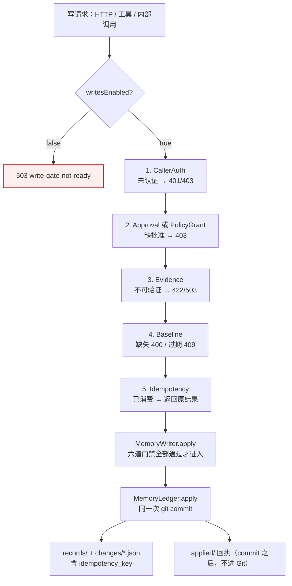

# dsh-memory 阶段 1 设计修订（Rev.3）

- 状态：**设计修订稿，尚未实施**
- 修订对象：[Rev.2](phase1-write-gate-design-rev2.md)；Rev.1、Rev.2 保留不改
- 本轮：只做设计；不改业务代码、配置或现有文档；不提交 Git
- 标记：**[代码]** 仓库源码；**[DSH Inspect]** 上一轮已读契约；**[未执行]** 本轮没有跑的验证，不得当结论

---

## 0. 本轮要修正的问题

| # | Rev.2 的问题 | Rev.3 修正 |
|---|---|---|
| 1 | 一次性批准用启动级 HMAC，长期 PolicyGrant 要跨重启仍防篡改，密钥生命周期冲突 | 拆成两把钥：启动级钥只签 ApprovalRecord；PolicyGrant 用独立的持久钥。持久钥的存储不假定 DSH 安全存储；失败则关闭自动写入 |
| 2 | 把 `allowed-once` 写成了真实人类批准 | 拆成结果、来源、`user_confirmed` 三个字段。V4/A8 未验证前，`user_confirmed` 不得为 true |
| 3 | 架构图让「已认证 owner」直接进 MemoryWriter | 六道门禁并列：CallerAuth、writesEnabled、Approval/Policy、Evidence、Baseline、Idempotency。缺任一道都拒绝 |
| 4 | runtime 写入口被当成「不写 Git 就不危险」 | 候选、提案、异议、抑制、设置分开列。设置和异议不能延期 |
| 5 | 崩溃恢复把 `idempotency_key` 当成 M4 才要加的字段 | **[代码]** 账本 change 已经在同一次 commit 里写 `idempotency_key`（`ledger.js:348-386`）。回执在 commit 之后、不进 Git。恢复协议按这个事实重写 |
| 6 | canonicalIntent 规则与 schema 字段不一致 | 哈希输入改成「Writer 交给 `validateProposal` 之前的那份字段」；数字、`source_refs` 排序与去重写死 |
| 7 | 未实测的 DSH 能力容易被读成已具备 | 本轮 V1–V10 **全部未执行**。每个结论标记为事实、假设或设计决定 |

---

## 1. 修订后的核心架构



设计决定：**已认证 owner 不是写入条件**。CallerAuth 只产生 principal。没有批准、没有证据、没有基线或幂等不匹配时，MemoryWriter 不被调用。

---

## 2. HMAC 与 PolicyGrant 密钥

### 2.1 威胁模型（设计决定，不是已验证事实）

要防的是：同用户进程手改 `runtime.json`，把已过期的批准改成 `granted`，或把未授权的 PolicyGrant 改成有效。

不能防的是：能读密钥文件的同用户进程（含 agent shell）。这一条写进文档，不得声称 HMAC 防住了 shell。

不假定 DSH 有安全存储。本轮没有查 DSH credential store 能否存任意二进制密钥。这是 **[未执行]** 的 V11，不得当成已具备。

### 2.2 两把钥

| 钥 | 保护什么 | 生命周期 | 存储 |
|---|---|---|---|
| `bootKey` | ApprovalRecord（一次性） | Host 启动生成，重启丢弃 | 只在内存 |
| `policyKey` | PolicyGrant（长期） | 用户授权时生成，直到撤销或轮换 | 见 2.3 |

两者不共用。ApprovalRecord 重启失效是预期行为；PolicyGrant 重启后仍有效，但只有密钥还在时。

### 2.3 policyKey 存储（不假定 DSH）

优先顺序：

1. **若 V11 证明 DSH credential store 能存任意密钥**：存那里。本轮不采用这一条，因为 V11 未执行。
2. **否则：本插件自己的文件** `~/.dsh/dsh-memory/policy.key`，模式 0600（Windows 上尽量收紧 ACL，实际效果 **[未执行]**）。文件不进 Git，不进 runtime.json。
3. 文件丢失、不可读、HMAC 不匹配：**失败关闭**。自动写入停止，已有正式记忆不回滚，用户必须重新授权。不得因为密钥丢了就把 grant 当成有效。

重启行为：

- `bootKey` 丢弃；所有 `granted`/`consuming` 的 ApprovalRecord 在启动对账时按第 5 节处理，不靠 HMAC 继续使用。
- `policyKey` 从文件读回；校验 PolicyGrant；失败则 `autoAccept` 视为关闭，即使 `memory-settings.json` 里仍是 `true`。

轮换：用户撤销自动写入时删除 `policy.key` 与 grant。下一次授权生成新钥。

---

## 3. 原生审批：结果、来源、user_confirmed

V4 与 A8 **本轮未执行**。因此不得把 `allowed-once` 写成真实人类批准。

账本记录拆成三个字段：

| 字段 | 含义 | 允许的值 |
|---|---|---|
| `approval.outcome` | DSH 返回的原始结果，或「未调用」 | `allowed-once` / `rejected` / `cancelled` / `unavailable` / `not-called` |
| `approval.source` | 这次批准从哪来 | `dsh-approval` / `panel` / `policy` / `none` |
| `user_confirmed` | 是否声称人类确认 | 只有下面的条件全部成立才为 true |

`user_confirmed = true` 的条件（全部必须同时满足）：

1. `outcome === 'allowed-once'`；
2. `source === 'dsh-approval'`；
3. V4 已证明：在 `ApprovalPolicy='ask'` 下，这个结果来自人类 UI，而不是静默放行；
4. A8 已证明：本插件能识别回答来自受信 answerer，而不是任意插件自答。

在 3 或 4 未证明之前：

- `outcome` 仍可记录 `allowed-once`；
- `source` 记 `dsh-approval`；
- **`user_confirmed` 必须为 false**；
- 正式写入仍然拒绝（`writesEnabled` 保持 false），直到 V4/A8 有结论。

降级：

| 情形 | 行为 |
|---|---|
| `rejected` / `cancelled` / `unavailable` | 不写账本 |
| `'never'` 下静默返回 `allowed-once`（V4 若证明） | 视为 PolicyApproval，`user_confirmed=false`；不得当人类批准 |
| 无法识别 answerer 身份 | 不写 `user_confirmed=true`；正式写入保持关闭，直到产品决定接受这个残余风险 |
| turn 外调用 | 不调用 `approval.request`；走面板路径或拒绝 |

---

## 4. runtime 写入口

这些路径不写 Git，但不都安全。

| 入口 | 调用路径 | 当前权限 | 影响 | 风险 | 本阶段 |
|---|---|---|---|---|---|
| 候选 | `POST /candidate`；`index.js` pre-step `addCandidate` | 回环围栏 | 只进 runtime 队列 | 低：不进 prompt，接受仍需批准 | 可延期；但接受走正式门禁 |
| 提案 | `memory_propose` → `addProposal`；`POST /proposals` accept | 工具只写 runtime；accept 写账本 | 接受才写正式记忆 | accept 路径已在正式写入门禁内 | accept 不延期 |
| 异议 | `POST /objections`；`handleCorrection` → `addObjection` | 回环围栏 / 进程内 | **立即把正式记忆挡出注入** | 未认证调用可隐藏用户记忆 | **不延期**：需要 CallerAuth |
| 恢复抑制 | `POST /objections/clear` → `reinstate` | 回环围栏 | 让已异议记忆重新进入注入 | 未认证调用可撤销用户的纠错 | **不延期**：需要 CallerAuth |
| 设置 | `POST /settings` → `writeSettings` | 回环围栏 | 可打开 `autoAccept`，之后自动写账本 | 间接获得长期写入权 | **不延期**：CallerAuth + 强批准（或在强批准未证明前拒绝改 `autoAccept`） |
| 注入审计 | pre-step `recordInjection` | 进程内 | 只记审计 | 低 | 可延期 |

设计决定：在 V4 未证明前，`POST /settings` 不得把 `autoAccept` 从 false 改为 true。其它字段可以先要求 CallerAuth。

---

## 5. 崩溃恢复协议

### 5.1 已确认的落盘顺序 **[代码]**

`MemoryLedger.applyUnderLock`（`ledger.js:348-401`）：

1. change 对象已含 `idempotency_key`（:354）。
2. `records/*.json`、`changes/<id>.json`、`changes/<id>.md` **在同一次 `git commit` 里提交**（:373-386）。
3. `change.commit` 在提交前是 `null`（:365）；commit hash 不回写 change 文件，因为 hash 依赖内容。
4. `applied/<sha>.json` 回执和 `outbox/` **在 commit 之后写，不进 Git**（:398-401）。

因此：`idempotency_key` 与 change **已经同一次 commit**。Rev.2 把这一点写成「M4 才要加」是错的。要加的是 `approval` 对象（来源、outcome、strength），它也必须进同一次 commit。

### 5.2 同一 approval 的重放

统一行为：

- 幂等键 = `approval_id`；
- 第二次请求若账本已有该键的回执或 change：返回 **200**，`replayed: true`，同一 `change_id`，不再 commit；
- 若批准仍是 `consuming` 且账本尚无记录：返回 **409 `approval-in-progress`**，不开第二个 commit；
- 不返回 200 假装成新写入。

### 5.3 启动对账

对每一条 `consuming` 的批准：

| 账本状态 | 动作 |
|---|---|
| `applied/` 回执存在 | 标 `consumed`，记下 `change_id` |
| 回执不在，但 `git grep`/`git log -S` 能在已提交的 `changes/*.json` 里找到该 `idempotency_key` | 视为已提交；补写回执；标 `consumed`。这就是「提交成功、回执缺失」 |
| 回执不在，已提交历史也没有该键，工作区干净 | 回退 `granted`（若未过期）或 `failed`（若已过期） |
| 工作区脏（commit 前崩溃） | 不自动清理；正式写入返回 503 `ledger-dirty`；批准保持 `consuming` 直到人工处理。不得猜「提交结果未知」就再写一次 |

并发：仍然是 runtime 锁内 CAS（`granted → consuming`）加账本锁。第二个请求拿不到 `granted`。锁顺序不变：不在持有 runtime 锁时跑 git。

「提交结果未知」的定义：进程在 `git commit` 返回前被杀。此时只能看 Git：工作区干净且 HEAD 含该 change → 已提交；工作区脏 → 未知，停止写入并报 `ledger-dirty`。

---

## 6. canonicalIntent

哈希的是 **Writer 交给 `validateProposal` 之前的意图**，不是账本最终记录。最终记录里的 `memory_id`、`created_at`、`last_change_id`、`commit` 由账本生成，不进哈希。

固定字段（与 `validateProposal` 对齐，`schema.js:130-161`）：

```
change_type, content, type, scope, tags, entities,
source_refs, target_memory_id, expected_base_change_id,
source_kind
```

不进哈希：`confidence`、`importance`（账本有默认值，用户看不到）、`actor`、`user_confirmed`（由门禁派生，不由调用方提供）、`reason`（可选说明，不改变事实）、`idempotency_key`（等于 approval_id，单独绑定）。

规则：

1. 未知字段拒绝，不参与哈希。
2. 对象键按 UTF-16 code unit 升序，递归；不用 `localeCompare`。
3. `source_refs`：先按 `(session_id, event_seq)` 升序；完全相同的引用（同 session、同 seq、同 event_type、同 quote_sha256）只留一条。这与账本现有 `dedupeRefs` **[代码]** `ledger.js:303` 的方向一致，但哈希前就做，避免「同一组引用不同顺序」产生不同批准。
4. `tags` / `entities`：trim、去重（保留第一次出现顺序）。顺序仍然敏感：`[a,b]` 与 `[b,a]` 哈希不同。
5. 缺失与 null：缺失不出现键；null 只允许在 schema 允许的字段。UPDATE/RETRACT 的 `expected_base_change_id` 不得为 null，缺失则拒绝（不进哈希）。
6. 字符串：不做 Unicode 归一化；`isWellFormed() === false` 拒绝。
7. 数字：`event_seq` 必须是 `Number.isSafeInteger` 且 ≥ 0；拒绝 NaN、Infinity、-0、浮点、指数形式。intent 里没有其它数字。
8. 输出：`JSON.stringify` 紧凑形式 → UTF-8 → SHA-256，前缀 `sha256:`。
9. 实现只有一份：`provider-git-ledger/src/canonical.js`。Host、Provider adapter、脚本 import 它。客户端不算哈希，只展示服务端返回值。现有 `schema.js` 的 `canonicalJson` 是带缩进的文件格式 **[代码]** :179，**不得**拿来做批准哈希。

测试向量（必须全部有用例）：键顺序无关；嵌套键顺序无关；`source_refs` 换序后哈希相同；完全重复的 ref 只算一条；`tags` 换序哈希不同；缺失 vs null 不同；NFC vs NFD 不同；未配对 surrogate 拒绝；`-0` 拒绝；`1.5` 拒绝；`1e2` 拒绝；中文与 emoji 稳定。

---

## 7. V1–V10 实际结果

**本轮没有执行 V1–V10 中的任何一项。** 没有在隔离 profile 里注册探针路由，没有调用 `approval.request`，没有注入 index，没有做崩溃注入。

上一轮只读了 DSH 契约（Service/Event 描述）。契约存在 ≠ 行为已验证。

| 项 | 状态 |
|---|---|
| V1 `connection.requestRejection` 在插件路由上的实际返回值 | **未执行** |
| V2 index 注入是否能被页面读到 | **未执行** |
| V3 同用户进程能否读 token 文件 | **未执行** |
| V4 `approval.request` 在 ask/never 下是否弹人类 UI | **未执行** |
| V5 `sessionQuery` 在运行 profile 是否可用 | **未执行** |
| V6 插件能否监听 `webserver/index-inject` | **未执行** |
| V7 Provider 是否已挂载 | **未执行**（仓库内 grep 为 0 只说明插件代码没 import，不说明 profile 没挂载） |
| V8 崩溃窗口 | **未执行** |
| V9 并发锁 | **未执行** |
| V10 页面自定义 header | **未执行** |
| V11（本轮新增）DSH credential store 能否存任意密钥 | **未执行** |

---

## 8. 产品决策建议（仍需确认）

| # | 建议 | 理由 |
|---|---|---|
| P1 | 面板弱批准默认关闭；开启后 `user_confirmed=false` | V4 未证明，不能把页面手势当人类批准 |
| P2 | AI 提案仍只能产出 `hypothesis` | schema 已经这么限制 **[代码]** `schema.js:116-118` |
| P3 | UPDATE 允许沿用旧证据，但标 `evidence_mode:'carried-over'`，不写「已核验」 | 用户纠正正文不一定有新会话 |
| P4 | RETRACT 不要求新证据 | 撤回不主张新事实 |
| P5 | autoAccept 保留，默认关；开启需要强批准或在强批准未证明前禁止开启 | 设置是间接写入入口 |
| P6 | 迁移整批一次批准，绑定 plan 哈希 | 避免逐条点击 |
| P7 | Provider 无人类批准时不写，只返回 candidate | 不开第二套语义 |
| P8 | token 文件不作为生产认证 | 同用户 shell 可读 |
| P9（新） | V4/A8 未证明前，即使 `allowed-once` 也不写 `user_confirmed=true`，且正式写入保持关闭 | 避免把未验证能力写成已具备 |

---

## 9. 最小实施顺序与失败姿态

| 步 | 做什么 | 失败时的安全姿态 | 验收 |
|---|---|---|---|
| 0 | 执行 V1–V11，不写生产代码 | 任一关键项失败：正式写入保持关闭 | 每项有通过/失败，不写「应该」 |
| 1 | 六道门禁骨架；`writesEnabled=false`；写路由 503 | 认证失败也是 503，不降级成回环放行 | 无凭据不能写；有凭据仍然 503；账本不变 |
| 2 | ApprovalStore + 原生审批记录；仍不开写入，直到 V4/A8 通过 | V4 失败：保持关闭，`user_confirmed` 不能为 true | 测试覆盖 outcome 三分法 |
| 3 | canonical + 基线必填 + 证据 fail-closed + 幂等 | 任一门禁抛错：不 commit | 哈希向量、缺基线、过期基线、重放 |
| 4 | change 写 `approval`；启动对账；PolicyGrant 两钥 | 密钥失败：关闭 autoAccept | 崩溃窗口、设置篡改 |
| 5 | 面板弱模式（默认关）与文档 | 未显式开启则 403 | UI 标注弱批准 |

对应测试：Rev.2 第 9 节的清单仍有效，另加：

- `policy-key.test.mjs`：密钥丢失、HMAC 不匹配、重启后 grant 仍有效、重启后 ApprovalRecord 失效；
- `approval-provenance.test.mjs`：`allowed-once` 在 V4 未通过时 `user_confirmed=false`；
- `write-gate-order.test.mjs`：认证通过但缺批准、缺证据、缺基线时都不调用 `ledger.apply`；
- `runtime-writes.test.mjs`：未认证的 `/objections`、`/objections/clear`、`/settings` 被拒。

---

## 10. 与 Rev.2 的差异

| 主题 | Rev.2 | Rev.3 |
|---|---|---|
| HMAC | 启动级密钥签所有批准，重启全部失效 | 两把钥；PolicyGrant 用持久钥；密钥丢失则关闭自动写入 |
| `allowed-once` | 写成强人类批准 | 拆成 outcome / source / user_confirmed；未验证前不为 true |
| 架构图 | 认证 owner 直接进 Writer | 六道门禁并列，缺一即拒 |
| runtime 写入 | 大多标成可延期 | 异议、恢复、设置不延期 |
| 崩溃恢复 | 要求 M4 才把 idempotency_key 写进 change | 代码已经在同一 commit；补的是 approval 字段与对账 |
| 重放 | 200 replayed 或 409，没写死 | 统一 200 replayed |
| canonical | 字段集与 schema 不完全一致 | 对齐 validateProposal；写死排序与去重 |
| V1–V10 | 写了步骤，容易被读成已做 | 明确全部未执行 |

---

## 11. 停止点

未改业务代码、配置或现有文档；未提交。等待审查 P1–P9 后再决定是否进入 Step 0。
