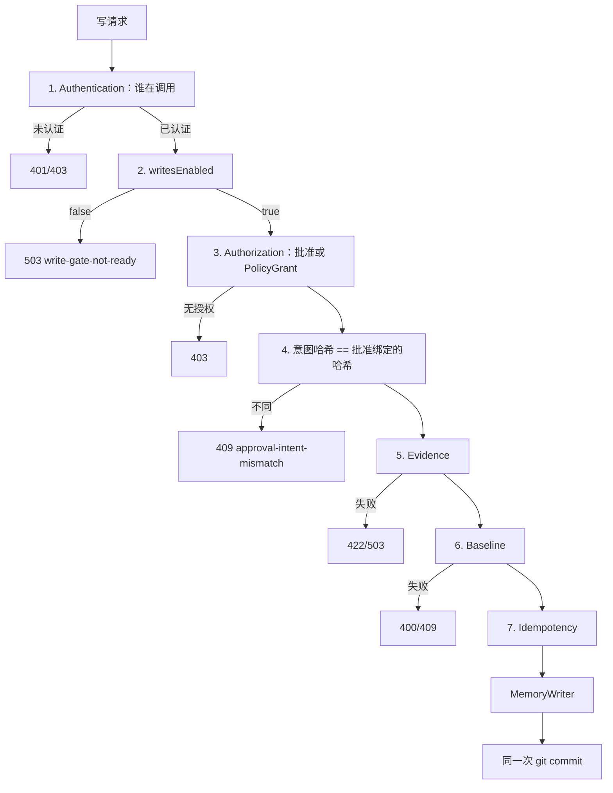

# dsh-memory 阶段 1 设计修订（Rev.4）

- 状态：**设计修订稿，尚未实施**
- 修订对象：[Rev.3](phase1-write-gate-design-rev3.md)；Rev.1、Rev.2、Rev.3 保留不改
- 本轮：只补安全边界、幂等和恢复规则；不重新设计架构；不改业务代码、配置或现有文档；不提交 Git
- 标记：**[代码]** 仓库源码；**[契约·未运行]** DSH Inspect 只读到契约，本轮没跑；**[设计]** 本稿决定；**[待验证]** 尚无证据

---

## 1. 本轮修订摘要

1. CallerAuth 只证明身份，不发放写权限。localhost、自称 owner、普通 token 文件都不是正式写入权限。
2. `approval_id` 必须绑定 `canonicalIntent` 哈希。同一 ID、不同意图必须拒绝，不能把旧结果当成这次成功。
3. 指数数字：只验证解析后的 `event_seq` 是安全非负整数。不再要求拒绝 `1e2`，因为普通 `JSON.parse` 区分不了它和 `100`。
4. ADD / UPDATE / RETRACT 分别定义证据和基线。证据不只查 `event_type`。
5. V4/A8 未通过前，正式写入继续关闭；不把 `allowed-once` 当人类批准；不自动降级成面板弱批准。
6. 工作区脏时停止写入并等待人工处理，不自动清理未知变更。

---

## 2. 核心架构与写入门禁顺序

保留 Rev.3 的六道门禁、`writesEnabled=false`、MemoryWriter 唯一正式写入入口、Git 账本权威源。

设计：认证通过不等于可以写。`writesEnabled=false` 的 503 测试只证明总开关关着，**不证明 CallerAuth 正常**。认证必须有独立单元测试，并在隔离 profile 里做集成测试。

---

## 3. CallerAuth

### 3.1 Authentication 与 Authorization

| | 问题 | 不是 |
|---|---|---|
| Authentication | 这个调用者是谁 | 因为来自 localhost 就信任 |
| Authorization | 这个已认证身份是否被允许做这次具体变更 | 因为自称 owner、持有普通 token 文件就可以写账本 |

正式写入权限只来自：已认证身份 + 绑定本次意图的批准，或已认证身份 + 未过期的 PolicyGrant。

### 3.2 各入口

| 入口 | 认证来源 | 现状 | 写权限 |
|---|---|---|---|
| HTTP 面板 | `ctx.connection.requestRejection` / `admit` | **[契约·未运行]** | 认证后仍要批准 |
| 插件内部（pre-step、自动接受） | 进程内调用，不经 HTTP | **[代码]** 现在无认证 | 只能用 PolicyGrant；没有 grant 就不写 |
| Provider `remember` | 调用方传入的 proposal | **[代码]** 直接 `ledger.apply` | 无批准则拒绝；不把 adapter 调用当成用户批准 |
| 脚本 | 进程启动者 | **[代码]** 验收脚本可无证据写入 | 必须 `--fixture` 且 dataDir 在临时目录；否则拒绝 |

DSH `connection` 能否在插件路由上真正区分浏览器和本机脚本，是 **[待验证]** V1。未通过前，不把它写成已具备的运行时能力。插件自行实现的后备是 index 注入的启动级内存凭据（V2/V6 未运行）。token 文件不用于生产认证。

### 3.3 测试分离

- `writesEnabled=false` → 503：只测总开关。
- CallerAuth 单元测试：无凭据、伪造 Host/Origin、跨站、`connection` 缺失。
- 隔离 profile 集成测试：真实页面、无 cookie 的本机请求、复制 cookie 的请求。这一项在 V1 执行前不能标成已通过。

---

## 4. Approval、PolicyGrant 与 user_confirmed

| 来源 | 默认 | `user_confirmed` | 条件 |
|---|---|---|---|
| `dsh-approval` | 关闭写入 | false | 只有 V4 证明人类 UI、且 A8 证明可识别受信 answerer 后，才能改为 true。本轮两者都未执行 |
| `panel` | 关闭 | false | 另需产品决策、独立审计和验收。不得因为原生审批失败就自动开启 |
| `policy` | 关闭 | false | 长期授权；开启本身也要求强批准。强批准未证明前禁止把 `autoAccept` 从 false 改为 true |

`allowed-once` 只记录为 `outcome`，不自动变成人类批准。

---

## 5. approval_id、哈希与重放

批准记录必须保存 `intent_sha256`。请求进入门禁后先重算哈希，再决定走哪一条。

检查顺序：

1. Authentication。未认证直接拒绝，即使旧批准已消费也不返回旧结果。
2. 找到批准记录，比较 `intent_sha256`。
3. 哈希不同 → `409 approval-intent-mismatch`，不返回旧结果。
4. 哈希相同，且账本已有对应 change 或回执 → `200`，`replayed=true`，同一 `change_id`，不再 commit。已消费不得当成「永远不能读原结果」。
5. 哈希相同，状态是 `consuming`，账本还没有 change → `409 approval-in-progress`。
6. 哈希相同，状态是 `granted` 且未过期 → 继续证据、基线、写入。
7. 不同 `approval_id`、相同意图 → **不是重放**。按新请求处理；若产品不允许重复正文，由分类规则另外拒绝，不借用幂等。

---

## 6. canonicalIntent 与数字

采用简单方案：**只验证解析后的值**。

- `event_seq` 必须是 `Number.isSafeInteger(n) && n >= 0`。
- `1e2` 与 `100` 经 `JSON.parse` 后都是 `100`，哈希相同。不再要求拒绝指数写法。
- 仍拒绝：非整数、NaN、Infinity、`-0`、超出安全整数。
- 不在解析阶段保留原始 JSON 词法。现有 HTTP 入口已经 `JSON.parse`，做不到可靠地区分写法。

其余规则不变：固定字段、UTF-16 键排序、`source_refs` 按 `(session_id, event_seq)` 排序后去重、`tags`/`entities` trim 后去重但顺序敏感、缺失≠null、不做 Unicode 归一、拒绝未配对 surrogate。

去重键与账本现有实现一致：**[代码]** `dedupeRefs` 用 `session_id#event_seq`（`ledger.js:450-457`）。同一 session 与 seq、不同 `quote_sha256` 只保留第一条；哈希前就按这个规则去重，避免批准哈希与账本写入结果不一致。

实现仍只有 `provider-git-ledger/src/canonical.js` 一份。现有带缩进的 `canonicalJson` 不用于批准哈希。

---

## 7. Evidence 与 Baseline

现有 `verify` **[代码]** `session-evidence.js:134-174`：会话不可读、事件不存在、类型不符、引文哈希不符都会失败。但没有 `quote_sha256` 时，只查事件存在和类型。这不足以证明正文就是那句话。

设计：新证据必须同时满足：

1. 事件存在；
2. 类型是 `user/message`（或记录上声明且一致的类型）；
3. 带 `quote_sha256`，且与事件正文哈希一致；
4. 对 ADD，记忆正文必须出现在该用户消息文本中（完整包含或经过空白归一后的子串）。只有哈希、正文对不上，仍拒绝。

| 动作 | 证据 | 基线 | 拒绝 |
|---|---|---|---|
| ADD | 必须有新证据，且正文可对上引文 | 不需要 | 无证据 422 `no-evidence`；事件不在、类型错、哈希不符、正文不在引文中 422 `evidence-invalid`；resolver 不可用 503 |
| UPDATE + 新证据 | 同 ADD | `expected_base_change_id` 必填，且等于当前 `last_change_id` | 缺基线 400；过期 409 `stale` |
| UPDATE + 沿用旧证据 | 不引入新 ref；记 `evidence_mode:'carried-over'`，`fact_reverified:false`；不写「来源已核验」 | 同上 | 同上。旧 ref 已不可读不阻止纠正，但必须记录 `stale_evidence:true` |
| RETRACT | 不要求新证据；`evidence_mode:'none'` | 必填；目标必须存在且当前为 active | 目标不在 404；缺基线 400；过期 409；已撤回再撤回按幂等返回原结果，不再 commit |

用户批准不等于事实已验证。两者分开记录。

---

## 8. Git commit、回执与恢复

### 8.1 已有代码事实

- change 含 `idempotency_key`，与 records、change、说明文件同一次 commit。**[代码]** `ledger.js:348-386`。
- `applied/` 回执在 commit 之后写，不进 Git。**[代码]** `:398-401`。
- 工作区不等于 HEAD 时拒绝写入，不覆盖未知变更。**[代码]** `:234-241`。
- 本轮要补的是：change 里的 `approval` 元数据，以及启动对账。不是再加一次 `idempotency_key`。

### 8.2 工作区是否独占

设计：`~/.dsh/dsh-memory/ledger` 只由 MemoryWriter 写。仓库没有其它生产写者的证据，但也没有运行时锁定「禁止人工 git 操作」的证据。因此工作区脏时必须当成未知状态，不得假定只有本插件会写它。

### 8.3 判定

| 状态 | 判定 | 动作 |
|---|---|---|
| 工作区干净，已提交的 change 含该 `idempotency_key`，回执缺失 | 提交成功、回执缺失 | 补写回执；批准标 `consumed` |
| 工作区干净，历史中没有该键，批准仍是 `consuming` | 未提交 | 可退回 `granted`（未过期）或 `failed`（已过期） |
| `git status --porcelain` 非空 | 未知 | **停止写入**，503 `ledger-dirty`；批准保持 `consuming`；不自动 `reset`/`clean` |
| commit 进程被杀，还没有退出码 | 未知 | 同上，等进程结束后再按工作区判定 |

可以退回 `granted` 的唯一条件：工作区干净，且已提交历史中确实没有这个 `idempotency_key`。

必须停止并等待人工的情况：工作区脏、无法读取 Git、哈希与已提交 change 不一致、同一键对应多个 change。

### 8.4 对账幂等与并发

- 启动对账可重复跑：已 `consumed` 的不再改；回执已在则不重写；脏工作区每次都停止，不改变脏状态。
- 并发：批准 `granted → consuming` 在 runtime 锁内 CAS；账本锁串行 commit。第二个请求拿不到 `granted`，不会再生成 change。
- 不在持有 runtime 锁时跑 git。

---

## 9. V1–V11

本轮仍未执行任何一项。执行前置：隔离 profile、临时 dataDir、不碰生产 `~/.dsh/dsh-memory`。

| 项 | 要证明什么 | 前置 | 状态 |
|---|---|---|---|
| V1 | 插件路由上 `requestRejection` 能区分页面与本机脚本 | 隔离 profile | 未执行 |
| V2 | 页面能读到 index 注入，未认证请求读不到 | 同上 | 未执行 |
| V3 | 同用户进程能否读 token 文件 | 临时文件 | 未执行 |
| V4 | `ask` 是否弹人类 UI；`never` 是否静默放行 | 隔离会话 | 未执行 |
| V5 | 运行 profile 是否有 `sessionQuery` | 隔离 profile | 未执行 |
| V6 | 插件能否监听 `webserver/index-inject` | 同上 | 未执行 |
| V7 | Provider 是否已挂载 | 读 profile 配置，不改它 | 未执行 |
| V8 | commit 后、回执前杀进程 | 临时账本 | 未执行 |
| V9 | 并发不死锁、不双写 | 临时账本 | 未执行 |
| V10 | 页面能否带自定义 header | 真实页面 | 未执行 |
| V11 | DSH 能否存任意密钥 | 只读契约；不写生产凭据 | 未执行 |

---

## 10. 分阶段与失败姿态

| 阶段 | 做什么 | 失败时 |
|---|---|---|
| 0 | 执行 V1–V11 | 关键项失败：正式写入保持关闭 |
| 1 | 六道门禁骨架；`writesEnabled=false` | 认证失败也不降级成回环放行；503 |
| 2 | 批准记录与哈希绑定；仍不开写入 | V4/A8 未过：继续关闭；不降级面板弱批准 |
| 3 | 证据、基线、幂等 | 任一门禁失败：不 commit |
| 4 | change 写 approval；对账；PolicyGrant | 密钥失败：关闭 autoAccept；脏工作区：停止 |
| 5 | 面板弱模式，默认关 | 未显式开启：403 |

---

## 11. Rev.3 → Rev.4

| 主题 | Rev.3 | Rev.4 |
|---|---|---|
| CallerAuth | 方案对比，未分清认证与授权 | 明确：认证不发放写权限；503 测试不等于认证测试 |
| 重放 | 同 ID 统一 200 replayed | 同 ID 不同意图必须 409；不同 ID 相同意图不是重放 |
| `1e2` | 拒绝指数写法 | 改为只验解析后的安全非负整数 |
| 证据 | 按情形列表 | 补上正文必须对上引文；不只查类型 |
| V4 失败 | 不写 `user_confirmed=true` | 另加：不得自动降级成面板弱批准 |
| 脏工作区 | 报 `ledger-dirty` | 写明不独占、不自动清理、哪些情况才能退回 `granted` |

---

## 12. 残余风险与待确认决策

风险：

- V1 未跑，原生认证可能实际不可用。
- 同用户进程仍可能读走浏览器凭据或 `policy.key`。
- answerer 可能被其它插件自答（A8 未执行）。
- 沿用旧证据的 UPDATE 不证明新正文为真。
- 脏工作区会一直挡住写入，直到人工处理。

仍需确认（未批准）：

1. 面板弱批准是否保留为未来可选项；若保留，默认关闭，需要单独的授权、审计和验收。
2. UPDATE 是否允许沿用旧证据。
3. autoAccept 在强批准未证明前是否一律禁止打开。
4. Provider 无人类批准时是否只返回 candidate。

本稿不把这些建议当成已批准的产品决策。

---

## 13. 停止点

未改业务代码、配置或现有文档；未执行会改变运行环境或生产数据的操作；未提交。等待审查，不进入 Step 0。
