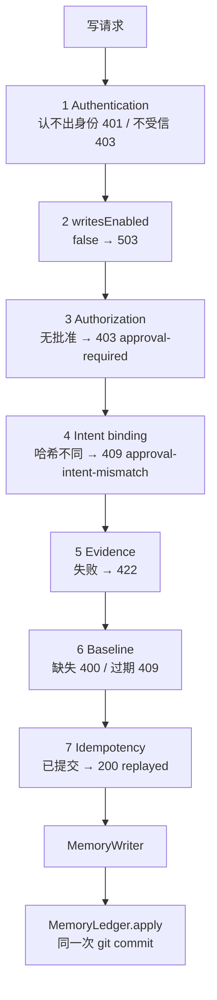

# dsh-memory 阶段 1 设计修订（Rev.6）

- 状态：**设计修订稿，尚未实施**
- 修订对象：[Rev.5](phase1-write-gate-design-rev5.md)；Rev.1–Rev.5 保留不改
- 本轮只处理：Git 恢复安全、ADD 与人工批准边界、ADD 字面匹配、`source_refs` 一致性
- 不改业务代码、配置或现有文档；不提交；不执行 Step 0；不运行测试
- 标记：**[代码]** 仓库源码；**[契约·未运行]** 只读过 DSH 契约；**[设计]** 本稿决定；**[待验证]** 尚无运行证据

Rev.5 的六道门禁、`writesEnabled=false` 安全停止点、MemoryWriter 唯一正式写入、Git 账本权威源继续有效。

---

## 0. 本轮修订摘要

| # | 问题 | Rev.6 处理 |
|---|---|---|
| 1 | Rev.5 用「工作区干净 + 当前历史没有键」推断未提交 | 明确祖先关系只证明当前历史关系，不证明历史未被重写；`committing` 状态下找不到 change 一律 `needs-manual`，不自动退回 `granted` |
| 2 | 用户批准可能被当成越过证据门禁 | 批准只解决授权；普通 ADD 仍必须过证据。改写内容要进账本，只能是独立的 attested 模式，且该模式尚未获产品批准 |
| 3 | 字面匹配规则含糊 | 写死归一化函数、空白与 Unicode 规则、空正文行为 |
| 4 | 两套 `source_refs` 去重规则 | 只有一个 `normalizeSourceRefs`；冲突在生成批准哈希前拒绝，映射 `422 evidence-conflict` |

---

## 1. 架构与门禁顺序（不变）



设计：任何一道门禁失败都不调用 MemoryWriter。认证通过不是写入权限。

---

## 2. Git 恢复安全（P0）

### 2.1 祖先关系能证明什么

**[设计]** `pre_head` 与当前 HEAD 的祖先关系只能说明：当前这条历史是从 `pre_head` 长出来的。它**不能**说明：

- 期间没有创建过别的 commit 又被 reset 掉；
- 仓库没有被整体替换或从别处 clone；
- reflog 没有被清理；
- 历史没有被 rewrite。

因此：

- **不得**因为当前可达历史里找不到 `idempotency_key`，就断言原操作从未提交。
- **不得**在 `committing` 状态下仅凭「工作区干净 + 没找到键」把批准退回 `granted`。

### 2.2 状态机与 `pre_head` 持久化

批准状态：

```
granted ──开始写入──▶ committing ──找到 change──▶ consumed
   │                      │
   │                      └──找不到/不确定──▶ needs-manual
   ├──过期/撤销──▶ expired / revoked
```

写入顺序（设计）：

1. 读取 `repo_root`、`root_commit`（`git rev-list --max-parents=0 HEAD`，空仓库记 `null`）、`pre_head`（`git rev-parse HEAD`，空仓库记 `null`）。
2. 原子写批准记录：`status:'committing'`、`pre_head`、`repo_root`、`root_commit`、`intent_sha256`、`idempotency_key`。
3. 调用 MemoryWriter / `MemoryLedger.apply`。
4. 成功后写 `status:'consumed'`、`change_id`、`commit`。

崩溃窗口：

| 崩溃点 | 状态 | 结论 |
|---|---|---|
| 步骤 1 与 2 之间 | 仍是 `granted` | 未调用 Git；不会有 change。可直接过期或撤销 |
| 步骤 2 与 3 之间 | `committing` | 可能还没写，也可能刚要写；**无法证明**。`needs-manual` |
| 步骤 3 与 4 之间 | `committing` | 用 §2.4 判定；找到 change 才能 `consumed` |

说明：`status` 的原子写在 runtime.json；它的持久性依赖文件系统 rename 语义 **[待验证]**。即使状态写丢失、批准仍是 `granted`，账本也不能重复写入：`MemoryLedger` 必须在写前同时检查**回执**和**已提交 change 里的 `idempotency_key`**（§2.6）。这样状态丢失只会导致重复请求返回 `replayed`，不会生成第二条 change。

### 2.3 仓库身份

批准记录保存：

- `repo_root`：`git rev-parse --show-toplevel` 的真实路径
- `root_commit`：当时可达历史的第一个 commit；空仓库为 `null`
- `owner_id`：`manifest.json` 里的 owner

恢复时重算这三项。任一不同 → `needs-manual`，不自动判定。理由：换仓库、从别处 clone、从根重写历史都会改变 `root_commit` 或 `repo_root`。

### 2.4 恢复判定

先看工作区，再看仓库身份，再看历史关系，最后才搜键。

| 条件 | 动作 |
|---|---|
| `git status --porcelain` 非空 | `needs-manual`，写入 503 `ledger-dirty`；不 reset/clean |
| Git 不可读 | `needs-manual`，503 `ledger-history-uncertain` |
| `repo_root` / `root_commit` / `owner_id` 与记录不一致 | `needs-manual` |
| `pre_head` 为 `null` 但当前仓库已有 commit | `needs-manual` |
| 当前 HEAD 不是 `pre_head` 的后裔（`merge-base --is-ancestor` 失败） | `needs-manual`，判定历史被改写/重置 |
| 当前 HEAD 是后裔，`pre_head..HEAD` 内恰好一个 change 的 `idempotency_key` 等于该批准 | `consumed`，补回执 |
| 同一键在可达历史里出现多次 | `needs-manual` |
| 当前 HEAD 是后裔，但这段历史里没有该键 | **`needs-manual`**。不能证明没提交过 |

**允许自动回到 `granted` 的条件：没有。** 只要进入过 `committing`，就不会自动退回；`granted` 本来就没开始写，不需要“恢复”。过期只改 `expired`。这是 Rev.6 相对 Rev.5 最重要的收紧。

### 2.5 人工恢复

人工只能二选一，并记录操作者、时间、理由：

1. 找到对应 change：标 `consumed`，写回 `change_id`/`commit`。
2. 确认不应再写：标 `revoked`。要重写必须新签批准，**不复用旧 `approval_id`**。

禁止：`git reset`、`git clean`、删除未提交文件、用「历史里没有」当证据自动再写。人工恢复步骤本身不自动执行，必须显式触发。

### 2.6 对账幂等与防重复

- 对账可重复跑：`consumed`/`needs-manual`/`revoked` 不再变；脏工作区每次停止。
- `MemoryLedger.apply` 在锁内：
  1. 查回执；
  2. 回执缺失时，在已提交的 `changes/*.json` 中查 `idempotency_key`；
  3. 任一命中 → 返回 `replayed`，不 commit。
- 批准 `granted → committing` 在 runtime 锁内 CAS；账本锁串行。第二个并发请求拿不到 `committing`，不会生成第二条 change。
- 两个不同 `approval_id`、相同意图：不是重放；是否允许重复内容由分类规则决定，不借幂等。

---

## 3. ADD 与人工批准的边界（P0）

### 3.1 授权与证据是两件事

- **批准**回答：这个已认证调用者是否被允许做这次变更。
- **证据**回答：这段正文能不能指回用户原话。

用户批准**不能**让普通 ADD 跳过证据门禁。`user_confirmed=true` 也不等于 `evidence_verification.verified=true`。

### 3.2 普通 ADD

普通 ADD 必须：

1. 有新 `source_refs`；
2. 每条 ref 通过 §5 的归一化与校验；
3. 事件存在、类型一致、`quote_sha256` 匹配；
4. 正文通过 §4 的字面匹配。

任一条失败 → 拒绝，不写账本；即使批准是强批准也一样。失败码见 §6。

### 3.3 改写内容：attested 模式（未获批准，不实现）

如果产品希望保存「语义相同但字面对不上」的内容，必须是一个**独立写入模式**，不能静默复用普通 ADD：

```
change_type: 'ADD'
origin: 'user-attested'
evidence_mode: 'attested'
fact_reverified: false
approval: { kind:'native', ... }        // 仍然需要强批准
source_refs: 保留用户指出的来源，但不声称字面匹配
```

要求：

- 只有用户显式选择「保存为人工确认内容」才进入；
- 账本、UI、注入文案都标注「用户确认，非字面引文」；
- 不计入「已核验事实」；
- 需要单独的产品决策与验收，不能由实现者默认开启。

**本轮不批准该模式。** 在 P10 答复前，普通 ADD 遇到 `evidence-not-literal` 一律拒绝。

### 3.4 审计

无论普通 ADD 还是未来的 attested，都记录：

- `approval.kind` / `outcome` / `source`
- `evidence_mode`：`literal` / `attested` / `carried-over` / `none`
- `fact_reverified`：只有字面匹配且证据验证通过才为 true
- `user_confirmed`：只由强批准派生，不由证据派生

---

## 4. ADD 字面匹配规则（P1）

### 4.1 归一化函数

```
normalizeForMatch(s):
  s.normalize('NFKC')
   .replace(/\p{White_Space}+/gu, '')
   .toLowerCase()
```

规则：

1. **NFKC** 只用于匹配，不用于批准哈希。哈希仍用账本将写入的精确 UTF-8 文本（Rev.5 §6）。
2. 去掉所有 Unicode 空白字符（`\p{White_Space}`）。不额外去零宽字符；含零宽字符的正文按原样比较，通常不会匹配，属于保守失败。
3. `toLowerCase()` 用于大小写不敏感匹配；不做 locale 相关折叠。
4. 先拒绝未配对 surrogate（`isWellFormed() === false`），再归一化。
5. 匹配定义：`normalizeForMatch(content)` 非空，且是 `normalizeForMatch(userMessage)` 的子串。

### 4.2 空正文

- `content.trim() === ''`：422 `empty-content`，在证据门禁之前拒绝。
- 仅空白、仅零宽字符、仅标点：按归一化后是否为空处理；归一化为空 → `empty-content`。
- 用户消息为空或归一化为空：422 `evidence-invalid`。

### 4.3 边界

| 输入 | 结果 |
|---|---|
| 正文与消息完全一致 | 通过 |
| 仅空白/全半角差异（NFKC 后一致） | 通过 |
| 仅大小写差异 | 通过 |
| 正文是消息的子串 | 通过 |
| 正文经过归纳、改写、翻译 | 拒绝 `evidence-not-literal` |
| 正文为空/仅空白 | 拒绝 `empty-content` |
| 正文含未配对 surrogate | 拒绝 `invalid-text` |

字面匹配通过只表示「这段字出现在用户消息里」，**不表示事实为真、仍然有效或适用于当前项目**。

---

## 5. `source_refs` 一致性（P1）

### 5.1 唯一实现

新增 `provider-git-ledger/src/normalize-refs.js`：

```
normalizeSourceRefs(refs) -> Array<ref>   // 或抛 EvidenceConflictError
```

批准哈希、账本写入、Provider adapter、迁移、脚本全部调用它。**不得**再各自实现去重。

### 5.2 规则

1. 每条 ref 先过 `validateSourceRef`（`session_id` 字符串、`event_seq` 非负安全整数、可选 `event_type`/`quote_sha256` 格式）。
2. 按 `session_id#event_seq` 分组。
3. 组内字段完全相同（`event_type`、`quote_sha256` 都相同，含都缺失）→ 只留一条。
4. 组内任一字段不同（含一条有 `quote_sha256`、一条没有）→ 抛 `EvidenceConflictError`，附带冲突组。**不选第一条。**
5. 不冲突的 refs 排序：`session_id` 按 UTF-16 code unit 升序；`event_seq` 数值升序；`event_type` 缺失视为空串再比较；`quote_sha256` 缺失视为空串再比较。
6. 返回新数组，不修改输入。

### 5.3 冲突必须在哈希前拒绝

- 批准签发：先 `normalizeSourceRefs`，再算 `canonicalIntent` 哈希。冲突直接 422 `evidence-conflict`，不生成批准。
- 账本写入：锁内再次 `normalizeSourceRefs`。两次结果必须一致；不一致 → 拒绝（409 `approval-intent-mismatch`）。
- 不允许「哈希用一套规则、账本用另一套」。

### 5.4 替换旧 `dedupeRefs`

**[代码]** 现有 `ledger.js:450-457` 的 `dedupeRefs` 只按 `session_id#event_seq` 留第一条，且用于 UPDATE 合并（`:303`）。Rev.6 设计：

- `dedupeRefs` 删除或改成 `normalizeSourceRefs` 的别名，仓库内只保留一套规则；
- UPDATE 合并 `[...before.source_refs, ...proposal.source_refs]` 后调用 `normalizeSourceRefs`；
- 旧记录里已有的同键异哈希（历史脏数据）在读取时不报错；一旦 UPDATE 需要合并并触发冲突 → 422 `evidence-conflict`，提示人工处理，不静默丢弃。

---

## 6. HTTP 状态码（更新）

沿用 Rev.5，新增两类证据错误：

| 情形 | 状态 | 错误码 |
|---|---|---|
| 认不出身份 | 401 | `unauthenticated` |
| 身份不受信 | 403 | `forbidden` |
| 已认证但 `writesEnabled=false` | 503 | `write-gate-not-ready` |
| 无批准/无有效 PolicyGrant | 403 | `approval-required` |
| 同 `approval_id` 不同意图 | 409 | `approval-intent-mismatch` |
| 批准 `committing` 且尚无 change | 409 | `approval-in-progress` |
| 正文为空/仅空白 | 422 | `empty-content` |
| 正文不在用户消息中 | 422 | `evidence-not-literal` |
| 同事件不同引文/类型 | 422 | `evidence-conflict` |
| 事件不存在/类型不符/哈希不符 | 422 | `evidence-invalid` |
| 缺基线 | 400 | `missing-base` |
| 基线过期 | 409 | `stale` |
| 工作区脏 | 503 | `ledger-dirty` |
| 历史关系/仓库身份不确定 | 503 | `ledger-history-uncertain` |

---

## 7. V1–V11（仍未执行）

本轮没有运行任何验证。

| 项 | 状态 |
|---|---|
| V1 `connection.requestRejection` 在插件路由的实际行为 | 未执行 |
| V2 index 注入能否被页面读取 | 未执行 |
| V3 同用户进程能否读 token 文件 | 未执行 |
| V4 `approval.request` 在 `ask`/`never` 下的行为 | 未执行 |
| V5 运行 profile 是否有 `sessionQuery` | 未执行 |
| V6 插件能否监听 `webserver/index-inject` | 未执行 |
| V7 Provider 是否已挂载 | 未执行 |
| V8 崩溃窗口 | 未执行 |
| V9 并发锁 | 未执行 |
| V10 页面自定义 header | 未执行 |
| V11 DSH 能否存任意密钥 | 未执行 |

在 V4/A8 有结论前，正式写入保持关闭；`allowed-once` 不写成人类批准；`user_confirmed` 不为 true。

---

## 8. 分阶段与失败姿态

| 阶段 | 内容 | 失败时 |
|---|---|---|
| 0 | 执行 V1–V11 | 关键项失败：正式写入继续关闭 |
| 1 | 六道门禁骨架；`writesEnabled=false` | 认证失败 401/403；已认证但总开关关 503；不降级回环放行 |
| 2 | 批准记录、意图哈希、单次消费 | V4/A8 未过：不开启写入；不降级面板弱批准 |
| 3 | 证据、基线、`normalizeSourceRefs`、字面匹配 | 任一失败不 commit |
| 4 | change 写 approval；对账；PolicyGrant | 历史不确定/工作区脏：停止，人工处理 |
| 5 | 面板弱模式（默认关）与文档 | 未显式开启：403 |

---

## 9. Rev.5 → Rev.6 逐项变更

| 主题 | Rev.5 | Rev.6 |
|---|---|---|
| 祖先关系 | 作为「未提交」的证据之一 | 明确它只证明当前历史关系，不证明历史未被重写 |
| 干净工作区+无键 | 可退回 `granted` | **不得**退回；进入 `needs-manual` |
| 自动恢复 `granted` | 有条件允许 | 只要进过 `committing`，一律不自动恢复 |
| `pre_head` | 要求记录 | 补充 `repo_root`/`root_commit`/`owner_id`，写明崩溃窗口与持久化顺序 |
| 防重复 | 依赖回执 | 回执缺失时再查已提交 change 的 `idempotency_key` |
| 人工批准与 ADD | 未明确能否越过 `evidence-not-literal` | 明确不能；attested 模式独立、未批准、不实现 |
| 字面匹配 | 只说「正文出现在消息中」 | 写死 NFKC + 去空白 + 小写 + 子串；空正文先拒 |
| `source_refs` | 排序去重 | 唯一 `normalizeSourceRefs`；同键异值拒绝；替换 `dedupeRefs` |
| 错误码 | 无证据冲突/无空正文 | 新增 `evidence-conflict`、`evidence-not-literal`、`empty-content`、`invalid-text` |

---

## 10. 仍然存在的风险与待确认项

风险：

- Git 无法证明「从未提交」；`committing` 崩溃一律人工，运维成本上升。
- `runtime.json` 原子写的持久性未实测；依赖账本按 `idempotency_key` 查已提交 change 兜底。
- `root_commit` 在历史从根重写时变化，会被判为 `needs-manual`，这是有意的保守行为。
- 字面匹配会漏掉真实但被改写的偏好；attested 模式未获批，暂不提供。
- NFKC 匹配可能让全角/兼容字符意外命中；这是匹配层行为，不影响哈希。
- 旧账本中同键异哈希的脏数据会阻塞后续 UPDATE，需要人工修复路径。
- V1–V11 未执行，认证与原生审批仍只是契约。

待确认（未默认决定）：

1. 是否允许 attested 模式保存改写内容；若允许，授权、审计与 UI 文案如何定。
2. 面板弱批准是否保留为未来可选项。
3. 强批准未证明前，是否一律禁止打开 `autoAccept`。
4. Provider 无人类批准时是否只返回 candidate。
5. 人工恢复是否接受为常规运维步骤，还是需要专门的恢复 CLI/UI。

---

## 11. 停止点

未改业务代码、配置或现有文档；未提交；未执行 Step 0；未运行测试；未改变运行环境。等待审查。
