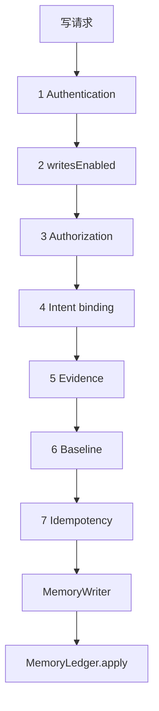

# dsh-memory 阶段 1 设计修订（Rev.7）

- 状态：**设计修订稿，尚未实施**
- 修订对象：[Rev.6](phase1-write-gate-design-rev6.md)；Rev.1–Rev.6 保留不改
- 本轮只处理：状态丢失与防重复的保证边界、证据冲突与意图不匹配的错误码、`invalid-text`、仓库身份检查的边界、空正文与零宽字符
- 不改业务代码、配置或现有文档；不提交；不执行 Step 0；不运行测试
- 标记：**[代码]** 仓库源码；**[契约·未运行]** 只读过 DSH 契约；**[设计]** 本稿决定；**[待验证]** 尚无运行证据

Rev.6 的六道门禁、`writesEnabled=false`、MemoryWriter 唯一正式写入、Git 账本权威源继续有效。本轮不放宽 `needs-manual`。

---

## 0. 本轮修订摘要

| # | 问题 | Rev.7 处理 |
|---|---|---|
| 1 | Rev.6 把「查回执 + 当前可达 change」写成能防住重复提交 | 明确这只能在原提交仍在当前历史里时证明重放；历史被重写后不能排除「曾经提交过」。不宣称绝对防重复 |
| 2 | 证据冲突被写成 409 哈希不匹配 | `EvidenceConflictError` 只返回 `422 evidence-conflict`；只有归一化结果与批准时绑定的意图不同才返回 409 |
| 3 | 统一错误表缺 `invalid-text` | 补上 `422 invalid-text`；未配对 surrogate 在归一化和字面匹配之前拒绝 |
| 4 | `repo_root` / `root_commit` / `owner_id` 像唯一身份 | 明确它们只是一致性检查，不是仓库绝对唯一身份。是否加 UUID 仍待确认 |
| 5 | 零宽字符被说成归一化后为空 | 写明：仅空白会变空；仅零宽、仅标点不会。`normalizeForMatch` 不去零宽字符 |

---

## 1. 门禁顺序（不变）



**[设计]** 任一道失败都不调用 MemoryWriter。认证通过不是写入权限。`writesEnabled=false` 时正式写入关闭；本轮不改这个停止点。

在下面两件事都有运行证据之前，正式写入继续关闭：

1. 批准状态的持久化保证（runtime 写入丢失时系统如何表现）——**[待验证]**；
2. 账本写入约束（回执与已提交 change 的查找在历史被改写后的行为）——**[待验证]**。

关闭期间不为了自动恢复而放宽 `needs-manual`。

---

## 2. 状态持久化丢失与防重复（P0）

### 2.1 已知事实

- change 与 `idempotency_key` 在同一次 git commit。**[代码]** `packages/provider-git-ledger/src/ledger.js` 先写 change 再 commit。
- 回执 `applied/` 在 commit 之后写，不进 Git。**[代码]**
- 批准状态在 runtime.json。它的原子写入在崩溃或掉电后是否一定落盘，**本轮没有测试**。**[待验证]**

### 2.2 状态写丢失时看到什么

**[设计]** 若 runtime 写入丢失，记录仍可能显示 `granted`，即使账本已经 commit。调用方会看到「还没开始写」。这不是「没写过」的证据。

此时账本侧只能做两件事：

1. 查 `applied/` 回执；
2. 回执不在时，在**当前可达**的已提交 `changes/*.json` 里查 `idempotency_key`。

命中则返回 `replayed`，不再 commit。这只证明：**原提交仍在当前历史里**。

它不能覆盖：

- commit 曾经存在，后来被 reset、重写或换仓库从当前历史里拿掉；
- 回执也一并丢失；
- reflog 已被清掉，无法再找到那次 commit。

**[设计]** 在无法可靠排除「曾经提交、后来从当前历史移除」时，系统**不得宣称绝对防重复**。最多说：在当前可达历史内，同一 `idempotency_key` 不会再 commit 一次。

### 2.3 不放宽恢复

| 情形 | 动作 |
|---|---|---|
| 当前可达历史里找到该键 | `consumed`，补回执；返回 `replayed` |
| 工作区脏、Git 不可读、仓库一致性检查失败、同一键多个 change | `needs-manual`；正式写入 503 |
| `committing` 且当前历史找不到该键 | `needs-manual`。**不**退回 `granted`，**不**自动再写 |
| 仍是 `granted`（从未进入 `committing`） | 不是恢复。若要写，走完整门禁；账本若已有该键则 `replayed` |

人工处理仍只能：指出已有 `change_id` 并标 `consumed`，或标 `revoked` 并要求新批准。不自动 `reset` / `clean`。

---

## 3. 证据冲突与意图不匹配（P0）

**[设计]** 两种失败不得混用同一个 HTTP 错误。

| 异常 | 含义 | HTTP |
|---|---|---|
| `EvidenceConflictError` | 同一 `session_id#event_seq` 下 `event_type` 或 `quote_sha256` 不同（含一条有哈希、一条没有） | **422 `evidence-conflict`** |
| 归一化成功，但结果的哈希 ≠ 批准记录里的 `intent_sha256` | 这次要写的不是当时批准的那份 | **409 `approval-intent-mismatch`** |

映射顺序：

1. 先跑 `normalizeSourceRefs`。它抛 `EvidenceConflictError` 就立刻 422，**不算哈希**，**不**包装成 409。
2. 只有归一化成功后，才用这份结果算 `canonicalIntent` 哈希。
3. 哈希与批准绑定值不同，才是 409。

批准签发和账本写入都调同一个 `normalizeSourceRefs`。冲突在生成批准哈希之前拒绝，不产生批准记录。

---

## 4. `invalid-text`（P1）

**[设计]** 未配对 surrogate 在下面两步**之前**拒绝：

1. `normalizeForMatch`（NFKC、去空白、小写）；
2. 字面子串比较。

检查：`String.prototype.isWellFormed() === false` → **422 `invalid-text`**。正文和用户消息都要查。不进入匹配，不进入批准哈希。

---

## 5. 仓库身份检查的边界（P1）

**[设计]** `repo_root`、`root_commit`、`owner_id` 只是一致性检查：恢复时重算，与批准记录不同则 `needs-manual`。

它们**不是**仓库绝对唯一身份的证明。例如：

- 把整个目录拷贝到另一路径，`repo_root` 会变，但内容可能一样；
- 从同一个空仓库重新做出相同的第一个 commit，`root_commit` 可能相同；
- `owner_id` 是 manifest 里的字符串，不是机器唯一标识。

本轮**不**新增仓库 UUID。是否持久化 UUID 作为待确认项，见第 8 节。

---

## 6. 空正文、仅空白、零宽字符、标点（P1）

`normalizeForMatch` **[设计]**：

```
normalizeForMatch(s) =
  s.normalize('NFKC')
   .replace(/\p{White_Space}+/gu, '')
   .toLowerCase()
```

它只去 Unicode `White_Space`。**不去**零宽字符（如 U+200B、U+200C、U+200D、U+2060）。不要把「仅零宽」说成归一化后为空。

顺序：先 `invalid-text`，再看是否为空，再做子串匹配。

| 输入 | 归一化后 | 结果 |
|---|---|---|
| `""` 或 trim 后为空 | 空 | 422 `empty-content`，在证据门禁之前 |
| 仅空白（空格、换行、`White_Space`） | 空 | 422 `empty-content` |
| 仅零宽字符 | **非空**（零宽仍在） | 不是 `empty-content`。若用户消息归一化后不含这个子串 → 422 `evidence-not-literal` |
| 仅标点 | **非空**（标点不是空白） | 同上：子串命中则字面匹配通过；否则 `evidence-not-literal` |
| 未配对 surrogate | 不归一化 | 422 `invalid-text` |

字面匹配通过只表示字出现在用户消息里，不表示事实为真。

---

## 7. 统一错误码

| 情形 | 状态 | 错误码 |
|---|---|---|
| 认不出身份 | 401 | `unauthenticated` |
| 身份不受信 | 403 | `forbidden` |
| 已认证但 `writesEnabled=false` | 503 | `write-gate-not-ready` |
| 无批准 / 无有效 PolicyGrant | 403 | `approval-required` |
| 同 `approval_id`，归一化后意图哈希不同 | 409 | `approval-intent-mismatch` |
| 批准 `committing` 且当前历史尚无 change | 409 | `approval-in-progress` |
| 未配对 surrogate | 422 | `invalid-text` |
| 正文为空或仅空白 | 422 | `empty-content` |
| 正文不在用户消息中 | 422 | `evidence-not-literal` |
| 同事件不同引文或类型 | 422 | `evidence-conflict` |
| 事件不在 / 类型不符 / 引文哈希不符 | 422 | `evidence-invalid` |
| 缺基线 | 400 | `missing-base` |
| 基线过期 | 409 | `stale` |
| 工作区脏 | 503 | `ledger-dirty` |
| 历史或仓库一致性无法判定 | 503 | `ledger-history-uncertain` |

---

## 8. 待确认项（未默认决定）

1. 是否持久化仓库 UUID。本轮不加。
2. attested 模式是否允许保存改写内容。
3. 面板弱批准是否保留为未来可选项。
4. 强批准未证明前，是否一律禁止打开 `autoAccept`。
5. Provider 无人类批准时是否只返回 candidate。
6. 人工恢复是否要做成正式工具。

---

## 9. V1–V11

本轮没有执行。全部仍为**未执行**。不得把本稿的推断写成运行结果。

在持久化保证与写入约束未验证、且 V4/A8 未有结论之前：正式写入继续关闭；`allowed-once` 不写成人类批准；`user_confirmed` 不为 true。

---

## 10. Rev.6 → Rev.7

| 主题 | Rev.6 | Rev.7 |
|---|---|---|
| 防重复 | 写成回执或已提交 change 命中就不会再 commit | 只在原提交仍可达时成立；历史被拿掉则不能排除曾经提交；不宣称绝对防重复 |
| 状态丢失 | 说依赖账本查键兜底 | 明确此时界面仍可显示 `granted` |
| `committing` 找不到键 | `needs-manual` | 仍是 `needs-manual`，不为自动恢复而放宽 |
| 证据冲突 | 写成两次归一化不一致则 409 | 冲突抛错 → 422；只有哈希不同 → 409 |
| `invalid-text` | 匹配表写了拒绝，统一错误表没有这一行 | 补入统一表；且在归一化之前拒绝 |
| 仓库身份 | `repo_root` 等不一致则停止 | 明确这不是绝对唯一身份；不新增 UUID |
| 零宽字符 | 写成按归一化后是否为空 | 明确不会变空；仅空白才是 `empty-content` |

---

## 11. 仍然存在的风险

- 历史被重写后，同一批准可能再写一次。本设计不把这种情况说成已防住。
- runtime 写入丢失时，界面可能仍显示可写。若当前历史还在，账本会拒绝第二次 commit；若历史已不在，则不能。
- 仓库一致性检查可以被拷贝目录或相同根 commit 绕过。没有 UUID 之前，这是已知缺口。
- 仅零宽或仅标点的正文不会因空正文拒绝；它们只能靠字面匹配失败，或成为很差的正式记忆。
- V1–V11 仍未执行。认证与原生审批仍只是契约。

---

## 12. 停止点

未改业务代码、配置或现有文档；未提交；未执行 Step 0；未运行测试。等待审查。
