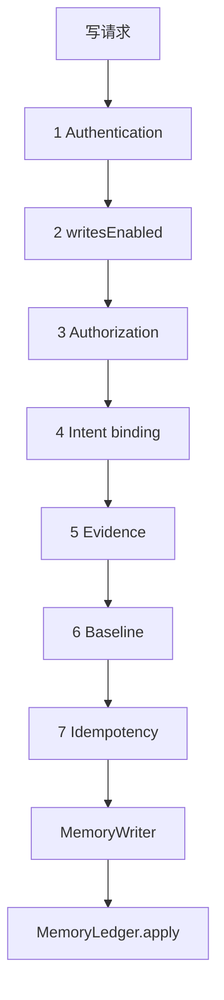

# dsh-memory 阶段 1 设计修订（Rev.8）

- 状态：**设计修订稿，尚未实施**
- 修订对象：[Rev.7](phase1-write-gate-design-rev7.md)；Rev.1–Rev.7 保留不改
- 本轮只处理：`approval-in-progress` 与 `needs-manual` 的矛盾；低质量正文的处理边界
- 不改业务代码、配置或现有文档；不提交；不执行 Step 0；不运行测试
- 标记：**[代码]** 仓库源码；**[契约·未运行]** 只读过 DSH 契约；**[设计]** 本稿决定；**[待确认]** 产品尚未批准；**[待验证]** 尚无运行证据

Rev.7 的六道门禁、`writesEnabled=false`、MemoryWriter 唯一正式写入、Git 账本权威源继续有效。本轮不放宽 `needs-manual`，也不宣称绝对防重复。

---

## 0. 本轮修订摘要

| # | 问题 | Rev.8 处理 |
|---|---|---|
| 1 | Rev.7 把「正在写」和「写到一半中断」都收成 409 | 并发请求仍是 409；恢复程序找不到 change 时进入 `needs-manual` 并停止自动写入，不得只返回 409 后自动重试 |
| 2 | 仅零宽、仅标点是否拒绝，Rev.7 只描述了当前函数行为 | 不把建议写成已批准决策。明确：`normalizeForMatch` 不去零宽字符；是否另外拒绝，列为待确认 |

---

## 1. 门禁顺序（不变）



**[设计]** 任一道失败都不调用 MemoryWriter。认证通过不是写入权限。`writesEnabled=false` 时正式写入继续关闭。持久化保证与写入约束未验证、且 V4/A8 未有结论之前，不开启正式写入。

---

## 2. 并发请求与恢复请求（P0）

Rev.7 的错误表写着：批准处于 `committing` 且当前历史尚无 change 时返回 `409 approval-in-progress`。同一节又写：这种情况进入 `needs-manual`，不退回 `granted`。两句话指向不同请求，不能用同一个 HTTP 结果。

### 2.1 两种请求

| 种类 | 判定 | 行为 |
|---|---|---|
| **并发请求** | 原写入仍在本进程或另一个活进程里执行 | `409 approval-in-progress`。不启动第二次写入，不改批准状态 |
| **恢复请求** | 没有活着的写入者，但批准已是 `committing` | 按第 2.3 节判定。找不到 change 时进入 `needs-manual`，停止自动写入 |

**[设计]** 「仍在执行」只能由活着的写入者证明，不能由 `committing` 本身证明。`committing` 只说明曾经开始写，不说明进程还活着。

活写入者的判定（设计，不是已运行验证）：

- 本进程：该批准的写入 Promise 尚未结束；或
- 账本锁的 `owner.json` 记录的 pid 仍存在，且锁未过 TTL。账本锁已有 pid 与 TTL。**[代码]** `packages/provider-git-ledger/src/lock.js`。本轮没有验证「用它区分活写入者」在崩溃后是否可靠。**[待验证]**

两者都没有：按恢复请求处理，不得返回 `409 approval-in-progress`。

### 2.2 并发请求

1. 第一个请求在 runtime 锁内把 `granted` 改成 `committing`，然后拿账本锁写入。
2. 第二个请求看到 `committing`，且活写入者仍在：返回 **409 `approval-in-progress`**。
3. 不开第二次 `MemoryLedger.apply`，不改批准状态，不自动重试。
4. 调用方若要再试，必须发新请求。新请求仍走完整门禁；若此时已提交，走重放，不再 commit。

### 2.3 恢复判定

没有活写入者时，按这个顺序：

| 条件 | 批准状态 | HTTP |
|---|---|---|
| 工作区脏、Git 不可读、仓库一致性检查失败、同一键多个 change | `needs-manual` | 503 `ledger-dirty` 或 `ledger-history-uncertain` |
| 当前可达历史里找到该 `idempotency_key` | `consumed`，补回执 | 200，`replayed=true` |
| `committing`，工作区干净，当前可达历史找不到该键 | **`needs-manual`** | **503 `ledger-history-uncertain`** |

最后一行是本轮修正：不返回 409，不退回 `granted`，不自动再写，不自动重试。找不到键只说明当前历史里没有，不说明从来没提交过。

人工处理仍只能：指出已有 `change_id` 并标 `consumed`，或标 `revoked` 并要求新批准。不自动 `reset` / `clean`。

### 2.4 状态机

```
granted ──活写入者开始──▶ committing
                         │
                         ├──找到当前可达 change ──▶ consumed
                         └──没有活写入者且找不到 change ──▶ needs-manual
```

并发请求看到 `committing` 且写入者仍活：状态不变，HTTP 409。

### 2.5 不宣称绝对防重复

**[设计]** 查回执和当前可达 change，只能在原提交仍在当前历史里时证明这是重放。历史被重写或移除后，不能排除曾经提交过。系统不得宣称绝对防重复。

runtime 写入丢失时，记录仍可能显示 `granted`。**[设计]** 这不是「没写过」的证据。若当前历史还在，账本拒绝第二次 commit；若历史已不在，则不能。正式写入在这一点有运行证据之前继续关闭。

---

## 3. 低质量正文（P1）

`normalizeForMatch` **[设计]** 仍是：

```
normalizeForMatch(s) =
  s.normalize('NFKC')
   .replace(/\p{White_Space}+/gu, '')
   .toLowerCase()
```

它只去 Unicode `White_Space`。**不去**零宽字符（如 U+200B、U+200C、U+200D、U+2060）。不要把「仅零宽」说成归一化后为空。

当前函数的行为（不是产品决策）：

| 输入 | 归一化后 | 按现有函数会怎样 |
|---|---|---|
| 空或仅空白 | 空 | 422 `empty-content` |
| 仅零宽字符 | **非空** | 不是 `empty-content`。对不上用户消息则 `evidence-not-literal`；对上了则字面匹配通过 |
| 仅标点 | **非空** | 同上。若用户消息里也有这些标点，字面匹配可以通过 |
| 未配对 surrogate | 不归一化 | 422 `invalid-text`，在归一化之前 |

**[待确认]** 下面两件本轮不决定：

1. 是否另外拒绝归一化后仅含零宽字符的正文。
2. 是否允许仅标点正文在字面匹配通过后进入正式账本。

在你确认之前，不把「应该拒绝」写成已批准规则。实现时不得自行加上这两条拒绝，也不得把现有函数的放行说成产品已经同意。

字面匹配通过仍只表示字出现在用户消息里，不表示事实为真。

---

## 4. 统一错误码

| 情形 | 状态 | 错误码 | 谁能返回 |
|---|---|---|---|
| 认不出身份 | 401 | `unauthenticated` | 门禁 |
| 身份不受信 | 403 | `forbidden` | 门禁 |
| 已认证但 `writesEnabled=false` | 503 | `write-gate-not-ready` | 门禁 |
| 无批准 / 无有效 PolicyGrant | 403 | `approval-required` | 门禁 |
| 同 `approval_id`，归一化后意图哈希不同 | 409 | `approval-intent-mismatch` | 门禁 |
| **原写入仍在执行** | 409 | `approval-in-progress` | 并发请求。不启动第二次写入 |
| **`committing` 且没有活写入者，当前历史找不到 change** | 503 | `ledger-history-uncertain` | 恢复请求。批准进入 `needs-manual`。不自动重试 |
| 未配对 surrogate | 422 | `invalid-text` | 在归一化之前 |
| 正文为空或仅空白 | 422 | `empty-content` | 门禁 |
| 正文不在用户消息中 | 422 | `evidence-not-literal` | 门禁 |
| 同事件不同引文或类型 | 422 | `evidence-conflict` | `normalizeSourceRefs` 抛错时。不算哈希 |
| 事件不在 / 类型不符 / 引文哈希不符 | 422 | `evidence-invalid` | 门禁 |
| 缺基线 | 400 | `missing-base` | 门禁 |
| 基线过期 | 409 | `stale` | 门禁 |
| 工作区脏 | 503 | `ledger-dirty` | 恢复；`needs-manual` |
| 历史或仓库一致性无法判定 | 503 | `ledger-history-uncertain` | 恢复；`needs-manual` |

`409 approval-in-progress` 不再用于恢复路径。

---

## 5. 仍然有效、本轮不改的规则

以下来自 Rev.6 / Rev.7，本轮不重写：

- 六道门禁与 `writesEnabled=false`。
- MemoryWriter 是唯一正式写入；Git 账本是权威源。
- 用户批准不能让普通 ADD 跳过证据门禁。attested 模式未获批准。
- `source_refs` 只有一个 `normalizeSourceRefs`。同键引文或类型不同 → 422 `evidence-conflict`，在算哈希之前。
- 未配对 surrogate → 422 `invalid-text`，在 NFKC 之前。
- `repo_root`、`root_commit`、`owner_id` 只是一致性检查，不是仓库绝对唯一身份。本轮不新增 UUID。
- V4/A8 未过前，`allowed-once` 不写成人类批准，`user_confirmed` 不为 true。

---

## 6. V1–V11

本轮没有执行。全部仍为**未执行**。

---

## 7. Rev.7 → Rev.8

| 主题 | Rev.7 | Rev.8 |
|---|---|---|
| `committing` 且找不到 change | 错误表写 409；恢复节写 `needs-manual` | 拆开：活写入者仍在 → 409；没有活写入者 → `needs-manual` + 503 |
| 自动重试 | 未写明 409 是否可重试 | 恢复路径不得因 409 后自动重试 |
| 仅零宽 / 仅标点 | 描述函数行为，容易读成已决定 | 明确列为待确认；不自行加拒绝，也不把放行说成已批准 |
| 零宽字符 | 已写明函数不去除 | 保留，并写明不得声称会移除 |

---

## 8. 仍待确认

1. 是否拒绝归一化后仅含零宽字符的正文。
2. 是否允许仅标点正文通过字面匹配后写入正式账本。
3. 是否持久化仓库 UUID。
4. attested 模式是否允许保存改写内容。
5. 面板弱批准是否保留为未来可选项。
6. 强批准未证明前，是否一律禁止打开 `autoAccept`。
7. Provider 无人类批准时是否只返回 candidate。
8. 人工恢复是否要做成正式工具。

---

## 9. 仍然存在的风险

- 活写入者判定依赖进程内状态或锁文件里的 pid。pid 被复用时，可能把已死的写入误判为仍在执行。这一点未验证。
- 历史被重写后，同一批准仍可能再写一次。本设计不把这种情况说成已防住。
- 仅零宽或仅标点的正文，在产品决策前仍可能因字面匹配进入账本。
- V1–V11 仍未执行。认证与原生审批仍只是契约。

---

## 10. 停止点

未改业务代码、配置或现有文档；未提交；未执行 Step 0；未运行测试。等待审查。
