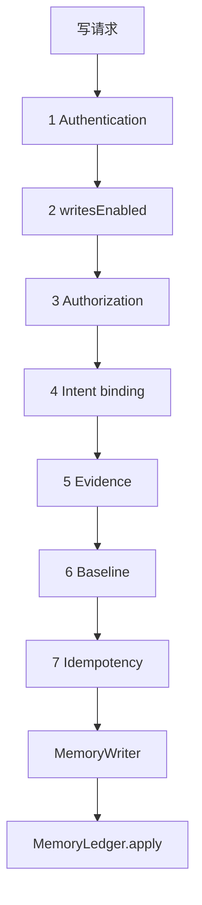

# dsh-memory 阶段 1 设计修订（Rev.9）

- 状态：**设计修订稿，尚未实施**
- 修订对象：[Rev.8](phase1-write-gate-design-rev8.md)；Rev.1–Rev.8 保留不改
- 本轮只处理：并发与恢复的时序窗口、批准状态的持久化、找到 change 后回执或 `consumed` 写失败
- 不改业务代码、配置或现有文档；不提交；不执行 Step 0；不运行测试
- 标记：**[代码]** 仓库源码；**[契约·未运行]** 只读过 DSH 契约；**[设计]** 本稿决定；**[待确认]** 产品尚未批准；**[待验证]** 尚无运行证据

Rev.8 的六道门禁、`writesEnabled=false`、MemoryWriter 唯一正式写入、Git 账本权威源继续有效。进入 `needs-manual` 后不自动退回 `granted`，不自动重试，也不宣称绝对防重复。仅零宽字符、仅标点正文仍是待确认项。

---

## 0. 本轮修订摘要

| # | 问题 | Rev.9 处理 |
|---|---|---|
| 1 | Rev.8 允许「暂时看不到活写入者」就进入 `needs-manual` | 按现有锁的 `mkdir` → `owner.json` 顺序写出时序。这个窗口内不得改状态 |
| 2 | 内存里的状态转换被当成已经落盘 | 五种状态只以 runtime.json 为准；写盘失败则停止，不自动重试 |
| 3 | 已找到 change，但补回执或写 `consumed` 失败时没有规则 | 保持不重复 commit；状态停在可重入的恢复点，下次对账继续补 |

---

## 1. 门禁顺序（不变）

**[设计]** 任一道失败都不调用 MemoryWriter。`writesEnabled=false` 时正式写入继续关闭。V1–V11 未执行，V4/A8 未有结论之前，不开启正式写入。

---

## 2. 并发与恢复时序（P0）

### 2.1 源码事实：锁不是一步完成的

**[代码]** `packages/provider-git-ledger/src/lock.js`：

1. `mkdir(.ledger-lock)` 是排他点（:135）。
2. 成功之后才 `writeFile(owner.json)`（:141）。
3. 目录已在、`owner.json` 还没有或读不出时，记为 `unattributed`（:58–71）。
4. 无主锁只有目录年龄超过 TTL（默认 60 秒）才可回收（:89–97）。读不出年龄时当作仍活着。
5. `isHeld()` 只看目录在不在，不看 `owner.json`（:206–208）。

因此存在窗口：**锁目录已经存在，`owner.json` 尚未建立。** 这时用 pid 判断「没有活写入者」是错的。

### 2.2 请求 A 的时序

**[设计]** 正式写入按这个顺序，不能调换 2 和 3：

| 步 | 动作 | 已持久化什么 |
|---|---|---|
| A0 | 门禁 1–6 通过。内存里还是 `granted` | 无新状态 |
| A1 | runtime 锁内：把 `granted` 写成 `committing`，并 `fsync` 后 `rename`。写盘失败则抛错，状态保持 `granted` | `committing` 在 runtime.json |
| A2 | 调用 `RepoLock.acquire()`。内部先 `mkdir` | 锁目录可能已在，`owner.json` 可能还没有 |
| A3 | `owner.json` 写完，`acquire()` 返回 | 锁有 pid、token、`expires_at` |
| A4 | 锁内再查回执和已提交 change。已有则 `replayed`，不 commit | 无新 commit |
| A5 | 写 records / changes，`git commit` | change 在 Git 里；回执还没有 |
| A6 | 写 `applied/` 回执 | 回执在，不进 Git |
| A7 | runtime 锁内把 `committing` 写成 `consumed`。写盘失败见第 4 节 | `consumed` 在 runtime.json |
| A8 | `release()` 删锁目录 | 锁消失 |

内存里把变量改成 `committing` 不算 A1 完成。A1 的 `rename` 返回之前，对外仍是 `granted`。

### 2.3 请求 B 在每个时点

| B 到达时 | 看到什么 | 行为 |
|---|---|---|
| A0 之前或 A1 写盘前 | `granted` | 与 A 竞争。runtime 锁内只有一个能完成 A1 |
| A1 已落盘，A2 的 `mkdir` 尚未成功 | `committing`，锁目录不存在 | **不得**改成 `needs-manual`。返回 `409 approval-in-progress` |
| A2 已 `mkdir`，`owner.json` 尚未写完 | `committing`，锁目录在、所有者未知 | **不得**改成 `needs-manual`。返回 `409 approval-in-progress`。这就是本轮要堵住的窗口 |
| A3–A7，锁仍被 A 持有 | `committing`，`owner.json` 的 pid 仍活着且未过 TTL | `409 approval-in-progress`。不启动第二次写入 |
| A8 之后，change 已在当前历史 | `consumed`，或仍是 `committing` 但 Git 里有该键 | `200 replayed`。不 commit |
| A 进程已死，且下面第 2.4 节的「可以判定已死」全部成立，当前历史没有该键 | `committing` | 恢复程序进入 `needs-manual`，503 `ledger-history-uncertain`。不自动再写 |

并发请求本身不把 `committing` 改成 `needs-manual`。只有没有活写入者的恢复程序可以，而且必须满足第 2.4 节。

### 2.4 什么时候才允许进入 `needs-manual`

**[设计]** 全部成立才可以。缺任何一条，都返回 `409 approval-in-progress` 或 `503 ledger-history-uncertain`，并且**不改批准状态**：

1. runtime.json 里该批准已经是持久化的 `committing`，不是内存中的过渡值。
2. 本进程没有未结束的该批准写入。
3. 锁目录不存在，**或者**锁已有 `owner.json` 且同时满足：pid 不存在，并且 `expires_at` 已过。
4. 只看到锁目录、没有可读的 `owner.json`：目录年龄必须已经超过 TTL。未超过则当作仍在 A2 窗口，返回 409，不改状态。读不出年龄也当作仍活着。这与现有 `isStale` 一致。**[代码]** `lock.js:89-97`。
5. 工作区干净。脏则 503 `ledger-dirty`，状态改为 `needs-manual` 只在第 3 条也成立时进行；否则只返回 503，不改状态。
6. 当前可达历史中找不到该 `idempotency_key`。找到了则走第 4 节，不进入 `needs-manual`。

「暂时没有发现活写入者」本身不够。A1 刚落盘、A2 还没 `mkdir`，以及 `mkdir` 已完成、`owner.json` 还没写完，都是暂时看不到活写入者。

用 pid 和 TTL 区分活写入者是否在崩溃、pid 复用、时钟回拨下可靠，**[待验证]**。未验证前，正式写入继续关闭。

---

## 3. 状态放在哪里（P0）

**[设计]** 批准状态只有一份持久副本：`~/.dsh/dsh-memory/runtime/runtime.json` 里该批准的 `status` 字段。进程内存里的对象是读缓存，不是权威。

| 状态 | 持久位置 | 重启后 |
|---|---|---|
| `granted` | runtime.json | 仍是 `granted`。还没开始写 |
| `committing` | runtime.json，加上 `pre_head`、`repo_root`、`root_commit`、`owner_id` | 不信任内存。按第 2.4 节重新判定 |
| `consumed` | runtime.json，加上 `change_id` 与 commit | 仍是 `consumed`。请求按重放返回 |
| `needs-manual` | runtime.json | 保持。不自动退回 `granted`，不自动重试 |
| `revoked` | runtime.json | 保持。要再写必须新批准 |

Git 里的 change 和 `applied/` 回执不是批准状态。它们只用来对照 `committing` 是否已经有对应提交。

**[设计]** 每一次状态变化都要等 runtime 的临时文件 `rename` 成功才算完成。`rename` 抛错、进程在 `rename` 前死亡、或读回的 JSON 不是刚写的状态，都算持久化失败。

持久化失败时：

- 不把内存里的新状态当成已保存。
- 不自动重试写入账本。
- 返回 `503 approval-state-unpersisted`。
- 若失败发生在 A1：磁盘上仍是 `granted`，没有 commit。
- 若失败发生在 A7：按第 4 节，磁盘上可能仍是 `committing`，但 Git 里已经有 change。下次只补状态，不再 commit。

runtime.json 的 `rename` 是否在崩溃和掉电后仍原子，**[待验证]**。现有实现会写临时文件再 `rename`。**[代码]** `runtime-store.js:163-172`。这还没有在本设计的崩溃点上验证。

---

## 4. 已找到 change，但回执或 `consumed` 写失败（P1）

**[设计]** 当前可达历史里已经有该 `idempotency_key` 的 change 时，禁止再 `git commit`。

| 失败点 | 磁盘上的批准状态 | 返回 | 下次 |
|---|---|---|---|
| change 已在 Git，回执写入失败 | 保持 `committing` | `503 receipt-unpersisted` | 对账再写回执，再写 `consumed`。不 commit |
| 回执已在，`consumed` 写入失败 | 保持 `committing` | `503 approval-state-unpersisted` | 对账看到回执或 change，只补 `consumed`。不 commit |
| 两者都已在 | `consumed` | `200 replayed=true` | 无操作 |

不得因为回执缺失或 `consumed` 没写上，就再执行一次 `MemoryLedger.apply`。

对账本身可重复执行：已经 `consumed` 的不改；回执已在的不重写；`needs-manual` 和 `revoked` 保持。

---

## 5. 统一错误码（只改本轮相关行）

| 情形 | 状态 | 错误码 | 是否改批准 |
|---|---|---|---|
| 原写入仍可能在进行，含锁目录尚无 `owner.json` 且未过 TTL | 409 | `approval-in-progress` | 否 |
| 已证明没有活写入者，当前历史没有该 change | 503 | `ledger-history-uncertain` | 改为 `needs-manual` |
| 状态写盘失败 | 503 | `approval-state-unpersisted` | 以磁盘为准，不用内存覆盖 |
| change 已在，回执写失败 | 503 | `receipt-unpersisted` | 保持 `committing` |
| 当前历史已有该 change | 200 | `replayed=true` | 能写上才标 `consumed` |

其余错误码与 Rev.8 相同。

---

## 6. 本轮不改的规则

- 六道门禁、`writesEnabled=false`、MemoryWriter 唯一正式写入、Git 账本权威源。
- `needs-manual` 不自动退回 `granted`，不自动重试，不自动 `reset` / `clean`。
- 不宣称绝对防重复。历史被重写后，不能排除曾经提交过。
- 仅零宽字符、仅标点正文是否拒绝，仍是待确认。`normalizeForMatch` 不去除零宽字符。
- `repo_root`、`root_commit`、`owner_id` 只是一致性检查。本轮不新增仓库 UUID。
- 用户批准不能跳过 ADD 证据门禁。attested 模式未获批准。
- V4/A8 未过前，`allowed-once` 不写成人类批准，`user_confirmed` 不为 true。

---

## 7. V1–V11

本轮没有执行。全部仍为**未执行**。

另有本轮提出、同样未执行的验证：

- 锁目录已创建、`owner.json` 尚未写完时，第二个请求是否会把批准改成 `needs-manual`。
- runtime `rename` 在进程被杀时，读回的状态是否一定是旧状态或新状态，而不是半截文件。
- change 已提交、回执写入失败后，再次请求是否还会 commit。

---

## 8. Rev.8 → Rev.9

| 主题 | Rev.8 | Rev.9 |
|---|---|---|
| 没有活写入者 | `committing` 且找不到 change 就进入 `needs-manual` | 必须先排除锁目录尚无 `owner.json` 的窗口；暂时看不到不算 |
| 时序 | 只写了「活着或已死」 | 按 A0–A8 与现有 `mkdir` → `owner.json` 顺序列出 B 的行为 |
| 状态存放 | 写了 runtime.json，但没写失败语义 | 五种状态只以落盘为准；写盘失败返回 503，不自动重试 |
| 回执或 `consumed` 失败 | 未单列 | 已有 change 时不再 commit；下次对账只补回执和状态 |

---

## 9. 仍待确认与风险

待确认项与 Rev.8 相同，本轮不决定：仅零宽、仅标点、仓库 UUID、attested 模式、面板弱批准、未证明强批准前是否禁止打开 `autoAccept`、Provider 无人类批准时的行为、人工恢复是否做成正式工具。

风险：

- pid 被复用时，仍可能把死写入者看成活的。未验证。
- 锁 TTL 内的无主目录会让恢复停在 409，直到超时。这是有意的，避免误进 `needs-manual`。
- 历史被重写后仍不能排除曾经提交。不宣称绝对防重复。
- V1–V11 以及第 7 节新增的三项都未执行。

---

## 10. 停止点

未改业务代码、配置或现有文档；未提交；未执行 Step 0；未运行测试。等待审查。
