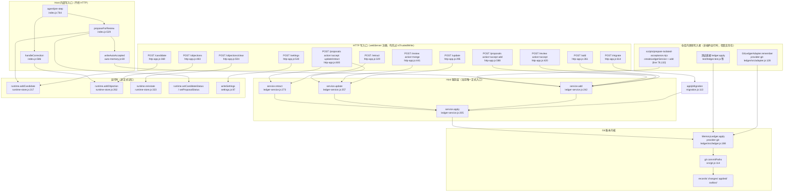
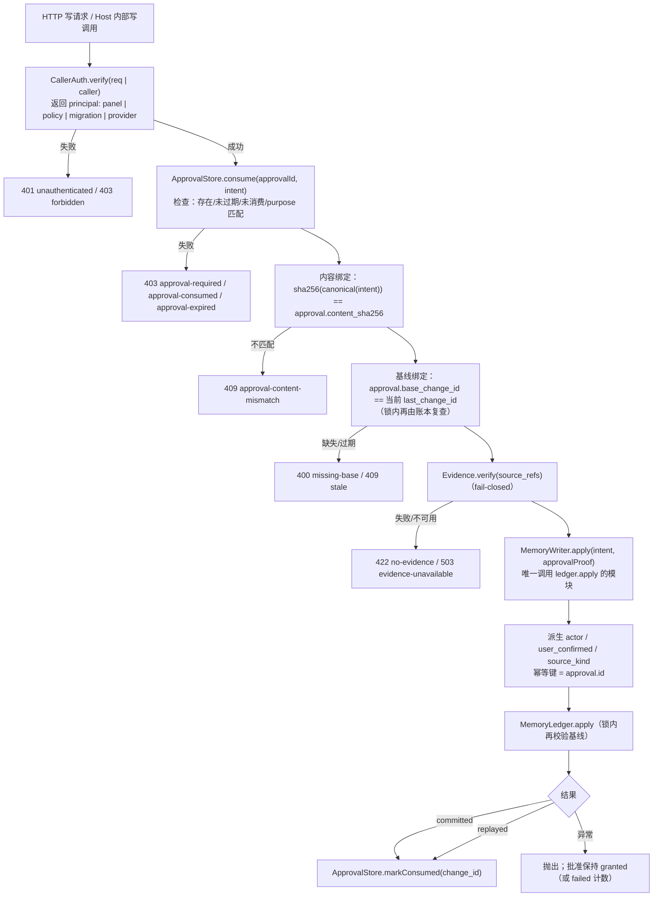

# dsh-memory 阶段 1 设计评审：安全写入边界

- 状态：**设计评审稿，尚未实施**
- 依据：[阶段 0 只读审计](../../status/phase0-readonly-audit.md)（HEAD `1e49b42`，414 项测试全绿）
- 本阶段范围：**只处理正式记忆（Git 账本）的写入安全边界**；不修改业务代码、配置或现有文档（本文件为新增）
- 约束（来自用户，作为本设计的硬约束）：
  1. 正式记忆以 Git 账本为唯一权威来源。
  2. MemoryWriter 是唯一正式记忆写入路径；ContextBuilder 只读。
  3. AI 可以提出记忆变更，但不能自行批准并直接写入正式记忆。
  4. 候选、提案、异议与正式记忆必须区分。
  5. 不引入 Memory RAG、向量库或与当前阶段无关的重构。
- 不在此阶段处理（避免范围蔓延）：localStorage 双权威（P1-3）、workspace 隔离（P2-8）、纠错 kind（P1-1）、异议 fail-open（P1-4）、文档全量同步（P2-9）。它们已记录在审计报告中，阶段 1 只保证**新的写入边界不会让它们更难修**。

> 证据标注约定：
> - **[代码]**：直接从当前源码读出，附文件:行。
> - **[测试]**：由现有测试断言确认，附测试文件:行。
> - **[文档]**：仅文档声明，代码未证实。
> - **[待验证]**：仓库内无法确认，列入第 7 节验证步骤，不作为已确认事实。

---

## 0. 结论摘要

1. 当前「正式写入」在实现上只有一个 Git 写入器 `MemoryLedger.apply()` **[代码]**，但它有 **6 个 HTTP 入口 + 2 个 Host 内部入口 + 1 个未挂载的 Provider 入口 + 1 个验收脚本入口**；「门禁」并不统一：认证只有回环围栏，用户批准不存在，证据校验是条件式的，基线多数可选，幂等只在部分路径存在。
2. 最关键的概念错误是：`ledger-service.apply()` 把 `actor:'user'` 与 `user_confirmed:true` **无条件写死** **[代码]**，于是系统在没有用户批准的情况下也会生成「用户已确认」的审计记录。这不能靠「让调用方传一个布尔值」修，必须由门禁**自己证明**批准，而不是**相信**批准。
3. 本设计把安全拆成**两个正交概念**：
   - **CallerAuth（调用者认证）**：证明请求来自受信任的 UI 通道，而不是任意本机进程/agent shell；
   - **UserApproval（用户批准）**：一个**一次性、短时、绑定具体变更内容与基线**的批准记录，由 Host 在认证通道内签发，MemoryWriter 消费后写账本。
   两者都通过，才允许 `MemoryLedger.apply()`。
4. 设计新增一个 `MemoryWriter` 模块，作为阶段 1 之后**唯一**允许调用 `ledger.apply()` 的 Host 模块；`host/ledger-service.js` 的 `add/update/retract/apply` 全部降级为 `MemoryWriter` 的薄封装；`GitLedgerAdapter.remember` 与验收脚本要么走同一个 Writer（带各自的 PolicyApproval），要么显式拒绝。
5. 批准与内容绑定用**规范化 JSON 的 SHA-256**（content + type + scope + tags + entities + source_refs + target/base），杜绝「先批准 A、再提交 B」；基线与幂等由批准记录携带，并在 Writer 内再次校验。
6. 最小改动分 6 步（M1–M6），M1 就能消除审计报告中的 P0；M2–M4 消除主要绕过；M5–M6 收口 Provider 与客户端。回归矩阵覆盖用户点名的 9 类场景。

---

## 1. A. 所有正式记忆写入入口的调用图（依据真实代码）

### 1.1 总图



### 1.2 入口清单（逐条对应代码）

| # | 入口 | 实际调用链（代码） | 是否写正式记忆 | 备注 |
|---|---|---|---|---|
| 1 | `POST /api/dsh-memory/add` | `http-app.js:279 service.add` → `ledger-service.js:242 add` → `:205 apply` → `ledger.js:198 apply` | 是 | 接受调用方自带 `sourceRef`（`:269`），或 `sessionId+turn` 解析（`:270-277`） |
| 2 | `POST /update` | `:304 service.update` → `:257` → `:205` → `ledger.apply` | 是 | `expectedBaseChangeId` 省略时传 `null`（`:307`） |
| 3 | `POST /retract` | `:336 service.retract` → `:273` → `:205` → `ledger.apply` | 是 | 同样可省略基线（`:338`） |
| 4 | `POST /review` `action=accept` | `:430 service.add`，`idempotencyKey: candidate:<id>`（`:435`） | 是 | `content` 可被请求体覆盖（`:421`） |
| 5 | `POST /review` `action=merge` | `:445 service.update` | 是 | `targetId` 与 `content` 都来自请求体；基线可省略（`:448`） |
| 6 | `POST /proposals` `accept` + `action=add` | `:589 service.add`，`idempotencyKey: proposal:<id>`（`:593`） | 是 | 内容来自 runtime 里的 proposal，不是请求体 |
| 7 | `POST /proposals` `accept` + `update`/`retract` | `:601/:602 service.update/retract` | 是 | 强制 `expectedBaseChangeId`（`:596`） |
| 8 | `POST /migrate` | `:623 planMemoryMigration` → `:631 applyMigration` → `migration.js:117 service.apply` | 是（逐条 ADD） | 证据来自 `evidence.resolve`；无 `sessionQuery` 时 `resolve` 返回 `undefined`（`:627-629`） |
| 9 | `POST /settings` | `:544 writeSettings` | **否**（但可打开 `autoAccept`，间接让入口 10 生效） | 安全相关：改变后续写入策略 |
| 10 | `agent/pre-step` → 自动接受 | `index.js:529 proposeForReview` → `:564 decideAutoMemory` → `:570 writeAutoAccepted` → `auto-memory.js:73 service.add` | 是（当 `enabled && autoAccept`） | 无 HTTP、无用户逐条批准 |
| 11 | `POST /candidate` | `:385 runtime.addCandidate` | 否 | 候选只进 runtime |
| 12 | `POST /objections`、`/objections/clear` | `:493 runtime.addObjection`、`:510 runtime.reinstate` | 否 | 异议只进 runtime |
| 13 | `GitLedgerAdapter.remember` | `adapter.js:141 proposalFromRemember` → `:151 ledger.apply` | 是（若被挂载） | **不经过** Host 的 `service.apply`，因此不经过 EvidenceError 拒绝（`ledger.js:243-244` 只记录不拒绝） |
| 14 | `scripts/prepare-isolated-acceptance.mjs` | `:78/:132 createLedgerService` → `service.add` | 是（夹具） | 无 `verifyEvidence`，证据校验为空 |
| 15 | 测试直接 `ledger.apply` | `test/ledger.test.js:17` 等 | 是（测试） | 内核级测试，不属于运行时入口 |

**结论 [代码]**：`MemoryLedger.apply()` 仍是唯一 Git 写入器；但「正式记忆写入入口」有 15 条，其中 8 条生产 HTTP、2 条 Host 内部、3 条仓库内旁路（脚本/adapter/测试）、2 条 runtime 非正式写入。**没有任何一处统一门禁**。

---

## 2. B. 每个入口的认证 / 批准 / 证据 / 基线 / 幂等现状

### 2.1 认证现状

- 所有 HTTP 写路由第一行都是 `if (!isTrustedWrite(req)) 403` **[代码]**，而 `isTrustedWrite = isTrustedRead`（`http-app.js:78`）：只检查回环 socket、回环 Host、非 `cross-site`、可选 Origin 同源。
- **没有任何调用者身份**：没有 token、cookie 校验、session、principal **[代码]**。
- 现有测试明确验证「无 Origin、无 Sec-Fetch-Site 的裸请求可以写入成功」**[测试]**：`test/http-app.test.mjs:72-98`。
- 文档承认插件路由绕过 DSH 认证层 **[文档]**：`docs/status/dsh-memory-v2-status.md:14`。

### 2.2 逐入口矩阵

| 入口 | 调用者认证 | 用户批准证明 | 证据校验 | 基线校验 | 幂等 | 现状缺口 |
|---|---|---|---|---|---|---|
| `/add` | 仅回环围栏 | **无** | 有 resolver 时校验；`sourceRef` 自带时只验存在/类型；无 resolver 时跳过 | 不适用（ADD） | 调用方可传任意 key；不传则随机 | 可伪造内容→真实事件；无批准；无认证 |
| `/update` | 仅回环围栏 | **无** | **无**（`sourceRefs` 不传） | 可选（`null` 放行） | **无**（每次新 `newChangeId`） | 可无基线改写任意正文；重试产生重复版本 |
| `/retract` | 仅回环围栏 | **无** | **无** | 可选（`null` 放行） | **无** | 可无基线撤回 |
| `/review accept` | 仅回环围栏 | **请求即批准**（无证明） | 校验 candidate 的 `source_refs` | 不适用 | `candidate:<id>` | 无批准证明；`content` 可被请求体改写（批准的不是候选原文） |
| `/review merge` | 仅回环围栏 | **请求即批准** | **无** | 可选 | **无** | 改写目标正文 |
| `/proposals accept add` | 仅回环围栏 | **请求即批准** | 校验 proposal 的 `source_refs` | 不适用 | `proposal:<id>` | 无批准证明 |
| `/proposals accept update/retract` | 仅回环围栏 | **请求即批准** | **无** | **强制**（好） | `proposal:<id>` | 无批准证明；AI 提案内容被用户「一键接受」即写 |
| `/migrate` | 仅回环围栏 | **无** | 逐条 `resolve`，失败跳过 | 不适用 | 每条 `migrate:<id>@<version>` | 批量写入无批准；无 resolver 时全部跳过（fail-safe） |
| 自动接受 | 无（进程内） | **策略**（settings） | 候选创建时已解析 refs；写入时 `service.apply` 重验（若有 resolver） | 不适用 | `auto:<id>` | 无用户逐条批准（设计允许），但被记成 `user_confirmed:true` |
| `Adapter.remember` | 无（库调用） | 无 | **无拒绝**（只记录） | 由 proposal 携带 | 由调用方 proposal 携带 | 第二条语义更弱的写入口 |
| 验收脚本 | 无 | 无 | **无**（未传 verifier） | 不适用 | 脚本可带 | 夹具旁路；若被误用于生产则绕过一切 |
| `/settings` | 仅回环围栏 | **无** | 不适用 | 不适用 | 无 | 可被用来打开 `autoAccept`，从而让自动写入生效 |

### 2.3 关键绕过路径（代码可证）

1. **未认证直写**：任意本机进程 `POST /update {memoryId,content}`（省略 baseline）即可改正式记忆 **[代码]**。
2. **伪造证据归属**：`POST /add {content, sourceRef:{session_id,event_seq}}`；有 resolver 时只验事件存在/类型，不验正文 **[代码]**。结合 1 可把任意正文挂到真实事件。
3. **批准字段伪造**：当前调用方传 `actor:'user'`、`user_confirmed:true` 会被 `ledger-service.js:207` 覆盖，**伪造无效**；但系统自己无条件写死这两个字段，等于**伪造批准**。这是本阶段要修的核心。
4. **无基线覆盖**：`/update`、`/retract`、`/review merge` 省略 `expectedBaseChangeId` 即放行（`ledger-service.js:268/279` → `ledger.js:252`）。
5. **重试放大**：`/update`、`/retract` 不传幂等键，`apply()` 每次生成新 `newChangeId()`（`ledger-service.js:223-225`），同一请求重试会写两条变更。
6. **策略升级**：`POST /settings {autoAccept:true}` 打开自动写入，之后用户消息中的规则命中句会被 `writeAutoAccepted` 自动写账本 **[代码]**。
7. **Adapter 旁路**：挂载 `provider-git-ledger` 后，`remember` 直接 `ledger.apply`，不经过 Host 的 EvidenceError 拒绝 **[代码]**。
8. **脚本旁路**：`scripts/prepare-isolated-acceptance.mjs` 使用无 verifier 的 service **[代码]**；不是生产进程，但说明「无 verifier 也能写」是仓库内被允许的。
9. **测试旁路**：`ledger.apply` 被 15+ 处测试直接调用；这是内核测试，不构成运行时漏洞，但意味着**不能靠「删除 apply 导出」来强制门禁**，必须靠模块边界 + 一致性测试。

### 2.4 证据文件位置

| 证据 | 位置 |
|---|---|
| `source_refs` 生成（candidate） | `host/session-evidence.js:107 resolve`（附 `quote_sha256`，`:83 withQuote`） |
| `source_refs` 校验 | `host/session-evidence.js:134 verify` |
| 校验结果写入 | `provider-git-ledger/src/ledger.js:243-244` → `change.evidence_verification` |
| 当前拒绝点 | `host/ledger-service.js:212-220`（**仅 Host service，条件式**） |
| Adapter 的证据 hook | `provider-git-ledger/src/adapter.js:34, 128-151` |
| 变更说明中的「已核验」文案 | `provider-git-ledger/src/ledger.js:503-504` |

---

## 3. C. 统一写入门禁设计

### 3.1 信任模型（必须先说清楚）

在单用户本机环境中，以下三条**不能**被当作安全边界：

- 回环 socket（任何本机进程都能连）；
- `Origin` / `Sec-Fetch-Site`（本机进程可任意伪造 header）；
- 调用方自己提交的 `actor` / `user_confirmed` / `approval` 字段（不可信输入）。

因此本设计区分：

| 概念 | 要回答的问题 | 可信来源 | 失败语义 |
|---|---|---|---|
| **CallerAuth** | 这个请求是不是来自受信任的 UI 通道？ | DSH 会话/启动注入的 capability（[待验证]），或 DSH 提供的请求身份 | 401/403，拒绝 |
| **UserApproval** | 用户是否为**这一次具体变更**点过确认？ | Host 在认证通道内签发的一次性批准记录（或 DSH 原生审批） | 403 `approval-required`，拒绝 |
| **PolicyApproval** | 是否是用户已明确启用的**长期策略**（autoAccept / 迁移）？ | 由 Host 根据签名过的设置快照生成，不由调用方提交 | 403，拒绝 |
| **Evidence** | 正文是否有可核验的会话证据？ | `session-evidence.verify`（fail-closed） | 422，拒绝 |
| **Baseline** | 是否基于用户看到的版本？ | 账本内 `last_change_id`（锁内校验） | 409 `stale` |
| **Idempotency** | 同一批准是否被重复提交？ | 账本回执 + 批准状态机 | 返回既有结果，不二次提交 |

**原则**：门禁只**验证**证明，不**相信**声明；账本里的 `actor`/`user_confirmed` 由门禁从证明派生，绝不来自请求体。

### 3.2 组件与数据流



### 3.3 批准记录（ApprovalRecord）

存放在 `runtime.json`（与候选/提案/异议同一权威运行时库），**不写 Git**（它不是记忆，且需要频繁写）：

```
ApprovalRecord {
  approval_id:   "AP-<timestamp>-<random>",   // 也是幂等键
  purpose:       "memory.add" | "memory.update" | "memory.retract"
               | "candidate.accept" | "proposal.accept" | "migration.apply"
               | "settings.update",
  target: {
    memory_id?:        string,
    base_change_id?:   string,     // UPDATE/RETRACT 必填
    candidate_id?:     string,
    proposal_id?:      string,
    migration_plan?:   string      // sha256(plan)
  },
  content_sha256: string,          // 见 3.4
  evidence_sha256: string,         // sha256(canonical(source_refs))
  granted_at:    ISO,
  expires_at:    ISO,               // 默认 10 分钟
  status:        "granted" | "consuming" | "consumed" | "failed" | "revoked",
  consumed_by:   { change_id?: string, commit?: string } | null,
  result?:       object | null,     // 幂等重放返回
  audit:         { principal: "panel", request_id, user_agent? }
}
```

**签发（mint）规则**：
- 只能由 `POST /api/dsh-memory/approvals` 在 **CallerAuth 通过**后签发；请求体只允许 `purpose + target + 待绑定内容`，Host 自己算哈希并落盘。
- 若 DSH 提供原生用户审批（[待验证]），则 `approvals` 端点内部调用它；用户点「允许」后才返回 `approval_id`。
- 没有 DSH 原生审批时，`approvals` 端点本身就是「认证通道 + 页面用户手势」；**它不能防御能读取页面 capability 的本机进程**，这是残余风险（3.9），不是可忽略项。
- 用户批准必须**绑定具体变更**：`content_sha256` 覆盖正文、类型、scope、tags、entities、source_refs、target/base；UI 在展示「将写入的内容」后签发，Gate 在写入前重算并比对。

### 3.4 内容绑定（防「批准 A 写 B」）

规范化哈希输入（键排序、UTF-8、无空格差异）：

```
canonical_intent = {
  change_type, content, type, scope, tags, entities,
  source_refs, target_memory_id, expected_base_change_id
}
content_sha256 = sha256(JSON.stringify(sortKeys(canonical_intent)))
```

- `/review accept` 的 `content` 若允许编辑，批准必须针对**编辑后的内容**签发；不能先按 `candidate.text` 批准、再接受 `body.content`。
- `/proposals accept` 的内容取自 runtime proposal；批准时把 proposal 的当前内容哈希写入，接受时若 proposal 已被修改则拒绝（409）。
- `/migrate` 的批准绑定 `migration_plan` 哈希（所有将写入条目的 content+refs 的 Merkle/串联哈希），逐条消费；计划变化即失效。

### 3.5 基线（防过期覆盖）

- UPDATE / RETRACT / MERGE 的批准记录**必须**包含 `base_change_id`；缺失 → `400 missing-base`（不再接受 `null`）。
- Gate 先读取当前 `last_change_id` 做一次比对（快速失败），但**权威检查仍在 `MemoryLedger.apply` 锁内**（`ledger.js:252-266`），避免 TOCTOU。
- 基线不匹配 → `409 stale`，批准保持 `granted`（用户可刷新后重试）或按策略 `revoked`。
- ADD 无基线；用 `content_sha256 + approval_id` 保证同一批准只写一次。

### 3.6 幂等（防重复提交）

- **幂等键 = `approval_id`**，由 Host 生成；**禁止**客户端自带 `idempotencyKey`（`/add` 当前的 `body.idempotencyKey` 要移除或仅允许测试注入）。
- 同一 `approval_id` 第二次请求：
  - 批准 `consumed` 且有 `result` → 直接返回同一 `{status, change_id, memory}`（HTTP 200，带 `replayed:true`）；
  - 批准 `consuming` → 409 `approval-in-progress`（或短暂等待）；
  - 批准 `granted` 但账本已有回执 → 视为成功，回填 `consumed`。
- 账本侧 `receiptFor(idempotency_key)` 已实现 **[代码]**（`ledger.js:163-165, 238-241`），门禁只需保证键稳定。
- 崩溃恢复：启动时扫描 `status='consuming'` 的批准，用 `ledger.receiptFor(approval_id)` 判定：
  - 有回执 → `consumed`；
  - 无回执且无对应 change → 回退 `granted`；
  - 无回执但 change 已存在（阶段 0 P2-3 窗口）→ 需要账本把 `idempotency_key` 写进 `changes/*.json`（见 M4），否则无法自动判定，只能标记 `failed` 并报警。
- `auto:` 与 `candidate:` 两套键的重复写入问题（阶段 0 P2-4）：统一改为 `approval_id`；auto 路径的批准由策略签发，仍是一次性 ID。

### 3.7 `actor` / `user_confirmed` / `source_kind` 的派生

| 批准类型 | actor | user_confirmed | source_kind |
|---|---|---|---|
| 面板用户批准（panel） | `user` | `true` | 按动作：`user-explicit` / `user-correction` |
| 自动接受（policy） | `system` | `false` | `session-extraction` |
| 迁移（migration） | `system` | `false`（或 `true` 仅当用户逐条确认；默认 false） | 原 legacy 值或 `session-extraction` |
| Provider（provider-policy） | `system` | `false` | `agent-inference`（且只能是 `hypothesis`） |

- **禁止**请求体携带 `actor`/`user_confirmed`；`MemoryWriter` 在写入前删除这两个字段并以证明覆盖。
- `change.evidence_verification` 继续记录证据结果；新增 `change.approval = {kind, id, content_sha256, base_change_id, at}`，使审计能回答「谁批准的、批准的是哪一版内容」。
- `renderChangeNote` 的文案必须按 `approval.kind` 区分「用户确认」「策略自动」「迁移导入」，不再对空证据写「已核验」。

### 3.8 内部写入如何走同一门禁

| 内部入口 | 做法 |
|---|---|
| `writeAutoAccepted` | 生成 `PolicyApproval`：`{kind:'policy', policy:'auto-accept', settings_sha256, candidate_id, content_sha256, evidence_sha256}`；`MemoryWriter` 校验当前设置哈希与策略版本一致（设置被改则批准失效）。不再走 `service.add` 的「无条件 user」路径。 |
| `applyMigration` | 由 `/migrate` 在 CallerAuth 通过后签发 `migration` 批准（绑定 plan 哈希）；逐条消费。脚本路径必须显式 `allowUnverified:true` 且只在 `--dry-run`/测试数据目录可用。 |
| `GitLedgerAdapter.remember` | 两种选择：<br>(a) Provider 内部构造 `provider-policy` 批准，并要求 `verifyEvidence` 返回 true，否则拒绝；<br>(b) 若 Provider 无法提供可信证据，则 `remember` 直接返回 `candidate` 回执（现状的 no-evidence 行为），**不再**在未验证时提交。<br>禁止绕过 `MemoryWriter` 直接 `ledger.apply`。 |
| 测试直接 `ledger.apply` | 保留为内核测试；新增「一致性测试」扫描 `packages/dsh-memory` 内除 `memory-writer.js` 外不得出现 `.apply(` 调用（静态断言），把模块边界变成可测约束。 |

### 3.9 残余风险（必须写进文档，不能假装解决）

1. **同一 OS 用户下的进程隔离是弱的**：如果 CallerAuth 的凭据以文件形式落盘（0600），同用户进程（含 agent shell）仍可读取；因此凭据**只应存在于 Host 内存 + 页面启动注入**，不落盘。即便如此，能读取浏览器内存/调试端口的本机进程仍可冒充页面。
2. **没有 DSH 原生审批时，无法证明「人类在场」**：认证通道 + 页面手势只能证明「请求来自页面」，不能证明「用户本人点击」。若 threat model 包含「agent 有 shell 且能偷页面凭据」，则必须依赖 DSH 原生审批或 OS 级确认；本设计把 `approvalVerifier` 做成可注入接口，默认拒绝，等待 DSH 能力确认。
3. **自动接受是用户授权的长期策略**，不是逐条批准；其安全性依赖「设置变更也必须认证+确认」。若攻击者能改设置，等于获得长期写入权，因此 `/settings` 必须与正式写入同级防护。
4. 证据语义仍是「事件存在 + 类型 + 可选引文哈希」，不是「正文被该事件蕴含」；本阶段只保证「没有证据不写、证据不可验证不写」，不承诺语义正确。

---

## 4. D. 代码 / 测试 / 文档的改动边界

### 4.1 新增代码模块（不写实现，只定接口）

| 模块 | 职责 | 关键接口（伪代码） |
|---|---|---|
| `host/caller-auth.js` | 请求→principal；默认拒绝 | `createCallerAuth({ mode, secret, now })` → `{ verify(req): {ok, principal, request_id} \| {ok:false, reason} }` |
| `host/approvals.js` | 批准记录状态机 + 内容哈希 + 过期 | `createApprovalStore({root, now})` → `mint(intent, principal)`, `consume(id, intent)`, `markConsumed(id, result)`, `markFailed(id)`, `reconcile(ledger)` |
| `host/memory-writer.js` | **唯一**调用 `ledger.apply` 的 Host 模块；执行完整门禁 | `createMemoryWriter({ledger, approvals, evidence, callerAuth, now})` → `apply({intent, approvalId, caller})` |
| `host/write-errors.js`（可选） | 统一错误码 | `unauthenticated | forbidden | approval-required | approval-consumed | approval-content-mismatch | missing-base | stale | no-evidence | evidence-unavailable | busy` |

### 4.2 需要修改的现有代码

| 文件 | 改动 | 依赖 |
|---|---|---|
| `host/http-app.js` | 每个写路由改为 `callerAuth.verify` + `writer.apply`；移除仅 `isTrustedWrite`；`/add` 禁止客户端 `idempotencyKey`、只接受 `sessionId+turn` 或带 `quote_sha256` 的 ref；`/update`/`/retract` 强制基线；`/review`、`/proposals` 要求 `approvalId`；`/settings` 改 `autoAccept` 时要求批准；`/migrate` 要求 plan 批准；新增 `POST /approvals` | M1、M2 |
| `host/ledger-service.js` | `apply/add/update/retract` 降级为内部 API，必须收 `approvalProof`；删除无条件 `actor:'user', user_confirmed:true`；`verifyEvidence` 缺失时拒绝而非跳过；`toApiError` 增加新错误码 | M2、M3 |
| `host/auto-memory.js` | `writeAutoAccepted` 构造 `PolicyApproval`；`service.add` 改 `writer.apply`；失败不再静默 | M2 |
| `host/migration.js` | `applyMigration(service, plan, approval)`；逐条消费；`plan` 哈希 | M2 |
| `index.js` | 初始化 `callerAuth` / `approvals` / `writer`；`createMemoryApp` 注入；`proposeForReview` 传 policy 批准；`sessionQuery` 加入 `inject`（或缺失时启动日志 + 写路由 503） | M1、M2 |
| `client.js` | `createHostClient` 增加认证头与 `approvalId` 流程；错误码展示；**不在本阶段**改 localStorage 主路径 | M6 |
| `provider-git-ledger/src/schema.js` | `validateProposal` 接受可选 `approval` 对象；`validateMemory` 不丢失审批字段（如需要） | M4 |
| `provider-git-ledger/src/ledger.js` | change 文件写入 `idempotency_key` 与 `approval`；回执/outbox 顺序修正（intent 记录）；`requireVerifiedEvidence` 选项（供 Adapter 使用） | M3、M4 |
| `provider-git-ledger/src/adapter.js` | `remember` 走 Provider Writer 或显式拒绝未验证；不再直接 `ledger.apply` | M5 |
| `scripts/prepare-isolated-acceptance.mjs` | 必须显式 `--allow-unverified` 且限制在临时 dataDir；默认拒绝写正式目录 | M5 |

### 4.3 需要调整的测试

| 测试文件 | 调整 | 新增断言 |
|---|---|---|
| `test/http-app.test.mjs` | 裸写断言（`:72-98`）改为 401；所有写请求带认证与 `approvalId`；`/update` 必须带基线 | 9 类安全场景各至少 1 条 |
| `test/ledger-service.test.mjs` | 所有 `service.add/update/retract` 调用改为经 `MemoryWriter` 或注入测试 verifier | 无 verifier 时拒绝；`actor/user_confirmed` 由批准派生 |
| `test/client.test.mjs`、`client-panels.test.mjs` | Host 客户端请求体增加 `approvalId` 与认证头 | 客户端在 403 时不落本地「已接受」状态 |
| `test/auto-memory.test.mjs` | 断言 `writeAutoAccepted` 使用 policy 批准、`user_confirmed:false` | 设置哈希变化使批准失效 |
| `test/migration.test.mjs` | 断言 plan 批准、逐条消费、无批准不写 | |
| `test/host.test.mjs` | pre-step 自动接受路径注入 policy 批准 | 无批准时不写账本 |
| `test/ledger.test.js` / `hardening.test.js` | 新增 `approval` 字段与 `idempotency_key` 落盘断言 | 回执缺失窗口 |
| `test/adapter.test.js` | 未验证证据被拒绝 | `remember` 不再直接 apply |
| 新增 `test/write-gate.test.mjs` | — | 认证/批准/绑定/基线/幂等/异常 6 组 |
| 新增 `test/caller-auth.test.mjs` | — | 伪造 header、跨站、无凭据、过期凭据 |
| 新增 `test/approvals.test.mjs` | — | 状态机、过期、内容不匹配、并发消费、崩溃恢复 |
| 新增 `test/writer-conformance.test.mjs` | — | 静态扫描：`packages/dsh-memory/**` 除 `memory-writer.js` 外无 `ledger.apply`/`MemoryLedger` 写入调用 |

### 4.4 需要同步的文档

| 文档 | 内容 |
|---|---|
| `docs/design/dsh-memory-host-api.md` | 写接口认证、`/approvals`、错误码、基线必填、幂等键；删除「裸 curl 写不进去」的错误声明（P2-9） |
| `README.md` | 设计约束 5 改为「AI 只能提案；正式写入需 CallerAuth + UserApproval」；补充残余风险 |
| `docs/status/dsh-memory-v2-status.md` | 测试计数、阶段状态、已实现/未实现 |
| 本文件 | 实施后回填「实际接口/差异」 |
| 新增（可选）`docs/dsh-memory-threat-model.md` | 把 3.9 的残余风险固定下来，避免下一阶段误以为已解决 |

---

## 5. E. 最小改动方案、依赖、回归矩阵、风险、验收标准

### 5.1 分步方案（每一步都可独立审查、独立回滚）

| 步骤 | 内容 | 解决 | 依赖 | 预估改动量 |
|---|---|---|---|---|
| **M1** | `caller-auth.js` + 所有写路由接入；`/settings` 同级防护；无凭据 401 | P0-1 的直接利用 | 无 | 中（新增 1 模块 + 路由改造 + 测试） |
| **M2** | `approvals.js` + `memory-writer.js`；用户路由要求 `approvalId`；内部 auto/migration 用 policy 批准；删除无条件 `user_confirmed` | 认证但未批准；批准伪造；内部旁路 | M1 | 大（核心） |
| **M3** | 证据 fail-closed（无 resolver 拒绝写）；基线必填；幂等键=approval_id；`/add` 禁止自带 key、ref 必须带 quote_sha256 | 证据绕过、过期基线、重复提交 | M2 | 中 |
| **M4** | 账本 change 落 `approval` + `idempotency_key`；回执/outbox 顺序修正；`requireVerifiedEvidence` 选项 | 崩溃后重复、Adapter 语义 | M3 | 中（内核，测试多） |
| **M5** | `GitLedgerAdapter` 走统一 Writer 或拒绝；验收脚本显式 `--allow-unverified` + 临时目录保护 | 第二条写入口 | M2/M4 | 中 |
| **M6** | `client.js` 认证与批准流程；错误展示；文档同步；全量回归 | 可用性 | M1–M3 | 中 |

**最小可交付**：M1 + M2 + M3。M4/M5 可以并行，但 **M5 之前必须先把 Adapter 视为「未加固入口」并在文档标注**，否则审计结论会不成立。

### 5.2 依赖关系

```
M1 ──▶ M2 ──▶ M3 ──▶ M4 ──▶ M5
                 └──────────▶ M6（M6 需要 M1 的认证头与 M2 的 approvalId 协议）
```

- M2 依赖 M1 的 `principal`（否则无法区分 panel/policy/migration）。
- M3 依赖 M2 的批准记录（幂等键来自审批）。
- M4 依赖 M3 的键协议（change 要落 `idempotency_key`）。
- M5 依赖 M2/M4（Provider 需要 Writer 与不拒绝未验证的选项）。
- M6 可以与 M4/M5 并行，但上线前必须等 M3。

### 5.3 回归测试矩阵（重点覆盖用户点名的场景）

| # | 场景 | M1 期望 | M2 期望 | M3/M4 期望 | 账本副作用 | 测试文件 |
|---|---|---|---|---|---|---|
| 1 | **未认证请求**（无凭据/伪造 header/跨站/非回环） | 401 或 403 | 同 | 同 | 无变化 | `caller-auth.test.mjs`、`http-app.test.mjs` |
| 2 | **已认证但未经用户批准** | 200（M1 尚不拦）→ 标注为 M2 缺口 | **403 `approval-required`** | 同 | 无变化 | `write-gate.test.mjs` |
| 3 | **伪造批准字段**（body 带 `actor:'user'`, `user_confirmed:true`, 假 `approvalId`） | 忽略/拒绝 | **403 或忽略字段后 403** | 同 | 无变化 | `write-gate.test.mjs` |
| 4 | **缺失基线**（UPDATE/RETRACT 不带 `expectedBaseChangeId`） | 200（现状） | **400 `missing-base`** | 同 | 无变化 | `http-app.test.mjs` |
| 5 | **过期基线**（带旧 `last_change_id`） | 409（账本已有） | 409 `stale` | 同 | 无变化 | `ledger-service.test.mjs` |
| 6 | **重复提交**（同 `approvalId` 连续两次） | 两次写（现状） | 第二次 200 `replayed:true`，或 409 | **一次提交** | git log +1 | `write-gate.test.mjs` |
| 7 | **绕过 HTTP 的内部写入**（auto / migration / adapter / 脚本） | 现状可写 | auto 需 policy 批准；migration 需 plan 批准 | adapter 需 Writer；脚本需显式 flag | 按批准 | `auto-memory.test.mjs`、`migration.test.mjs`、`adapter.test.js` |
| 8 | **门禁异常**（approval store 损坏、ledger busy、evidence 服务抛错） | — | 503 `approval-unavailable` / `busy`，**不写** | 同 | 无变化 | `write-gate.test.mjs`、`robustness.test.mjs` |
| 9 | **AI 工具写正式记忆**（`memory_propose` 只写 runtime） | 仍只写 proposal | 同 | 同 | 无变化 | `host.test.mjs`、`proposals.test.mjs` |
| 10 | **策略升级**（`/settings` 打开 autoAccept） | 需认证 | 需认证 + 批准 | 同 | 无变化（设置文件变更） | `http-app.test.mjs` |
| 11 | **批准内容被掉包**（批准 A，提交 B） | — | 409 `approval-content-mismatch` | 同 | 无变化 | `approvals.test.mjs` |
| 12 | **并发两个请求用同一批准** | — | 一个成功，一个 409/409 `approval-in-progress` | 同 | git log +1 | `approvals.test.mjs` |

### 5.4 风险

| 风险 | 影响 | 缓解 |
|---|---|---|
| DSH 不提供请求身份/原生审批 | M1/M2 的认证只能退化为「页面 capability」，无法防御能读页面凭据的本机进程 | 把 `callerAuth`/`approvalVerifier` 做成可注入接口；默认拒绝；文档明确残余风险；先做第 7 节验证 |
| 凭据分发方式未定 | 页面拿不到 token，面板全挂 | 先做 spike 验证 DSH boot 注入；保留「token 文件 0600」作为降级，并标注风险 |
| 每次写入多一次 runtime 写（批准状态） | 性能下降、锁竞争 | 批准记录小、原子写；两阶段不长期持锁；ledger 锁与 runtime 锁顺序固定 |
| 批准状态与账本提交非原子 | 崩溃窗口 | 状态机 + `receiptFor` 对账 + change 落 `idempotency_key`（M4） |
| 客户端改造大 | 面板回归风险 | M6 单独 PR；先保证 403/409 错误可展示；localStorage 主路径不动 |
| 迁移/自动接受被误伤 | 用户数据不再自动写入（可能符合预期） | 默认关闭 autoAccept；迁移要求用户点击并逐条展示 |
| 过度设计 | 违背「最小改动」 | M1–M3 是安全底线；M4/M5 可延后但必须文档标注 |

### 5.5 验收标准（可执行、可断言）

1. **认证**：6 个正式写路由 + `/settings`，无凭据请求一律 401/403；伪造 `Origin`/`Sec-Fetch-Site` 不改变结果；跨站请求仍 403。
2. **批准**：通过认证但缺 `approvalId` 的写请求一律 403 `approval-required`；请求体中的 `actor`/`user_confirmed` 被忽略，账本记录由批准派生。
3. **内容绑定**：批准 A 后提交 B → 409；账本 head 不变。
4. **基线**：UPDATE/RETRACT 缺 `expectedBaseChangeId` → 400；旧基线 → 409；两种情况下账本 head 不变。
5. **幂等**：同一 `approvalId` 提交两次 → 账本只多 1 个 commit；第二次返回同一 `change_id`。
6. **内部路径**：关闭 autoAccept 时自动路径不写；开启后写入的记录 `actor='system'`、`user_confirmed=false`；migration 无批准不写；adapter 未验证证据不写。
7. **异常**：approval store 写失败 / 账本 busy / evidence 抛错 → 5xx，账本 head 不变，批准状态可恢复。
8. **模块边界**：静态一致性测试通过（`dsh-memory` 内只有 `memory-writer.js` 调用 `ledger.apply`）。
9. **回归**：现有 414 项在按 4.3 调整后全绿；新增安全测试全绿；`node packages/dsh-memory/eval/run-extraction-eval.mjs` 仍 24/24。
10. **无范围蔓延**：不新增向量库/RAG 依赖；不改 Git 账本作为唯一权威；不引入第二套正式存储。

---

## 6. 结论来源标注（哪些是代码、哪些是测试、哪些待验证）

| 结论 | 来源 |
|---|---|
| `MemoryLedger.apply` 是唯一 Git 写入器 | **[代码]** `ledger.js:198`；grep 全仓仅此一处 `records/` 写入 |
| 存在 8 条生产 HTTP 正式写入口 | **[代码]** `http-app.js` 路由表 |
| `isTrustedWrite = isTrustedRead`，无调用者身份 | **[代码]** `http-app.js:52-78` |
| 裸请求可写 | **[测试]** `http-app.test.mjs:72-98` |
| `actor`/`user_confirmed` 被无条件写死 | **[代码]** `ledger-service.js:207` |
| 无 `sessionQuery` 时证据校验跳过 | **[代码]** `http-app.js:117-129`、`ledger-service.js:212-220` |
| `/update`、`/retract` 基线可省略、无幂等 | **[代码]** `http-app.js:307/338`、`ledger-service.js:223-225` |
| `/update`、`/retract` 无证据校验 | **[代码]** 路由不传 `sourceRefs`；`verify([])` 恒真 |
| 自动接受经 pre-step 写账本 | **[代码]** `index.js:529-575`、`auto-memory.js:69-85` |
| Adapter 不经过 Host 证据拒绝 | **[代码]** `adapter.js:151`、`ledger.js:243-244` |
| 验收脚本使用无 verifier 的 service | **[代码]** `scripts/prepare-isolated-acceptance.mjs:78,132` |
| DSH 插件路由绕过认证层 | **[文档]** `dsh-memory-v2-status.md:14`，未在运行环境复核 |
| DSH 是否提供请求身份 / 原生审批 / boot 注入 | **[待验证]** 见第 7 节 |
| 同一 OS 用户进程可读 token 文件 | **[待验证]** 安全假设，不是代码事实 |

---

## 7. F. 尚未验证的运行环境问题与验证步骤

> 这些是**假设**，不得写成已确认事实。验证必须在隔离 dataDir/临时 profile 中做，不触碰生产 `~/.dsh/dsh-memory`。

### V1. DSH web server 是否为插件路由提供调用者身份

- 问题：`req` 是否携带已认证用户/session（cookie、header、`res.locals`、`req.auth`）？插件路由是否真的绕过认证中间件？
- 步骤：
  1. 读 DSH `webServer` 实现与路由匹配顺序（本机 DSH 源码）：确认注册的 handler 在认证中间件之前还是之后。
  2. 在隔离 profile 中注册一个临时探针路由，打印 `req.headers` / `req.socket` / 任何 `req.user`，分别用：浏览器页面、`curl`（无 cookie）、`curl`（带页面 cookie）请求。
  3. 对照：未注册路径是否 401（status 文档说 401）。
- 判定：若插件路由在认证之后且 `req` 有身份 → CallerAuth 用 DSH 身份；否则走 V2/V3。

### V2. 页面能否拿到 Host 注入的 capability

- 问题：插件 Client 运行在 DSH Web 页面里，是否能读 `window.__DSH_BOOT__` 或等价启动注入？Host 能否把一次性 token 放进该注入？
- 步骤：
  1. 在真实页面执行 `Object.keys(window)` 与 `window.__DSH_BOOT__` 的键（只读检查）。
  2. 查 DSH web shell 的 boot 注入实现，确认是否允许插件贡献字段。
  3. 若可以：Host 启动生成 token → 写入 boot 注入 → 页面通过 header 携带；token 不落盘。
- 判定：可行则作为首选 CallerAuth 通道；否则走 V3。

### V3. token 文件降级方案的本机威胁

- 问题：同用户进程能否读取 `~/.dsh/dsh-memory/write.token`（0600）？agent 的 shell 工具是否以同一用户运行？
- 步骤：
  1. 在 Windows 上检查 ACL（`icacls`）与继承权限。
  2. 用同一用户启动一个子进程尝试读取。
  3. 确认 DSH agent 的 shell 运行身份（`whoami` / 进程 token）。
- 判定：若同用户可读，则 token 文件**不构成**对 shell-capable agent 的防护；必须依赖 DSH 原生审批或在文档中把残余风险标为接受。

### V4. DSH 是否提供可编程的用户审批

- 问题：Host 插件能否在写入前触发一个「用户确认」UI/API（类似工具调用审批），且模型无法自行批准？
- 步骤：
  1. 查 DSH 权限/审批 API（`ctx.approval`、`permissions`、tool approval 相关）。
  2. 在隔离 profile 写一个只读探针插件，调用该 API 并观察 UI。
  3. 验证模型侧工具无法伪造该审批。
- 判定：若存在 → `approvalVerifier` 首选实现；否则 M2 的批准只是「认证通道内的页面手势」，需在文档标注为降级。

### V5. `sessionQuery` 在运行 profile 中是否可用

- 问题：阶段 0 的 P1-2（证据 fail-open）是否在生产实际发生。
- 步骤：
  1. `dsh_memory_ping` / 临时诊断输出 `lookup('sessionQuery')` 是否存在。
  2. 在隔离 profile 中用真实会话发一条记忆，检查 `change.evidence_verification.verified`。
- 判定：缺失则 M3 的 fail-closed 会让所有写入 503，需要先修 `inject`/加载顺序。

### V6. 回环判定在 DSH 代理/转发下是否可靠

- 问题：若 web 请求经过本地代理，`req.socket.remoteAddress` 与 `Host` 头是否仍是回环？
- 步骤：在真实页面与 shell 两种来源下打印 `remoteAddress`/`Host`/`Origin`；对比 status 文档。
- 判定：若代理改写，回环围栏本身不可靠，进一步说明必须用认证而非网络来源。

### V7. Provider 是否被实际挂载

- 问题：`provider-git-ledger` 当前是否在 mnemon profile 中启用（决定 M5 的紧急度）。
- 步骤：检查 profile 的 `dsh` 配置与 mnemon providers 列表；若未启用，M5 可延后但必须标注。
- 判定：未挂载 → 该入口当前不可达；已挂载 → M5 与 M1 同级。

### V8. 崩溃窗口的实际行为

- 问题：SIGKILL 落在 commit 后、回执前时，`applied/` 是否缺失、`records/` 是否已提交。
- 步骤：在临时账本用子进程写入并在 `git commit` 后注入 kill（可用 `writer-child.mjs` 改造），检查 `git log`、`applied/`、`outbox/`。
- 判定：验证 M4 的对账逻辑是否覆盖。

### V9. 并发与锁顺序

- 问题：approval store（runtime 锁）与 ledger 锁同时存在时是否会死锁；两个写请求并发是否都能完成。
- 步骤：在隔离 dataDir 用两个子进程并发写（参考 `hardening.test.js:107` 的 H2），并让其中一个走批准流程。
- 判定：确认「先 runtime 后 ledger、且不同时持有」的锁顺序无死锁。

### V10. 客户端页面与 header 限制

- 问题：页面 `fetch` 能否带自定义 header（CORS/同源限制）、DSH 是否 CSP 限制。
- 步骤：在真实页面用 devtools 发一个带 `x-dsh-memory-*` 的 fetch，观察是否被拦截。
- 判定：确认 M6 的客户端改造可行。

---

## 8. 与阶段 0 缺陷的映射（本阶段只关这些）

| 阶段 0 | 本设计处理 | 步骤 |
|---|---|---|
| P0-1 写路由无认证 | ✅ CallerAuth + 所有写路由 | M1 |
| P1-2 证据闸门 fail-open | ✅ 无 resolver 拒绝写 | M3 |
| P2-1 证据只验存在 | ⚠️ 部分：要求 `quote_sha256` 或 `sessionId+turn`；语义蕴含仍不做 | M3 |
| P2-2 UPDATE/RETRACT 无证据 | ⚠️ 部分：基线必填 + 批准绑定内容；是否要求新证据待产品决策 | M3 |
| P2-3 commit 后回执失败 | ✅ change 落 `idempotency_key` + 对账 | M4 |
| P2-4 两套幂等键 | ✅ 统一为 `approval_id` | M2/M4 |
| P2-5 无条件 user_confirmed | ✅ 由批准派生 | M2 |
| P2-7 Adapter 第二入口 | ✅ 统一 Writer 或拒绝 | M5 |
| P3-3 `/add` 丢 reason/scope | 不在本阶段（可顺手） | — |
| P3-8 脏树恢复 | 不在本阶段（M4 可加提示） | — |
| P1-1/P1-3/P1-4/P2-6/P2-8/P2-9 | ❌ 不在本阶段 | — |

---

## 9. 待用户决策的开放问题（实施前需要答复）

1. **CallerAuth 的首选通道**：DSH 原生身份 / boot token / token 文件降级？取决于第 7 节 V1–V3。
2. **是否接受「认证通道 + 页面手势」作为 UserApproval**，还是必须接入 DSH 原生审批？这决定残余风险是否可接受。
3. **UPDATE/RETRACT 是否必须引入新证据**？若必须，面板编辑需要用户重新选择来源；若不必，批准只需绑定新内容（本设计默认不强制新证据，只强制批准+基线）。
4. **自动接受是否继续保留**？若保留，必须接受「策略批准」而非逐条批准，并在注入文案中区分（审计 P2-10）。
5. **迁移的批准粒度**：整批一次批准，还是逐条批准？（本设计建议整批 + plan 哈希，UI 展示条目数。）
6. **是否允许 Provider 在无人类批准时以 `provider-policy` 写入**？若不允许，`GitLedgerAdapter.remember` 应始终返回 `candidate`。

---

## 10. 停止点

本文件是阶段 1 的**设计评审稿**，不含实现。

- 未修改任何业务代码、配置或现有文档；
- 未新增依赖、未引入 RAG/向量库；
- 未创建 Git 提交；
- 等待审查后再决定是否按 M1–M6 实施。
