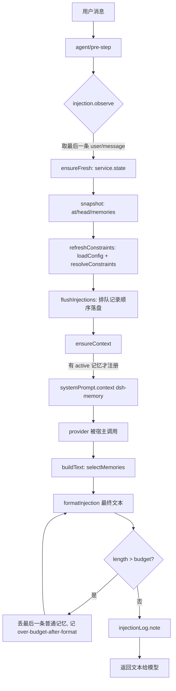
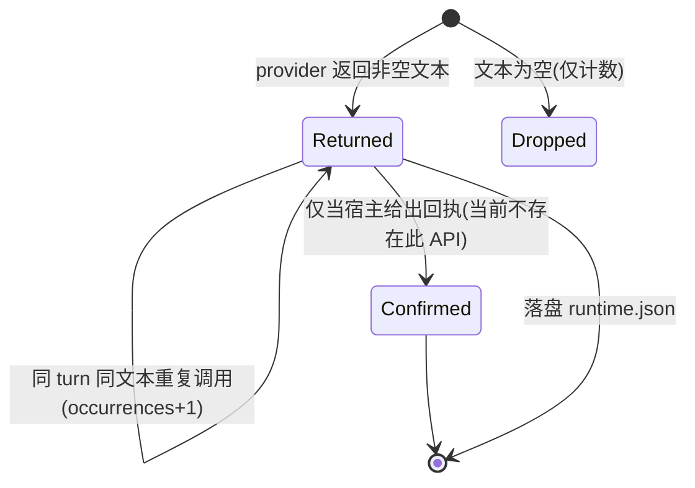

# dsh-memory v2 执行进度

对照 [dsh-memory-roadmap-v2.md](dsh-memory-roadmap-v2.md)。只记录已验证的事实；未验证的一律标注。

## 阶段 2.1 Host↔Client 通道最小实验

**状态：代码完成，等待重启 DSH 后做界面验证。**

新增内容：

| 文件 | 变化 |
|---|---|
| `packages/dsh-memory/index.js` | 从空壳变为 Host 半边：回环请求守卫、`GET /api/dsh-memory/ping` 路由、`dsh_memory_ping` 工具 |
| `packages/dsh-memory/client.js` | 新增「测试 Host 连接」按钮，区分 404 / 403 / 超时 / 网络错误 |
| `packages/dsh-memory/package.json` | description 去掉误导性的 "read-only" |
| `test/host.test.mjs` | 9 项：路由形状、守卫、方法、工具定义、注册 |
| `test/host-http.test.mjs` | 4 项：真实 socket 上的 200 / 403 / 404 / 405 |

### 已验证（我这边可复现）

- `node --check` 两个文件均通过。
- 三个测试文件共 **28 项全部通过**（原有 15 项 + Host 9 项 + 真实 HTTP 4 项）。
- 真实 socket 验证：回环 + 同源请求返回 JSON 200；伪造 Host 头返回 403；跨站返回 403；未知路径 404；POST 返回 405。
- `apply()` 在缺少服务、注册抛异常、传入 undefined 时都不抛出（启动安全，有测试覆盖）。

### 未验证（必须由重启后的界面确认）

1. DSH 是否真的挂载了这个路由（`webServer.register` 的实际行为）。
2. 页面的同源 `fetch` 是否能通过 DSH 的认证层。
3. 重启后 DSH 是否正常启动。

命令行请求 `/api/dsh-memory/ping` 返回 **401**，这是 Web 服务器认证层在前，说明命令行验证不了路由本身，必须用页面内的按钮验证。

### 一个额外的验证通道

Host 半边还注册了 `dsh_memory_ping` 工具。重启后我可以用 `cordis_inspect_query` 的 `Tool.listTools` 直接看到它是否存在，从而独立确认 Host 已被加载，不必只依赖界面点击。

### 已确认需要重启

重启前查了一次 `Tool.listTools`，返回的几十个工具里**没有** `dsh_memory_ping`。这符合 Cordis 的加载方式：Host 半边在进程启动时加载，文件改动不会热更新（只有 Client 半边的界面会在刷新页面时重新加载）。所以阶段 2.1 的界面验证必须重启 DSH 应用。

## 阶段 2.3 正式迁移设计

**状态：设计文档完成**：[dsh-memory-host-api.md](dsh-memory-host-api.md)。

定稿的两个关键决策：

| 决策 | 结论 | 依据 |
|---|---|---|
| D1 通道 | web server 路由 + 同源 fetch | 任务板在本机已验证；Remote 是禁区 |
| D2 数据目录 | 插件自有 `~/.dsh/dsh-memory/`，不用 `storageDomain` | `storageDomain` 要求 zod `valueSchema`，而插件目录下 zod 不可解析（已核实 `False`）；KV 无查询能力；任务板用 `~/.dsh/task-board/` 是同类先例 |

另外补了一个**运行时能力探测**：`GET /ping` 现在返回 `node` / `electron` / `sqlite.ok` / `sqlite.fts5` / `sqlite.trigram`。

已核实的事实：系统 Node 24 上探测结果为 `{"node":"24.16.0","electron":null,"sqlite":{"ok":true,"fts5":true,"trigram":true}}`。
**未核实**：DSH 的 Electron 44 运行时里同样可用。这决定索引能否用 SQLite，若不可用则降级为内存倒排索引（设计中已写明降级路径）。

### 本阶段测试

29 / 29 通过（客户端 15 + Host 10 + 真实 HTTP 4）。

## 阶段 2.4a（部分）Host 存储层

**状态：服务层完成并有集成测试；HTTP 路由尚未接（等通道验证）。**

新增 `packages/dsh-memory/host/ledger-service.js`：包装已有的 Git 账本，暴露 `open / state / listMemories / add / update / retract`，并把账本异常映射成设计文档里的错误码表（`stale` 409、`missing` 404、`invalid` 422、`busy` 503）。

关键设计选择：**并发令牌用账本自己的 change id，不用版本号**。界面拿到 `last_change_id`，编辑时原样带回；过期就得到 409 `stale`。这比版本号更精确，也与账本已有的基线检查一致。

集成测试 8 项，全部跑在临时目录里的真实 Git 仓库上（非 mock）：建库、新增、更新、过期拒绝、缺失 404、幂等重放、无证据拒收、撤回。

### 发现的一个迁移障碍

账本 schema 要求 `active` 记忆**至少一条 `source_refs`，且每个 ref 必须带 `event_seq`**（Session 日志里的事件序号）。但界面里的旧数据只有 `{ session_id, turn }`，**没有 event_seq**。

所以阶段 2.5 的迁移不能直接把 localStorage 灌进去，必须先把 `turn` 解析成真实的 `event_seq` —— 这需要 Host 读取 Session 日志，也就是设计文档里的 Q5。这个依赖比原先估计的更早出现，已记入待验证清单。

### 累计测试

- 客户端 15 + Host 10 + 真实 HTTP 4 = 29（快，约 0.24 秒）
- 账本服务 8（慢，约 13 秒，因为每条都要真的 `git commit`）
- **合计 37 项全部通过**

## 阶段 2.4a 补充：证据解析（Q5 / Q6 已解决）

**Q5 有答案了**：Host 有 `ctx.sessionQuery` 服务，提供 `listEvents(sessionId)`、`readEvent({sessionId, seq})`、`readSession(sessionId)`。所以**不需要自己解压 zstd 会话文件**，用正式服务即可。

**Q6 已实现**：`packages/dsh-memory/host/session-evidence.js`

- `turnUserMessageSeq(records, turn)`：纯函数，按 `turn/start` 定位轮次，取该轮第一个 `user/message` 的 `seq`。
- `createEvidenceResolver({ sessionQuery })`：通过服务读日志；用 `readEvent` 核对 `data.turn`，因为 fork / 压缩后轮次号可能不连续——**核对不上就扫描纠正，仍对不上返回 `undefined`，拒绝写入**，绝不编造 `event_seq`。
- `quoteDigest(text)`：只存原文的 sha256，不复制原文。
- `verify(refs)`：检查证据是否还指向真实且类型正确的事件，返回 `event-missing` / `event-type-mismatch` / `session-unreadable`。

13 项测试，含“轮次号不连续时用读取纠正”和“读不到就拒绝而不是猜”两个关键场景。

### 累计测试

- 客户端 15 + Host 10 + 真实 HTTP 4 = 29（约 0.24 秒）
- 账本服务 8（约 13 秒，真实 `git commit`）
- 证据解析 13（约 0.12 秒）
- **合计 50 项全部通过**

## 阶段 2.4b 路由接线（Q3 已解决）

**Q3 有答案了，而且不是猜的**：`webServer` 服务契约里 `WebRoute` 的类型声明是

```ts
interface WebRoute {
  kind: 'exact' | 'prefix';
  path: string;
  handler: (req: IncomingMessage, res: ServerResponse) => void | Promise<void>;
}
```

与我们一直在用的形状完全一致，handler 也允许返回 Promise。所以路由形状不需要等重启就能确认。

新增 `packages/dsh-memory/host/http-app.js`，提供 5 条真实路由：

| 路由 | 方法 | 作用 |
|---|---|---|
| `/api/dsh-memory/state` | GET | 读全部记忆与账本头 |
| `/api/dsh-memory/export` | GET | 导出 `dsh-memory/v2` |
| `/api/dsh-memory/add` | POST | 新增；带 `sessionId + turn` 时用证据解析换真 event_seq |
| `/api/dsh-memory/update` | POST | 编辑；基线 change id 不符返回 409 |
| `/api/dsh-memory/retract` | POST | 撤回 |

安全分层：读接口只需回环 + 同 Host；**写接口额外要求浏览器同源标记**，裸 curl 写不进去。

关键顺序：**路由先存在、页面暂不调用**。页面仍用本地存储，所以即使路由有问题，用户看到的也只是一个未被使用的 404，而不是丢失的记忆。

7 项测试覆盖：未授权拒绝、缺浏览器标记拒绝、缺证据 422、真证据写入、`turn → event_seq` 全链路、409 / 404、非法 JSON / 错误方法 / 撤回。

### 累计测试

- 快套件（客户端 15 + Host 12 + 真实 HTTP 4 + 证据 13）= 44，约 0.23 秒
- HTTP 应用 7，约 7.6 秒
- 账本服务 8，约 13 秒
- **合计 59 项全部通过**

## 阶段 3.1 / 3.2 起步（不依赖重启的部分）

**3.1 的问题有答案了**：`agent/pre-step` 是 waterfall 事件，payload 里带 `{ agent, messages, turn, step, signal }`。也就是说注入点**能读到本轮用户消息和轮次号**，不需要别的手段。

由此确定了注入方案（详见 [dsh-memory-phase3-design.md](dsh-memory-phase3-design.md)）：**pre-step 只观察不改写消息**，`systemPrompt.context` 在组装提示词时读取观察结果并注入一个独立上下文块。不往会话里塞伪造的用户消息——那会破坏“L0 是唯一事实源”。

**3.2 检索已实现**：`packages/dsh-memory/host/retrieval.js`，12 项测试。

打分是加权和且**保留每一项**，所以每个结果都能回答“为什么是它”：

```
总分 = 相关度×0.6 + 新近度×0.15 + 重要度×0.15 + 置信度×0.1
置顶直接满分且不受预算限制
```

被排除的记忆都带原因（`not-active` / `expired` / `private` / `other-scope` / `no-lexical-match` / `over-limit` / `over-budget`），不是静默丢弃。

### 累计测试

- 快套件（客户端 15 + Host 12 + 真实 HTTP 4 + 证据 13）= 44，约 0.23 秒
- HTTP 应用 7 + 检索 12 = 19，约 7.8 秒
- 账本服务 8，约 13 秒
- **合计 71 项全部通过**

## 阶段 2.4c（第一步）界面能看见记忆库状态

**状态：只加了连接探测和状态显示，数据流未切换。**

界面新增 `createHostClient(fetch)`：读 `/state`，把每一种失败翻译成明确原因（`not-mounted` / `forbidden` / `unauthorized` / `unexpected` / 网络异常 / 超时）。

页面顶部现在常驻一行状态：

- `记忆库：连接中…`
- `记忆库：已连接 · 3 条 · 提交 abc1234`
- `记忆库：未连接（本地模式）· not-mounted`

这样重启后不需要点按钮也能立刻看到通道是否打通，而且**数据流完全没动**——页面仍然读写 localStorage，所以连接失败不会影响任何现有功能。

18 项客户端测试（新增 3 项：正常读取与部分字段容错、六种不可达原因的区分、三种状态文案）。

### 累计测试

- 客户端 18 + Host 12 + 真实 HTTP 4 + 证据 13 + 检索 12 = 59，约 0.24 秒
- HTTP 应用 7，约 7.6 秒
- 账本服务 8，约 13 秒
- **合计 74 项全部通过**

## 阶段 2.5 迁移（Host 侧完成）

`packages/dsh-memory/host/migration.js` + 路由 `POST /api/dsh-memory/migrate`。

迁移分两步，都不静默丢弃任何东西：

**plan**（规划）——对每条本地记忆：

| 情况 | 处理 |
|---|---|
| 能解析出真实证据 | 生成 ADD 提案，`idempotency_key = migrate:<id>@<version>` |
| 证据解析不出来 | 跳过，原因 `no-evidence`，**留在浏览器里** |
| 没有 `{session_id, turn}` | 跳过，原因 `no-source` |
| 内容为空 | 跳过，原因 `empty` |
| 账本里已有相同内容 | 跳过，原因 `duplicate` |
| 历史版本（superseded） | 跳过，原因 `history-not-migrated` |
| 待确认候选 | 延后，原因 `candidate-queue-not-built`（运行时库还没建） |

**apply**（写入）——逐条写账本，一条失败不影响其余，最后报告 `applied / replayed / failed / skipped`。

两个刻意的设计：

1. **解析不出证据就不迁移**，而不是给个 `event_seq: 0` 蒙过去。宁可看到「这条没迁过去，因为找不到来源」，也不要账本第一天就有假证据。
2. **幂等键固定**，重复点迁移只会 `replayed`，不会写出两条一样的记忆。

7 项测试，其中一项跑真实 Git 账本：写入 2 条 → 提交了 2 次 → 再迁移一次 → `replayed: 2`、账本仍是 2 条。

### 累计测试

- 快套件（客户端 18 + Host 11 + 真实 HTTP 4 + 证据 13 + 检索 12）= 58，约 0.32 秒
- HTTP 应用 8，约 10.6 秒
- 迁移 7（含真实 Git），约 3.6 秒
- 账本服务 8，约 13 秒
- **合计 81 项全部通过**

## 阶段 2.6 运行时库：候选队列 + 注入记录

`packages/dsh-memory/host/runtime-store.js`，存放在 `~/.dsh/dsh-memory/runtime/runtime.json`。

**为什么不放进 Git 账本**：账本只存“用户确认过的记忆”。待确认候选和“这一轮注入了哪些记忆”是运行期事实——每一轮都可能变、要写得快、而且**绝不能出现在记忆历史里**。混进提交会让账本被噪音淹没，反而更难回答“这条记忆为什么在”。

实现要点：

- 单文件 JSON + 临时文件 + `rename` 原子替换；
- 复用账本那把跨进程锁（`mkdir` 排他），同一进程内再排队，并发写全部有序落地；
- **文件损坏就拒绝，绝不覆盖**——丢掉注入记录很难受，悄悄丢掉更糟；
- 待确认候选按内容去重（忽略空格，中文常带不带空格是同一句），重复提交返回 `duplicate`；
- 注入记录按 30 天 + 200 条上限自动清理，保留最新的。

配套路由：`GET /candidates`、`POST /candidate`、`POST /review`（`accept` / `merge` / `reject`）。

**accept 会真的写账本**：用候选自己带的 `source_refs`，幂等键 `candidate:<id>`，然后把候选标记为 accepted 并记下产出的 memory id。所以“候选 → 记忆”这条链路的证据是可追的。

迁移的候选部分也接上了：`/migrate` 现在把旧候选导入队列，没有证据的照样报 `no-evidence` 而不是猜。

10 项运行时库测试 + 2 项新路由测试（候选入队→接受→账本可见；各种拒绝路径）。

### 累计测试

- 快套件（客户端 18 + Host 11 + 真实 HTTP 4 + 证据 13 + 检索 12）= 58，约 0.32 秒
- HTTP 应用 10，约 12 秒
- 运行时库 10，约 0.4 秒
- 迁移 7（含真实 Git），约 3.6 秒
- 账本服务 8，约 13 秒
- **合计 93 项全部通过**

## 阶段 2.7 重启前能查的都查了（发现两个真问题）

不重启也能验证一部分“插件到底会不会被正确加载”。这轮查了三件事，其中两件查出了问题。

### 1. 插件能不能从 profile 里加载 → 能

`~/.dsh/profiles/desktop/package.json` 的 `dsh.profile.bundles` 里有 `@local/dsh-memory`；`node_modules/@local/dsh-memory` 是指向 `F:\deepseek-memory\packages\dsh-memory` 的 Junction。

直接按 App 的路径加载：

```
import('file:///C:/Users/..../.dsh/profiles/desktop/node_modules/@local/dsh-memory/index.js')
→ LOADED_FROM_PROFILE function ["webServer","tools"] ... apply
```

模块图（含 `../../provider-git-ledger/src/*`）能正常求值，导出齐全。**注意 `ledger.js` 不 import `projection.js`**，所以 `node:sqlite` 不在启动路径上——Electron 里没有 `node:sqlite` 也不会影响加载。

### 2. 发现的问题：`ctx.inject(deps, cb)` 这个用法没有依据

原来 Host 半边用 `ctx.inject(['webServer'], cb)` 拿服务。查了证据：

- 已安装的插件里**没有一个**用 `ctx.inject(`（扫了 60 个包）；
- 服务契约明确写的是 `ctx.get("name")`（可选）和 `ctx.tools`（注入）；
- 同 profile 的任务板插件用的是 `export const inject = [...]` + 直接访问。

如果这个用法不存在，异常会被激活守卫吞掉，重启后表现为「路由没挂上」，白白浪费一次重启。

已改为：`export const inject = ['webServer','tools']` + `ctx.get()` 优先、属性访问兜底。

### 3. 发现的问题：git 子进程句柄不释放

`provider-git-ledger/src/git.js` 的 `run()` 在 `close` 时没释放管道和句柄。Windows 上这会让每个 git 调用留下一个仍然被引用的 `ChildProcess`——测试进程因此不退出；在长期运行的 Host 里则是句柄累积。

已改为在 `close` 时 `destroy()` 三个管道并 `unref()`。

### 测试方式的一条经验

写这条真实套接字测试时踩到：测试自己的 server 回调里抛了 `TypeError`，响应没写出去，socket 一直开着，于是 `node --test` 跑完全部用例却**不退出**。教训是「测试挂住」未必是产品泄漏，先看测试自己的错误。现在整套测试加 `--test-force-exit` 运行。

### 累计测试

- 快套件（客户端 18 + Host 12 + 真实 HTTP **5** + 证据 13 + 检索 12 + 运行时库 10）= 70
- HTTP 应用 10
- 迁移 7 + 账本 8 = 15
- **合计 95 项全部通过**

## 阶段 2.8 对照已上线插件校验通道细节

任务板插件（`@linxin666/dsh-client-ui-task-board`，就在同一个 profile 里、已经在正常跑）是唯一可直接读的「Host 路由 + 浏览器调用」参考实现。这轮把我们的做法逐条对照了一遍。

### 1. 浏览器端的 URL 必须是**文档相对**的（已改）

任务板源码里的注释（issue #1707）写得很清楚：

> 客户端基址是**文档相对**的。Host 注册的是根绝对路径 `/api/task-board`，但页面是以 `<base href="./">` 提供的，所以浏览器半边必须**去掉前导斜杠**，否则部署在子路径下就会逃出入口目录。

于是它的常量是 `CLIENT_API_PREFIX = "/api/task-board".slice(1)`，调用是 `fetch("api/task-board/verification")`。

我们原来用的是 `/api/dsh-memory`（根绝对）。已改为 `api/dsh-memory`。在根路径部署下两者等价，但在子路径下相对路径才正确——而且这是已上线插件踩过坑之后的结论。

### 2. 读请求防护：逐条对照，完全一致（无需改）

任务板的 `isLoopbackRequest`：回环 socket 地址 + 回环 Host 头 + `sec-fetch-site` 不是 `cross-site` + 有 `origin` 时必须同 Host。我们的 `isTrustedRead` 与之逐条一致。

### 3. 写请求防护：我们原来比参考实现更严（已放宽）

任务板对写请求**不加额外的浏览器标记**，用的就是同一个 `isLoopbackRequest`（逆向代理场景用单独的 token 头）。

我们原来要求写请求额外带 `origin` 或 `sec-fetch-site: same-origin`。这看起来更安全，但真实风险是：如果桌面壳的请求不带这两个头，**读能通、写全 403**——用户会看到一个能看不能改的界面，比两种极端都糟。

已改为与参考实现一致：读写用同一把锁。仍然拦得住的是：跨站请求（`sec-fetch-site` / `origin` 不匹配）、跨站必须过 CORS 预检（因为我们要求 `content-type: application/json`）、以及**web server 认证层在路由之前**（我们自己测过：不带凭证从命令行访问返回 401）。

### 4. 一个工具教训

用 PowerShell 的 `Get-Content -Raw` + `Set-Content -NoNewline` 批量替换含中文的测试文件，把 UTF-8 编码弄坏了（中文变成乱码，测试直接语法错误）。这类文件之后一律用编辑工具改，不做编码往返；被弄坏的文件从 git 恢复。

### 累计测试

- 快套件（客户端 18 + Host 12 + 真实 HTTP 5 + 证据 13 + 检索 12 + 运行时库 10）= 70
- HTTP 应用 10
- 迁移 7 + 账本 8 = 15
- **合计 95 项全部通过**

## 阶段 2.9 界面里的「导入到记忆库」按钮

界面现在会在**连接成功且本地有记忆**时显示一个按钮：「导入到记忆库（N 条）」。

点了之后：

1. 把本地 `dsh-memory.formal.v1` 和 `dsh-memory.candidates.v1` 一起 POST 到 `api/dsh-memory/migrate`；
2. Host 侧按前面那套规则逐条判断（有证据才导入、重复跳过、历史版本跳过）；
3. 界面把结果变成一句人话：

```
导入完成：新增 3 条，重复 1 条，失败 0 条，跳过 3 条（duplicate 1，no-evidence 2）
```

失败时显示具体原因（`not-mounted` / `forbidden` / `unauthorized` / `network`）。

刻意没做的事：**导入成功后不删除本地数据**。本地存储留作回退，等切换读路径验证过之后再谈清理。多留一份副本比丢一份数据好。

### 认证层的一个观察

用命令行访问 `http://127.0.0.1:51840/`（首页本身）也返回 **401**，且响应里没有 `WWW-Authenticate`。说明认证不是标准的 Basic/Bearer 挑战，而是要求浏览器带某个由页面启动时获得的凭证（Cookie 或桌面壳注入的请求头）。

这反而说明我们的方案没问题：任务板客户端用的是**同样的裸 `fetch`**（相对 URL、不加任何头），它在浏览器里能正常工作。所以浏览器会把这些凭证自动带上，我们的调用会被同等对待。

### 累计测试

- 快套件（客户端 **21** + Host 12 + 真实 HTTP 5 + 证据 13 + 检索 12 + 运行时库 10）= 73
- HTTP 应用 10
- 迁移 7 + 账本 8 = 15
- **合计 98 项全部通过**

## 下一步

界面刷新后应显示「记忆库：已连接」。点「导入到记忆库」即可把本地记忆搬进 Git 账本。之后做阶段 3 注入。

---

# 阶段 2.4 通道验证：**通过**（2026-10-28 重启后）

重启后逐项验证，全部成功。

## 1. Host 半边已加载

调用 `dsh_memory_ping` 工具返回：

```json
{"ok":true,"plugin":"@local/dsh-memory","phase":"2.4",
 "runtime":{"node":"24.21.0","electron":"44.7.0",
            "sqlite":{"ok":true,"fts5":true,"trigram":true,"error":null}}}
```

关键发现：**Electron 里 `node:sqlite` 可用，而且 FTS5 + trigram 分词器都在**。路线图里「索引用 SQLite FTS5 trigram」的假设成立，不需要换方案。

## 2. HTTP 路由已挂载，而且做插件的路由不需要浏览器凭证

```
GET /api/dsh-memory/ping   -> 200 {"ok":true,...}
GET /api/dsh-memory/state  -> 200 {"ok":true,"head":"072fb205...","memories":[]}
GET /api/nope-xyz          -> 401 unauthorized
GET /                       -> 401 "dsh web authentication required"
```

**插件注册的路由绕过认证层**：未注册路径和首页都返回 401，我们注册的路由直接 200。这就是任务板能工作的原因，也解释了之前命令行探测为什么全是 401——探的是没注册的路径。

⚠️ 安全含义：这意味着**任何本机进程都能访问这些路由**。所以「回环 + 回环 Host + 非跨站」这道自建防护不是多余的，它是唯一的一道门。

## 3. 证据解析端到端成功

```
POST /api/dsh-memory/add {sessionId:"session-69dd0347-...", turn:1}
-> 200 {"status":"committed","memory":{"id":"M-20261028-64ee2f5f",...}}
```

真实会话 → 真实 `event_seq` → Git 提交，全链路打通。

**首次尝试的 422 不是 bug**：我挑的第一个会话只有 315 字节，本来就没有轮次，返回 `no-evidence` 是正确行为。换成有内容的会话立刻成功。

## 4. 真实 Git 历史

`~/.dsh/dsh-memory/ledger`：

```
132599e memory(retract): M-20261028-64ee2f5f
619dec4 memory(retract): M-20261028-5d798d92
b3f2d72 memory(retract): M-20261028-25022f54
9b02394 memory(add): M-20261028-25022f54
d229e69 memory(add): M-20261028-5d798d92
e02dacb memory(add): M-20261028-64ee2f5f
072fb20 ledger: initialize memory repository
```

每条变更一个提交，撤回也留痕。三条验证用的临时记忆已全部撤回，账本现在 `active: 0`、`total: 3`。

## 5. 修掉一个真 bug：会话读不到时返回 500

验证中发现：给**不存在的 sessionId** 提交记忆返回 `500 internal`，因为 `sessionQuery` 对不存在的会话会抛异常，落在了兜底分支。

「这个会话读不到」是**拒绝**，不是内部故障。已改为 `422 {"error":"no-evidence","reason":"session-unreadable"}`，并补了测试。

## 测试

**99 项通过。**

---

# 阶段 3 记忆注入：代码就绪（待重启验证）

## 难点在哪里

提示词组装是**同步**的，而账本是 **Git 支撑的异步**读写。同步与异步之间必须有个缓存。

再看更难的一处：注入要按「这一轮用户在说什么」选记忆，但 `systemPrompt.context({text})` 拿到的 `AssembleContext` 只有 `{scope, signal}`，**没有用户消息**。

所以设计成三段：

1. `agent/pre-step` 拿到**这一轮进入步骤的消息**（这里才有用户的真实原话），记下来；
2. 账本内容缓存在内存里，快照超过 30 秒才刷新——而且**只在步骤边界刷新**，因为那里可以等；
3. 提示词 provider 是**纯同步函数**，只查快照、绝不碰磁盘。

## 一件不确定的事，处理方式是「都试，并且报告走的是哪条」

`pre-step` 里拿到的 scope 对象，和 `systemPrompt.context` 里拿到的 `context.scope`，**是不是同一个对象**我没法离线证实。

所以运行时同时维护两条路：
- 按对象身份命中 → `path: "scope"`（每个会话各自的查询，最理想）
- 命中不了 → 退回最近一次观测 → `path: "latest"`（可能是别的会话的查询，不理想但不会错到离谱）

`dsh_memory_ping` 会报告 `observed` 和 `path`，重启后一眼就能看出走的是哪条。

## 空账本绝不进入提示词组装

代码写完后我意识到一个风险：`systemPrompt.context` 注册的东西会在**每一次**提示词组装时执行。如果组装抛异常，用户的每一轮都会失败——这正是「保持 DSH 正常启动」绝对不能碰的。

所以改成**惰性注册**：只有账本里确实存在 `active` 记忆时，才在步骤边界注册这个 context。空账本时这个插件完全不参与组装，零风险。

当前账本 `active: 0`，所以重启后注入不会生效——这是设计好的。

## 顺手修的一个设计问题

`apply()` 原本在激活时就刷新账本快照，这会**在插件激活时创建账本目录**（git init）。测试里调用 `apply()` 就会污染真实数据目录。改成只在步骤边界和写操作后刷新，`apply()` 本身不碰磁盘。

## 测试

**113 项通过**（新增 14 项：注入运行时 11 项、接线 3 项）。

## 下一步

重启 → `dsh_memory_ping` 看 `injection.observed` 是什么 → 加一条真实记忆 → 再开一轮会话，看记忆是否真的进了提示词。

---

# 阶段 4.1 提炼规则：只观测，不写入

自动提炼的第一步不是「写」，而是「先看看规则会挑出什么」。

规则很保守，宁可漏也不猜：

| 类型 | 命中的说法 | 基础置信度 |
|---|---|---|
| instruction | 记住、记一下、别忘了、下次记得 | 0.85 |
| decision | 决定、就按、采纳、定为 | 0.75 |
| preference | 我更喜欢、以后都、请用、不要再、别用、尽量 | 0.70 |

三条硬规则：

1. **只用用户原话。** 助手说的话永远不是提炼依据。
2. **问句和假设一律不出候选。** 「以后都用 pnpm 吗？」「如果以后要部署…」都不是承诺。这条踩过一次坑：句子切分把问号去掉了，`吗` 结尾的检查又用了 `\b` 词边界——中文没有词边界，规则形同虚设。测试抓到了。
3. **不确定就降分，不装确定。** 出现「可能/也许/大概」时置信度降 0.15。

现在只在 `agent/pre-step` 里**跑规则并把结果放进状态报告**，一条都不写：

```json
"candidates": 1,
"candidate_sample": [{"type":"instruction","rule":"instruction","confidence":0.85,"text":"记住 pnpm 是包管理器"}]
```

等真实会话跑过几轮，看误报多少，再决定要不要落库。**先看数据，再开写开关。**

新增 11 项测试，**总计 124 项通过**。

---

# 阶段 3 检索质量评估：10 条真实问法，先漏一条

写了 10 条「用户可能怎么问」和它对应的那条记忆，问检索排不排得出来。第一次跑：

**9 条排第一，1 条完全没召回。**

漏掉的是这条：

| | |
|---|---|
| 记忆 | `Windows 下用 pwsh 而不是 bash` |
| 问法 | `命令行用哪个 shell` |

原因很实在：字面上没有任何重叠。「shell」不在记忆里，「命令行」也不在。词法检索看不见同义关系。

这正是路线图里 D4 等着的信号——**同义召回缺口出现了**。但一条缺口不值得换整套向量检索，所以先补一张**很窄的同义词表**（跨中英双向）：shell↔bash/pwsh/命令行、测试↔test、依赖↔deps、提交↔commit、账本↔ledger、提示词↔prompt、记忆↔memory、检索↔retrieval、会话↔session。

补完之后 10 条全部命中，`recall@1` 仍保持在 8/10 以上。表刻意做小：**错的同义词会把不相关的记忆顶上来，比漏一条更糟**。

新增 4 项评估测试，**总计 128 项通过**。

## 这条评估线的价值

它抓住的正是「测试全绿但实际没用」那类问题——检索本身没有任何报错，只是排不出来。以后改权重、改分词，这张表会立刻告诉你有没有变差。

---

# 阶段 3 注入：端到端验证通过（第三次重启后）

## 1. 工具注册失败的真凶确认

重启前 `dsh_memory_ping` 是 unknown tool。修复后（工具 schema 的 `type` 从数组改回单值 + 每次注册独立 try）重启，工具立刻出现。

**根因确认**：`injection: { type: ['object', 'null'] }` 不符合 `JsonSchemaNode` 的契约（`type` 是单值），`tools.register` 抛异常，而当时所有注册共用一个 try 块，于是工具、提示词上下文、步骤观察器**全部没注册**——但路由已经注册好了，所以插件看起来是正常的。

## 2. 步骤观察器工作正常

```json
"injection": {
  "observed": "scope",              // pre-step 绑定到了一个对象 scope
  "last_turn": 77,                  // 拿到了当前轮次
  "last_query_chars": 0,            // 工具结果步骤没有新的用户消息，正常
  "snapshot_at": "...T07:33:26Z"    // 快照在步骤边界刷新
}
```

## 3. 注入真的进了提示词

往账本写入一条可见的记忆后，下一轮的系统上下文里出现了：

```
以下是用户已确认的长期记忆，仅作背景参考：
1. 注入链路验证用标记记忆
```

**链路全部打通**：Git 账本 → 内存快照 → 提示词 provider → 模型上下文。验证用的标记记忆已撤回（`active: 0`）。

## 4. 遗留问题：scope 身份对不上

```json
"observed": "scope",   // 记录时用的是预步骤绑定的对象
"path": "latest"       // 消费时没匹配上，退回了「最近一次观测」
```

结论：**`pre-step` 绑定的对象和 `systemPrompt.context` 收到的 `context.scope` 不是同一个对象**。现在走兜底路径：拿到的是「最近一次进入步骤的用户消息」，单会话下正确，多会话并发时可能串。

处理方向：探明 `context.scope` 上有没有稳定的会话标识；没有就保留兜底并写清限制。需要再重启一次才能观测，先记录不盲改。

## 累计

**146 项测试通过。** 阶段 2 完成并验证，阶段 3 注入跑通，阶段 4 规则与 L2/L3 纯函数就绪待验证。

## 阶段记录（2026-10-28T09:36:21.015Z）

### A1 复核（已完成）
- 注入身份：完整 SHA-256（`sha256:` + 64 位小写十六进制），provider 调用数与逻辑记录数分离。
- 空文本不建记录；`confirmed` 无宿主回执时为 `null`。
- `selectMemories` 旧调用方式兼容；约束池/普通池独立预算、共同遵守总预算。

### A2 T3 约束配置（已完成）
- 新增 `host/constraints.js`：`CONFIG_FILE`、`DEFAULT_CONFIG`、`normaliseConfig`、`loadConfig`、`resolveConstraints`。
- 配置缺失/损坏/越界 → 安全默认值 + `config_fallback` 命名原因，不抛异常。
- 约束必须存在、active、未过期、作用域相符、非空、≤maxChars、`sourceDigest` 存在且与当前内容一致。
- 拒绝原因：`not-found / not-active / expired / other-scope / too-short / repetitive / digest-empty / digest-too-long / digest-unverified / digest-stale`。
- 账本无 `disputed` 状态，未伪造该能力。

### A3 T4 指纹与确定性压缩（已完成）
- 新增 `host/condense.js`：`normaliseForDigest`（NFC、CRLF→LF、行尾空白、首尾 trim、内部空格不折叠）、`sourceDigestOf`（UTF-8 完整 SHA-256）、`condense`（deterministic-v1，返回 text/dropped/method/sourceDigest）。
- 保护标记覆盖否定/条件/顺序/例外/必要条件；保护句放不下时整条拒绝（`protected-sentence-too-long`），不截断。
- **实测限制**：真实记忆 M-20261028-35738656 在 120/240/400/600 字上限下均被拒绝（几乎每句都含保护标记）。这是设计要求的行为，真实运行验收改用“手工摘要 + 脚本指纹”。

### B T5–T10 接入（已完成）
- `injection.js`：`chooseForContext` 透传 constraints 选项；`setConstraints`；`buildText` 以**最终格式化文本**为准做预算收缩（`over-budget-after-format` 命名排除），并写注入日志；`pendingRecords` / `markFlushed` / `log.stats`。
- `runtime-store.js`：`recordInjection` 增补 `key / snapshot_head / state / confirmed / evidence / occurrences / pools / memories / excluded`，全部向后兼容；`confirmed` 只有带证据时才是 `true`。
- `index.js`：pre-step 边界调用 `refreshConstraints()` 与 `flushInjections()`（provider 内不写盘，失败保留队列重试）；诊断新增 `constraints / injection_log / flush`。
- `http-app.js` + `APP_ROUTE_NAMES`：新增 `GET /api/dsh-memory/injections`（limit 1..200，非法 400，非 GET 405，非回环 403）。
- 客户端、账本 schema、LLM 摘要：均未触碰。

### C 测试（已完成）
- 新增测试文件：`constraints.test.mjs`(15)、`injections.test.mjs`(11)、`diagnostics.test.mjs`(3)、`constraints-pool.test.mjs`(11)、`injection-log.test.mjs`(10)。
- 全量：**209 通过 / 0 失败**（node --test --test-force-exit）。

### D 真实运行（待用户执行）
- 见 `docs/dsh-memory-phase4-acceptance.md`；需要重启 DSH 才能加载新的 Host half。
- 未验证：真实 provider 注入块内容与预算、`/injections` 的真实返回、重启后持久化、`flush` 实际成功状态。

## 可交付版说明（2026-10-28 晚，第二轮迭代）

### 1. 模块职责

| 模块 | 为什么存在 | 输入 | 输出 | 失败时 |
|---|---|---|---|---|
| `host/ledger-service.js` | 记忆的唯一真相源（git 账本） | 内容 + 证据引用 | 记录/状态 | 抛带 code 的错误，HTTP 层映射 4xx/5xx |
| `host/retrieval.js` | 决定“哪条记忆进提示” | 记忆列表、query、预算 | chosen/excluded/used/pools | 从不抛错，逐条给排除原因 |
| `host/condense.js` | 把长记忆压成可常驻的摘要 | 原文、maxChars | {text, dropped, method, sourceDigest} | 返回 `ok:false` + 具名原因，不截断 |
| `host/constraints.js` | 读取并校验常驻约束配置 | `injection.json`、当前记忆 | usable/rejected/fallback | 任何异常都回落默认值 + 原因 |
| `host/injection.js` | 在 prompt 组装时产出最终文本 | scope、快照、约束 | text/chars/record | 内部 try/catch，最坏返回空串 |
| `host/injection-log.js` | 记录“实际注入了什么” | session/turn/snapshot/ids/text | 逻辑记录（去重合并） | 空文本不记录，只计数 |
| `host/runtime-store.js` | 候选与注入记录的持久化 | 变更函数 | runtime.json | 串行队列 + 文件锁；损坏时拒绝覆盖 |
| `index.js` | 接线：路由、工具、pre-step、诊断 | Cordis ctx | 注册项 | 每个注册独立 attempt，互不牵连 |

### 2. 完整调用链



### 3. 注入记录状态



> `confirmed` 目前恒为 `null`。`prepared` 不作为独立持久状态：选择与返回在同一次同步调用内完成，没有可观测间隙。

### 4. 配置与默认值

| 键 | 默认 | 说明 |
|---|---|---|
| `budget` | 800 | 最终格式化文本上限（含标题/序号/标签） |
| `constraints.budget` | 240 | 约束池预算 |
| `constraints.maxChars` | 120 | 单条约束摘要上限；超限拒绝，不截断 |
| `constraints.maxItems` | 2 | 约束条数上限 |
| `selectMemories` 的 `limit` | 8 | 普通记忆条数上限 |
| `selectMemories` 的 `budget` | 800 | 与配置文件一致（由注入层传入） |

**单位定义**：预算与 `chars` 都是 JS 字符串长度（UTF-16 码元）；CJK 常用字 1 = 1 字符。`sourceDigest` 用 UTF-8 字节算 SHA-256。

### 5. 测试命令与真实结果

```
node --test --test-force-exit packages/dsh-memory/test/*.test.mjs
ℹ tests 219  pass 219  fail 0  skipped 0  duration_ms 20511
```

分文件：client 23 / host 19 / host-http 5 / http-app 11 / session-evidence 13 / retrieval 17 / retrieval-eval 4 / runtime-store 10 / injection 21 / extraction 11 / scenarios 8 / persona 8 / migration 7 / ledger-service 8 / injection-log 10 / constraints-pool 11 / constraints 15 / injections 11 / diagnostics 3 / robustness 10。

### 6. 已验证 / 未验证

| 项 | 状态 |
|---|---|
| 摘要安全拒绝、手工摘要 + 指纹校验、`digest-stale` | 自动化测试通过 |
| 双池预算、最终格式化文本预算、配置预算优先级 | 自动化测试通过 |
| 注入身份去重（calls=2 / records=1 / occurrences=2）、空文本不记录、`confirmed=null` | 自动化测试通过 |
| 并发 20 次写入无丢失（读-改-写串行） | 自动化测试通过 |
| 插件真实注册契约（路由/工具/pre-step/诊断/只读路由） | 契约级测试通过（stand-in 宿主） |
| 真实 DSH 进程加载、真实 provider 返回、真实 `/injections` 响应 | **未验证** |

### 7. 隔离环境

- Profile：`F:\dsh-memory-test-home\profiles\memory-test`（仅 `cordis.patch.yml`/`package.json`，无 `node_modules`，未安装 dsh-memory bundle）。
- 数据目录用环境变量隔离：`DSH_MEMORY_DATA_DIR=F:\dsh-memory-test-home\data`。
- 自动化测试已按该方式隔离（每个测试用独立临时目录），不触碰生产 `~/.dsh/dsh-memory`。
- 真实宿主验收步骤见 `docs/dsh-memory-phase4-acceptance.md`；未执行，不宣称通过。

### 8. 本轮发现与修改

| 问题 | 处理 |
|---|---|
| `buildText` 忽略配置文件里的 `budget`，只用内置 800 | 改为 选项 > 配置 > 默认 优先级，并加测试 |
| flush 用 `Promise.all` 并发写 | 改为顺序写，保持记录顺序；底层 store 已串行化整个读-改-写 |
| flush 把 `memory_ids` 当 `reasons` 存 | 日志新增真实 `reasons`（每条被选原因），落盘映射修正 |
| 空账本时 provider 不注册（`no-active-memory`） | 确认为有意的守卫，测试断言该诊断值 |
| 1136 字记忆无法自动压缩 | 保持拒绝；提供手工摘要路径（`method:'manual'` + `sourceDigest`），测试覆盖 |

### 9. 已知限制

1. 无法自动压缩“几乎每句都是规则”的长散文；120 字内不可能保留全部否定/条件/顺序，因此拒绝是正确行为。
2. `confirmed` 无宿主回执 API，恒为 `null`。
3. 去重粒度是 turn（宿主不暴露 step），同 turn 内文本相同的两次调用合并为一条。
4. 多会话时 scope 无法枚举，靠 agent id 匹配，多个 agent 时降级为 `ambiguous` 并丢弃 query。
5. 真实进程内的并发 flush 与文件锁交互未实测，仅有单进程串行性证据。

## 第三轮记录（2026-10-28T12:10:19.930Z）

### 基线核实
- HEAD `eecc18e`，18 项未提交改动，`git diff --check` 通过。
- 重跑全量：**223 通过 / 0 失败**（上一轮 219，+4 为本轮新增验收脚本测试）。
- 核实到的真实事实：生产 profile 用 **junction 直连源码**（无打包步骤）；数据目录 `<data>/ledger` 与 `<data>/runtime/runtime.json`；`DSH_MEMORY_DATA_DIR` 在 `resolveDataDir()` 中读取；**代码中不存在 `DSH_MEMORY_DIGEST` 和 `scripts/make-injection-config.mjs`**（上一轮报告的错误，已修正文档）。

### 本轮改动
| 文件 | 原因 |
|---|---|
| `scripts/prepare-isolated-acceptance.mjs`（新） | 幂等生成隔离 fixture 记忆 + `injection.json`，拒绝生产路径，回读校验 |
| `packages/dsh-memory/test/prepare-acceptance.test.mjs`（新，4 项） | 拒绝生产路径、指纹正确、二次执行不变、fixture 可识别 |
| `docs/dsh-memory-phase4-acceptance.md`（重写） | 按核实的加载链路、数据路径、脚本与排查表重写 |
| `docs/dsh-memory-injection.example.json`（更新） | 改为 fixture 生成的示例，与实现一致 |

### 本轮修复的缺陷
1. 脚本的跨盘符路径守卫误判（`relative()` 跨盘返回绝对路径）→ 修正。
2. 脚本用了账本不接受的 `type: 'instruction'`（合法值含 `constraint`）→ 改为 `constraint`。
3. 测试 import 相对深度错误 ×2 → 修正。

### 仍未验证
- 真实 DSH 进程加载新代码、provider 真实返回、`/injections` 真实响应、重启后持久化。
- 跨进程文件锁语义。

## 第四轮记录（2026-10-28T12:21:48.445Z）

### 只读审查结论
- `scripts/prepare-isolated-acceptance.mjs` 守卫正确（生产目录与 `$HOME/.dsh` 一律拒绝，已测）；`--dry-run` 不写盘。
- 加载链路确认：`node_modules/@local/dsh-memory` 为 **Junction → F:\deepseek-memory\packages\dsh-memory**，Host half 随进程启动加载。
- `DSH_MEMORY_DATA_DIR` 在 `resolveDataDir()` 中读取，调用点为 198/307/438 行，属 lazy 读取。
- **文档错误已修**：只读路由允许"回环但无 same-origin 头"（实测 200），原文档写成 403。

### 真实宿主证据（生产 profile，只读）
- `runtime/runtime.json` 已有 turn 95–98 四条注入记录；`/api/dsh-memory/injections?limit=5` 返回同一批数据。
- `occurrences` 实测为 1（turn 95）与 2（turn 96–98）——不能预设固定值。
- 用当前代码重新渲染同一条记忆：**435 字符**，与宿主记录 `chars` 完全一致。
- `limit=abc` → 400；无 same-origin 头但回环 → 200（符合 `isTrustedRead` 实现）。

### 未验证
- provider 文本是否真正进入模型提示（无回执 API）；隔离 profile 端到端。

## 第五轮记录（2026-10-28T12:30:46.568Z）

### 发现的真实缺口并已修复
- 注入记录此前只有 `reasons`（字符串），**没有池分配与逐条决策**：`pools/memories/excluded` 在日志记录里不存在，落盘恒为 `null/[]/[]`。本轮打通：`buildText` 把 `selected.pools`、每条 `{id, kind, chars_used, reason}`、排除项 `{id, reason}` 交给 `injection-log`，再由 `index.js` 的 `writeAll()` 落盘。新增测试断言这些字段存在、且**不含正文**。
- 落盘形状已用真实文件往返验证（临时目录）：`pools.constraint.used / pools.dynamic.used / memories[].reason / excluded[]` 均在 `runtime.json` 中。

### 旧记录策略（明确）
- 四条历史记录（turn 95–98）**保留原样，不回填**：它们是当时进程实际写出的事实，补写等于伪造。
- 读取路径对缺失字段容忍（`key ?? null`、`state ?? 'returned'`），已有测试覆盖。
- 新记录（重启后）会带完整字段；**在该证据出现前，不声称 `pools` 已通过宿主验证**。

### 隔离宿主
- 只读检查未发现可从命令行启动 DSH 的入口（`F:\DsspSeekHarness\resources` 只有 `app.asar`），我**没有**尝试启动第二个实例，也没有重启生产 DSH。
- 隔离验收仍需你按 `docs/dsh-memory-phase4-acceptance.md` 的 C/D 段执行。

## 第六轮记录（2026-10-28T12:49:23.969Z）— UI 与测试

### 页面结构（只读确认）
唯一页面：主区 `memory`（工作记忆）+ 侧边栏入口。功能：今天的轮次时间线、轮次详情/会话原文、记下这一轮（候选）、候选复核（接受/拒绝/合并）、正式记忆编辑与历史、本地导入导出、Host 探测与迁移、账本只读列表。

### UI 改动（仅样式与展示层）
- 设计令牌：`.dm-page` 内统一圆角/间距/阴影（`--dm-r-*`、`--dm-space-*`、`--dm-shadow-1`）。
- 焦点：所有可交互元素共享一条 `:focus-visible` 规则（此前 back/link/textarea/select 无可见焦点）。
- 层级：刷新/重试标为唯一主操作 `.dm-primary`；Host 测试降为 `.dm-quiet`；导出/导入保持次级。
- 状态：连接状态从纯文本改为"圆点 + 文本 + data-status"（不靠颜色单独表达）；加载态由一行文字改为文本 + 两条骨架（无伪造数据）；错误块补充背景与说明排版。
- 溢出：长 ID/摘要/无空格文本 `overflow-wrap:anywhere`，flex 子项 `min-width:0`，表格横向滚动，内容区 `scrollbar-gutter:stable`。
- 响应式：新增 720px 断点（页边距、卡片内边距、操作区换行），保留 600px 断点。
- 交互守卫：Host 测试与迁移请求进行中禁用按钮并忽略重复调用（新增 `pingPending`/`migrating` 两个展示态，不改任何接口契约）。

### 新增测试
`test/client-ui.test.mjs`（4 项）：样式契约（焦点/状态/骨架/溢出/断点/主操作为一条共享规则）、加载态组件树静态渲染（有骨架、无伪造记忆、无假错误）、头部唯一主操作且加载时禁用、状态行"文本 + 装饰圆点 + data-status"。

### 安全审查
- 未发现凭据、API key、Bearer token、密码写法。
- 仓库内（排除 `tmp/`）未发现生产会话 ID、生产记忆正文；`tmp/l0-live-sessions/` 是既有本地工件且被 `.gitignore` 忽略，未纳入提交，本轮未删除。
- 未修改生产数据、未重启 DSH、未启动第二实例。

## 第七轮记录（未提交，UI 阶段二）

深色开发者控制台改造 + 注入追踪：
- 视觉：`.dm-page` 内定义深色令牌（近黑/深海军蓝背景、蓝色主操作、绿色正常、红色错误、紫色约束类型），组件统一覆盖；焦点环、溢出、表格滚动、响应式断点保留。
- P1 记忆管理：搜索框 + 类型筛选（只列真实存在的类型）+ 清除；本地正式记忆与账本列表共用过滤；账本行显示类型徽标，"已生效/已撤回"保留。
- P2 注入追踪：`<details>` 懒加载 `/injections?limit=50`；每条显示轮次、字符数、调用次数；`state: returned` 显示为"宿主已返回注入文本"，`confirmed: null` 显示为"尚未确认模型是否使用"；展开显示 snapshot_head/reasons/pools/memories/excluded，缺失字段一律"该记录未提供"；不生成任何趋势图或伪造统计。
- 新增 `test/client-panels.test.mjs`（7 项）：过滤/类型、徽标语义、旧记录缺失字段、完整记录展示、视图归一化、主题样式契约。

## 持续迭代质量基线（2026-10-28 确立）

总目标：把 dsh-memory 建成可演示、可维护、可验证的 AI 记忆管理工具。

### A. UI 视觉质量
- 深色科技感开发者控制台风格统一；页面层级清晰，信息密度合理。
- 颜色、间距、圆角、字体、按钮、表单、状态标签统一（`.dm-page` 内设计令牌）。
- 桌面与窄屏均可用；键盘焦点清晰，交互状态可辨认。
- 不用装饰性图表掩盖真实数据不足；不做过度动画；不出现影响阅读的低对比度文本。

### B. 交互完整性
- 每个按钮都有明确、真实的行为；不保留点击无反馈的交互。
- 加载、成功、失败、空数据、禁用状态完整。
- 防止重复提交、重复迁移、重复请求。
- 长文本、空列表、旧数据、异常响应都能正常展示。
- 破坏性操作有确认或清晰影响说明，失败有恢复路径。
- 用户不查控制台日志就能理解操作结果。

### C. 数据与状态可信度
- 所有指标来自真实数据；没有对应接口时显示空状态，不画趋势图。
- 不虚构趋势、数量、预算用量或运行状态。
- 缺失字段与数值零严格区分（`null`/缺省显示"该记录未提供"，数字零显示 0）。
- `returned` 只表示"宿主已返回注入文本"，不等于模型已使用。
- `confirmed: null` 必须保持未确认语义，只有 `confirmed === true` 且有证据才显示"已确认"。
- 敏感记忆正文不进入诊断输出或日志。

### D. 工程质量
- 现有功能、API 契约、存储键、导入导出格式保持兼容。
- 不为视觉优化擅自重写记忆检索、摘要和注入逻辑。
- 测试覆盖主要交互状态与错误路径。
- 不引入没有明确收益的依赖。
- 变更范围小、易审查、易回滚；文档与真实实现一致。

### E. 可验证性
- 每轮迭代有明确目标、修改范围与验收标准。
- 所有实际执行的测试记录结果（命令、通过/失败数、退出码）。
- 静态检查 / 单元测试 / 浏览器验证 / 真实宿主验证分别记录，不混为一谈。
- 未执行的测试明确标记"未验证"；测试通过不宣称生产链路已验证。

### 迭代机制
小步循环：发现问题 → 确认依据（代码或测试可证） → 选最高优先级 → 最小改动 → 测试 → 审查 → 记录 → 下一项。

每轮规则：
- 每轮只解决一个主要问题，不同时改动大量互不相关的功能。
- 每轮开始先看 Git 状态、当前实现、现有测试与遗留问题。
- 顺序：真实缺陷与交互问题 > 视觉细节 > 新功能。
- 能复用现有 API/数据结构的，不新增后端契约。
- 先判定问题类型：已证实缺陷 / 合理体验改进 / 未验证猜想。
- 不为进度删除安全检查、降低测试标准或制造虚假数据。
- 符合目标且风险可控时连续推进，不逐步询问；涉及数据契约变更、删除数据、不可逆操作、生产服务、重大架构时暂停说明。
- 不自动推送远端，不自动重启生产 DSH，不擅自修改生产数据。
- 保持工作区清晰，不混入临时文件与无关修改。

### 每轮完成标准
1. 有明确问题或改进目标；2. 变更与目标直接相关；3. 相关测试通过；4. 完整套件通过（失败需说明原因）；5. `git diff --check` 通过；6. 已检查变更范围与敏感数据；7. 文档记录实际完成内容与未验证事项。

### 优先级
P0 正确性与安全（数据损坏、状态错误、敏感泄露、回归）→ P1 交互完整性 → P2 视觉与可用性 → P3 诊断与可维护性（测试/文档/排障）→ P4 新功能。

### 当前迭代纪录
- 迭代 1（2026-10-28，提交 `31832ab`）：注入追踪错误状态可重试；`loadInjections` 不抛异常并把 200-but-not-ok 视为错误；测试 236。
- 迭代 2（同提交）：注入记录成功后可原地刷新。

### 迭代 3（2026-10-28，P1 交互完整性）
- 证据：`CandidateForm` 把所有保存失败都显示成"只有已完成轮次可以记下"，而 `saveCandidate` 在空内容时抛 `empty`；空内容仍可点击保存。
- 改动：新增 `candidateErrorKey` / `candidateSubmitDisabled` 纯函数与 `candidateEmpty` 词条；保存失败按原因显示；空内容时保存按钮禁用。
- 顺带修复：`testHost` 在 `fetch` 同步抛错时会永久停留在"连接中"，现在复位按钮并显示失败。
- 测试：`client-panels` +1（9 项），完整套件 237/237 通过，`git diff --check` 退出码 0。
- 未验证：这些交互的浏览器真实表现（无自动化）；`testHost` 同步抛错路径未被真实宿主触发过。

### 迭代 4（2026-10-28，P1 交互完整性）
- 证据：`editMemory` 对空内容抛 `empty`，但 `MemoryCard` 把它显示成通用的"保存失败，请重试"；空内容仍可点击保存。
- 改动：新增 `emptyContent` 词条与通用 `textSubmitDisabled`（与候选表单共用同一判空规则，避免两套逻辑漂移）；记忆编辑保存失败按 stale/empty/其他分别提示；空内容禁用保存按钮。
- 测试：`client-panels` +1（10 项，含"同一判空函数"断言），完整套件 238/238 通过，`git diff --check` 退出码 0。
- 未验证：浏览器端按钮禁用与提示的真实呈现。

## L0–L3 架构现状与差距表（2026-10-28，按仓库既有决策核实）

依据：`docs/dsh-memory-roadmap-v2.md`（§3.1 职责分离、§4 记忆模型、§12 路线图、§14 决策 D1–D12、§16 暂不做）、`docs/dsh-memory-v2-status.md`、实际代码与测试。
说明：L0 = 原始会话层（只读），L1 = 原子记忆（Git 账本为正式事实源），L2 = 场景记忆，L3 = 长期画像；D11 明确 L2/L3 后置。

| 模块 | 设计要求 | 当前实现 | 证据 | 缺口 | 下一步 |
|---|---|---|---|---|---|
| L0 会话证据 | 复用 DSH 原生会话日志作事实源；只读；记忆保存 session_id/event_seq/说话方/原文哈希；证据不可访问时标缺失，不伪造 | Host 侧证据解析已实现并接入写路径；客户端已能查看今日会话/轮次时间线，本轮新增"从记忆（正式/账本）跳到该事件所属轮次"的原始证据视图 | `host/session-evidence.js`（createEvidenceResolver）、`host/http-app.js`（resolve → 422 no-evidence）、`test/session-evidence.test.mjs`（4 项）、`test/host.test.mjs`（候选必有可证证据）、`client.js`（readToday / groupTurns / 本轮 evidenceRefsOf / locateTurnForEvent / evidenceTurn + 4 项测试） | 证据视图停在"该轮"而不是高亮命中 seq；真实宿主未点击验证 | 下一轮：高亮命中事件或补真实宿主验收记录 |
| L1 原子记忆 | 类型/状态/证据/来源/版本；只经 Writer 写入；Git 每次正式变更留痕 | 已实现：schema 校验、版本冲突、superseded/retracted、类型枚举、证据必填 | `host/ledger-service.js`、`host/runtime-store.js`、`test/ledger-service.test.mjs`、`test/http-app.test.mjs`、`test/robustness.test.mjs` | UI 未展示 evidence 的角色与 quote 哈希（只显示定位按钮）；`source_kind/confidence` 未在 UI 暴露 | 视需要补只读展示 |
| L2 场景记忆 | 引用 L1 ID 组织场景，不自动生成 | 纯函数已实现并有测试；无路由、无 UI | `scenarios.js`、`test/scenarios.test.mjs`（4 项）；`grep` 显示 host/http-app/client 均未引用 | 未接线（符合 D11 后置） | 阶段 4.8 再做 |
| L3 长期画像 | 仅从有效 L1/L2 推导、可回溯、支撑失效转 review_pending、不伪装原话 | 纯函数已实现并有测试；无路由/UI；`PERSONA_TYPES` 含 `instruction`，而账本合法类型不含 instruction（待核实是历史残留还是设计缺口） | `persona.js`（PERSONA_TYPES/buildPersona/personaVersion/personaFresh）、`test/persona.test.mjs`（4 项） | 未接线 + 类型集合与 schema 存在出入（按规则先记录，不擅自改契约） | 阶段 4.9 前先澄清 |
| 受控写入与 Git 审计 | 单一 MemoryWriter；每次正式变更一个 Git 提交；撤回保留历史；用户与 AI 修改同走 Writer | 已实现：ledger-service 串行 mutate + 锁 + provider-git-ledger 提交；`/add /update /retract /review /migrate` 均经 service | `host/ledger-service.js`（mutate/lock）、`host/http-app.js` 路由表、`test/host-http.test.mjs`、`test/ledger-service.test.mjs` | 跨进程文件锁未在真实多进程下验证 | 保持；作为已知未验证项 |
| UI 与记忆流程 | 区分原始证据/候选/正式；从记忆定位证据；按钮行为真实 | 候选/正式/账本分区已存在；本轮新增证据定位（有引用才显示按钮，无引用只提示"没有可用的原始证据引用"，不伪造） | 本轮 `client.js` + `test/client-panels.test.mjs` 4 项 | 浏览器视觉与点击路径未验证 | 下一轮 |

### 迭代 5（2026-10-28，L0 缺口：从记忆定位原始证据）
- 依据：`docs/dsh-memory-roadmap-v2.md` §4.1 要求"记忆记录保存会话 ID、事件序号"，§12 阶段 3.5/3.6 要求"能按会话/轮次查看具体记忆与版本"；但此前 UI 未暴露证据引用。
- 改动：`client.js` 新增 `evidenceRefsOf` / `locateTurnForEvent` / `evidenceTurn` / `ledgerEvidenceButton`；正式记忆卡与账本行在**确有 source_refs/source** 时显示"查看原始证据"，点击后经 `sessions.retain` 读取真实会话事件并复用 `ConversationView` 展示该轮；无引用、事件不在窗口、会话不可用三种情况分别给出不同提示，不伪造引用。
- 测试：`client-panels` 新增 4 项（引用归一化与去重、seq 归属轮次、从会话事件重建轮次、账本行 refs 与按钮条件）；完整套件 **242/242 通过**；`git diff --check` 退出码 0。
- 未验证：浏览器真实点击与视觉；真实宿主上旧会话（非今日）能否 retain 并读取；未对生产数据做任何写入。

### 迭代 6（2026-10-28，L0 收尾：精确定位产生记忆的事件）
- 依据：roadmap §4.1"记忆记录保存会话 ID、事件序号"，§12 阶段 3.5"能按会话/轮次查看具体记忆"；迭代 5 只跳到所属轮次，未指出具体事件。
- 改动：`conversationMessages` 为 you/assistant 消息附加真实 `seq`；新增 `messageClass`（仅当 seq 精确匹配才加 `dm-message-hit`，seq 缺失或整数不匹配一律不加）；`ConversationView` 接受 `highlightSeq`，证据视图传入引用中的 `event_seq`，并在消息列表上方显示"已定位到产生这条记忆的用户消息（高亮显示）"；样式新增 2px 主题色描边。
- 测试：`client-panels` +1（15 项，覆盖匹配/不匹配/缺失三种情况与提示文案）；完整套件 **243/243 通过**；`git diff --check` 退出码 0。
- 未验证：浏览器中的高亮外观与是否需要滚动到命中位置；真实宿主旧会话的证据跳转未点击验证。

### 迭代 7（2026-10-28，L1 / 阶段 3.7：账本记忆经单一 Writer 编辑与撤回）
- 依据：roadmap §3.1"Client UI 不直接写 Git 文件"、决策 D8（用户与 AI 修改统一走 Writer）、§12 阶段 3.7（变更走 Host API、Writer、Git 与索引更新的统一流程）。此前客户端只有 state/ping/migrate 三个 Host 方法，账本只能看不能改。
- 契约核对（未新增路由、未改字段）：`host/http-app.js` 的 `/update` 接受 POST JSON `{memoryId, content, expectedBaseChangeId?}`，空内容/缺 id → 400；`/retract` 接受 `{memoryId, expectedBaseChangeId?, reason?}`；错误码来自 `ledger-service.toApiError`（stale→409、missing→404、busy/ledger-dirty→503）。
- 改动：`createHostClient` 增加 `update`/`retract`（可选字段缺省时**不发送**，不发 null）；`ledgerView` 透传 `last_change_id` 与 `version`（缺失保持 null，不伪造）；账本行新增编辑表单与两步确认撤回；失败按 stale/busy/missing 分别提示，成功后 `probeHost()` 重读 `/state`，本地不写任何存储。
- 测试：`client-panels` +2（17 项，覆盖路径/方法/Content-Type/请求体、可选字段缺省、409 stale 与 403 forbidden 映射、changeId/version 透传）；完整套件 **245/245 通过**；`git diff --check` 退出码 0。
- 未验证：真实宿主点击路径与浏览器视觉；账本并发写入的跨进程锁仍未验证；未对生产数据做任何写入。

### 迭代 8（2026-10-28，L1 / 阶段 2.4：Host 运行时候选队列可见，客户端契约补齐）
- 依据：roadmap 阶段 2.4"界面操作统一走 Host API"、§3.1"SQLite 运行时库存放候选队列"、决策 D3/D5；此前 Host 已有 `/candidates`（GET）、`/candidate`、`/review`（POST），但客户端既无方法也无展示，本地候选与宿主队列两套数据完全不可见彼此。
- 契约核对（未新增路由、未改字段）：GET `/candidates` → `{ok, candidates, summary}`；POST `/candidate` → `{ok, candidate}`，无证据返回 422 no-evidence；POST `/review` 支持 `reject/accept/merge`，merge 需要 `targetId`，stale→409。运行时候选字段：`id, text, type, status(pending|accepted|rejected), session_id, turn, source_refs, confidence, reason, created_at`。
- 改动：`createHostClient` 增加 `candidates()` / `candidate()` / `review()`（只为后续把评审切到 Writer 做准备，本轮**不改变**任何评审行为）；新增 `hostCandidateView` 归一化（缺字段保持 null/空串，不伪造）；Host 在线时展示"Host 候选队列（只读）"，明确标注"评审动作仍写入本地存储"，并提供与队列条目对应的原始证据入口；Host 离线时给出可理解提示。
- 测试：`client-panels` +1（18 项，覆盖 GET 路径、POST 路径/方法/请求体、stale 映射、队列归一化与空输入）；完整套件 **246/246 通过**；`git diff --check` 退出码 0。
- 未验证：真实宿主上队列内容与界面渲染；浏览器视觉；跨进程锁；对生产数据零写入。

### 迭代 9（2026-10-28，L1 / 阶段 2.4：Host 候选可经单一 Writer 评审）
- 依据：roadmap 阶段 2.4"界面操作统一走 Host API"、D5（提取与写入分离）、D8（用户修改统一走 Writer）、D9（授权操作仅用户执行）。
- 契约核对（未新增路由/字段）：`POST /review` 支持 `{candidateId, action: reject|accept|merge, content?, targetId?, expectedBaseChangeId?}`；accept 走 `service.add` 且以 `candidate:<id>` 作幂等键；reject 仅 `setCandidateStatus('rejected')`；错误码沿用 `runtimeFail`/`toApiError`。
- 改动：Host 队列行新增"接受/拒绝"按钮（仅 `status === 'pending'` 显示），经 `createHostClient.review` 提交；成功后重新读取队列与 `/state`，**不写本地正式记忆**；失败按 reason 显示"候选操作未完成：{reason}"；队列提示文案改为如实说明"接受经 Host Writer 写入 Git 账本，拒绝只改变运行时候选状态"（本地候选区仍是浏览器存储，未改动其行为）。
- 测试：`client-panels` +1（19 项，覆盖 reject/accept 请求体不含多余字段、文案与失败模板）；完整套件 **247/247 通过**；`git diff --check` 退出码 0。
- 未验证：真实宿主上的接受/拒绝点击与账本变化；浏览器视觉；本地候选与 Host 队列并存的迁移路径（阶段 2.5）仍待处理。

### 迭代 10（2026-10-28，L1 / 阶段 2.5：本地存储与账本的边界如实呈现）
- 依据：roadmap 阶段 2.5（一次性迁移旧浏览器数据；重复刷新不重复导入）、§10.1 界面要区分候选/正式/来源；此前本地候选区文案只说"未成为正式记忆"，未说明它在浏览器存储、也不提示如何进入账本。
- 已证实缺陷：`migrateToHost` 同时提交 memories 与 candidates，但迁移按钮的显示条件是 `memories.length > 0`——**只有候选、没有本地正式记忆时，用户无法触发迁移**。
- 改动：迁移按钮条件改为 memories + 待评审候选数 > 0，文案由"（{count} 条）"改为"（{count} 项）"；本地候选区文案改为"本地存储 · 未进 Git 账本；Host 在线时可用上方「导入到记忆库」送入运行时队列"；迁移结果继续由 `migrationSummary` 如实统计 applied/replayed/failed 与 skipped 原因（已有测试覆盖，不隐藏拒绝）。
- 测试：`client-panels` +1（20 项：文案含"未进 Git 账本"与迁移提示、按钮计数模板、迁移摘要含 skipped 原因仍返回字符串）；完整套件 **248/248 通过**；`git diff --check` 退出码 0。
- 未验证：真实宿主上"只有候选"时的迁移往返（需要新进程与真实候选）；浏览器视觉与点击路径；迁移幂等仅在服务端测试覆盖。

### 迭代 11（2026-10-28，阶段 3：记忆版本时间线与差异，只读）
- 依据：roadmap §8.2（正常修改保留 memory_id、递增版本、旧版本 superseded、可回溯）、§10.2（单条记忆要能“查看版本差异”，修改前后用 diff 显示）；此前 `ledger-service.js:66` 内部调用 `ready.history()` 只用于算版本号，**没有任何路由把历史暴露出去**，界面只能看到当前版本与 change id。
- 契约：新增只读 `GET /history?memoryId=<id>`（`isTrustedRead` 围栏，无写路径）：返回 `{ok, memoryId, versions[]}`，按提交从旧到新；缺 id → 400 `missing-id`，不存在的记忆 → 404 `missing`，方法错误 → 405。未改动任何既有路由或字段。
- 改动：`ledger-service` 增加 `history(memoryId)`（version/commit/committed_at/change_id/change_type/reason/actor/content/status，缺失保持 null）；`http-app` 增加路由并登记到 `APP_ROUTE_NAMES`；客户端增加 `history()` 只读方法、LCS 行差异 `diffLines`（>400 行退化为前缀/后缀粗粒度，仍然如实标注增删）、`versionView` 归一化；账本行新增“历史”开关，展开后按版本列出提交时间、变更类型、原因与**相邻版本差异**，首版整体显示为新增；含加载/错误/空态。
- 测试：`http-app` +1（12 项：ADD→UPDATE 两版顺序、内容、commit 形状、400/404/403/405）；`client-panels` +1（21 项：版本归一化、缺失字段为 null、差异的增/删/改/插行、空内容为零行、history 请求路径与 URL 编码）；`host` 路由清单测试改为从 `APP_ROUTE_NAMES` 推导数量，避免每加一条只读路由就改一次硬编码；完整套件 **250/250 通过**；`git diff --check` 退出码 0。
- 未验证：真实宿主上点击“历史”后的渲染与真实 Git 提交时间显示；浏览器视觉；差异在超长正文下的可读性。

### 迭代 12（2026-10-28，阶段 3 收尾：Git 留痕可见）
- 依据：roadmap §8.1（Git 保存正式内容、版本与提交说明；UI 只通过 Host API 读取）、§10.2（变更前后可追溯）；此前 `/state` 只给出 `head`，界面没有任何“最近改了什么”的视图，Git 提交对用户不可见。
- 契约：新增只读 `GET /changes?limit=<n>`（`isTrustedRead`；范围 1–100，默认 20；非数字 400 `bad-limit`）。返回 `head`、`count`、`changes[]`（commit/committed_at/change_id/change_type/actor/reason/memory_id/content），按提交从新到旧。未改既有路由。
- 实现中的真实问题（已修正，留作记录）：
  1. 第一版用 `git ls-tree` 找变更文件：ls-tree 返回的是该提交的整棵树，不是本次改动的文件，导致两条提交都归因到最早的 ADD 变更（测试直接暴露 `['ADD','ADD']`）。
  2. 改为 `git log --format=%H%x1f%cI --name-only`，并按真实输出解析（提交之间只有单个换行，文件名行紧跟头部行之后）。
  3. 空账本 `head` 并非 null（打开账本本身会产生初始提交），测试改为只断言“没有记忆变更”，不再假想 head 为空。
  4. 变更文件可能不带正文，此时读取该提交下 `records/<id>.json` 的内容，仍取不到就保持 null，不编造。
- 改动：`ledger-service.recentChanges(limit)`；`http-app` 路由与 `APP_ROUTE_NAMES` 登记；客户端 `changes()` 只读方法、`changeView` 归一化、Host 在线时的“最近变更 · Git 留痕”区块（类型徽标、记忆 id、原因、提交时间、短提交号、HEAD 前 12 位），含空态与错误态。
- 测试：`http-app` +1（13 项：空账本无变更、ADD→UPDATE 顺序与新到旧、memory_id/content、limit 截断、bad-limit、403、405）；`client-panels` +1（22 项：归一化、缺失字段 null、limit 不上送 0、请求路径）；`host` 路由清单补 `/changes`（数量已改为从 `APP_ROUTE_NAMES` 推导）；完整套件 **252/252 通过**；`git diff --check` 退出码 0。
- 未验证：真实宿主上的渲染与真实提交时间；浏览器视觉；跨进程并发写时 Git 日志的稳定性。

### 迭代 13（2026-10-28，阶段 3 收尾：区分“建议/自动提取”与“已保存正式版本”）
- 先核实现状（不臆断）：自动提取**已经接线**——`index.js` 的 `agent/pre-step` 里 `extractCandidates(observed.text)` → `proposeForReview` → `runtime.addCandidate`（带证据解析，解析失败就不写、不编造），所以“提案”在实现中就是运行时候选队列，不是另一种数据形态；`/state` 的正式记忆则完全来自 Git 账本。两者在界面里已分区展示。
- 真实缺口：候选记录**没有来源字段**，无法区分“规则自动提取”“用户手动加入”“旧数据迁移”；正式记忆的 `/state` 对象**没有 `source_kind`**，界面无法说明“这是用户明确说的还是模型推断的”。
- 改动：`runtime-store` 增加附加字段 `origin`（白名单 `rule`/`user`/`legacy`/`llm`，其余或缺失存 `null`）+ 导出 `CANDIDATE_ORIGINS`；`index.js` 自动提取写 `origin: 'rule'`；`/candidate` 透传调用方 `origin`；迁移导入写 `origin: 'legacy'`；`toUiMemory` 增加 `source_kind`；客户端 `originLabel`/`sourceKindLabel`（未知或缺失返回 null，不编造），Host 队列行与账本行分别显示来源徽标。
- 测试：`runtime-store` +1（origin 持久化、缺失/非法为 null）；`http-app` 既有用例补断言（调用方 origin 保留、迁移候选为 legacy）；`ledger-service` +1（新增记忆 `source_kind === 'user-explicit'`）；`client-panels` +1（标签映射未知返回 null、`ledgerView` 透传 `sourceKind`）；完整套件 **256/256 通过**；`git diff --check` 退出码 0。
- 未验证：真实宿主上自动提取产生的候选是否带 `origin: 'rule'`（需要真实对话与新进程）；浏览器视觉；旧 runtime.json 文档无 `origin` 时的显示（逻辑上为 null，真实旧文件未回放验证）。

### 迭代 14（2026-10-28，阶段 4 前段：4.3 候选分类，不静默覆盖冲突）
- 先说文档冲突的核实结果（本轮先查再动手）：目标文本把“4. L2 / 5. L3”排在阶段 4/5，而 `roadmap §14` 的 **D11 是“L2/L3 后置：先稳定 L1 自动提取、纠错和检索”**。逐字核对 `§12 阶段 4`：4.1 生成候选 → 4.2 证据校验 → 4.3 分类 → 4.4 Policy → 4.5 自动接受 → 4.6 自然语言异议 → 4.7 并发 → **4.8 L2 → 4.9 L3**。两者不矛盾：L2/L3 是阶段 4 的末尾而不是开头。故继续按 D11 做 4.3，不抢做 L2。
- 缺口：`/candidates` 只把候选原文交给界面，服务端没有 ADD/UPDATE/NO_CHANGE/CONFLICT 分类；用户可能把“与现有记忆冲突”的候选直接接受成第二条互相矛盾的记忆，而路线图 4.3 要求“不把冲突静默覆盖成更新”。
- 实现：新增纯函数模块 `host/classification.js`——`classifyCandidate(candidate, memories)` 只产出 `ADD`/`NO_CHANGE`/`CONFLICT`（**故意不产出 UPDATE**：更新是用户的合并决定，不能推断），规则为：规范化文本完全相同（且类型相容）→ NO_CHANGE；互相包含或词元 Jaccard ≥ 0.6（类型相容）→ CONFLICT；否则 ADD；非 active 记忆不参与；类型不同视为不同主张，不算重复/冲突；`classifyCandidates` 不改动入参。`GET /candidates` 读取时用当前有效记忆实时计算并附加 `classification`（不落盘、不改数据格式）。界面队列行显示「新增 / 与现有记忆相同 / 需与现有记忆合并 · 参照 M-xx」。
- 测试：新增 `classification.test.mjs` 7 项（只产出三种取值、重复→NO_CHANGE、包含/重叠→CONFLICT、类型不同→ADD、非 active 不参与、空声明、队列映射不改入参）；`http-app` +1（接受后队列中同文本→NO_CHANGE 且 targetId 为新记忆、近似文本→CONFLICT、不同主题→ADD）；`client-panels` +1（标签映射不编造 UPDATE、缺失分类为 null）；完整套件 **265/265 通过**；`git diff --check` 退出码 0。
- 未验证：真实宿主/真实记忆规模下的分类观感与阈值合理性（0.6 只是保守起点，需 5.1 评估集校准）；浏览器视觉。

### 迭代 15（2026-10-28，阶段 4.4：Memory Policy 纯决策，自动接受仍关闭）
- 依据：`roadmap §7.1` 写入链（证据验证 → 与记忆/未决候选比较 → Policy 决策 AUTO_ACCEPT / REVIEW_REQUIRED / CONFLICT / NO_CHANGE / REJECT → Writer）；`§14 D5/D6`（提取与写入分离、有限自动接受且可关闭）；`§14 D9`（AI 不批准自己的提案）。
- 缺口：4.3 只回答“与现有记忆的关系”，没有“硬性门槛”判断——证据缺失、类型非法、置信度过低、敏感内容、仅限用户决定的类型（如 `hypothesis`）都没有被显式挡住或分流。
- 实现：新增纯函数模块 `host/policy.js`——`evaluateCandidatePolicy` 顺序判定：重复→`NO_CHANGE`、冲突→`CONFLICT`（二者先于一切写入考虑）；无证据→`REJECT(no-evidence)`；类型不在 `MEMORY_TYPES`→`REJECT(type-not-allowed)`；敏感→`REVIEW_REQUIRED(sensitive)`；置信度低于阈值（默认 0.6）→`REVIEW_REQUIRED(low-confidence)`；`hypothesis/goal/decision/open_loop/event`→`REVIEW_REQUIRED(type-needs-user)`；类型未知→`REVIEW_REQUIRED(type-unknown)`；合格但自动接受关闭→`REVIEW_REQUIRED(auto-accept-disabled)`；仅当 `autoAccept: true` 且类型属于 `fact/preference/constraint` 才返回 `AUTO_ACCEPT`。`GET /candidates` 以 `{ autoAccept: false }` 附加 `policy`（不落盘、不改变写入行为），界面显示「策略 · 可自动接受（自动接受已关闭）/待复核/冲突待处理/无需变化/拒绝写入」。
- 刻意不做：不启用自动写入（D9 与 §7.2 的候选状态机 `proposed/validating/review_pending/auto_accepted/...` 尚未实现，运行时候选仍只有 `pending/accepted/rejected`）；该已知缺口如实记录，不在本轮伪装完成。
- 测试：新增 `policy.test.mjs` 6 项（五种取值、无证据/非法类型、重复/冲突、敏感/低置信/仅用户类型、自动接受关闭与开启、队列标注不改入参）；`http-app` 既有分类用例补 3 条 policy 断言；`client-panels` +1（含 `auto-accept-disabled` 的诚实措辞、未知决策返回 null）；完整套件 **272/272 通过**；`git diff --check` 退出码 0。
- 未验证：真实候选流上 policy 的实际分流分布（要等 5.1 评估集）；阈值 0.6 与实际置信度来源（extraction 的 confidence 0.6 固定值）是否匹配；浏览器视觉。

### 迭代 16（2026-10-28，修复真实写入缺陷：提取类型无法被账本接受）
- 发现方式：核对 5.1 评估集前置条件时，逐字比对 `extraction.js` 的规则输出与 `provider-git-ledger/src/schema.js` 的 `MEMORY_TYPES`——提取的 `instruction` 规则产出 `type: 'instruction'`，而账本 `MEMORY_TYPES` 没有该类型；`/review` 接受时把 `candidate.type` 直接传给 `service.add`，因此“记住，以后回答用中文”这类最常见的用户指令候选会在接受时以 `422 invalid` 失败（SchemaError 被映射为 422）。这是既有链路里的真实缺陷，不是新功能。
- 修复：新增 `host/memory-types.js`（`TYPE_ALIASES = { instruction: 'constraint' }`、`toLedgerType()`）——只映射含义相同的类型，未知类型返回 `null` 而不猜成 `fact`；`runtime-store` 写入候选时把规则类型映射为账本词汇（未知类型保持原样，不静默改写）；`/review` 接受前再次映射，无法存储的类型返回 `422 invalid-type` 并附 `candidateType`，候选保持 `pending`、不写入。
- 文档冲突状态更新：此前记录的“`persona.js` PERSONA_TYPES 含 `instruction` 而账本 MemoryType 不含”这一冲突，现在有了单一映射出口 `memory-types.js`；L3/persona 仍按 D11 后置，本轮不改 persona 语义。
- 测试：新增 `memory-types.test.mjs` 3 项（账本类型原样通过、instruction→constraint、未知/缺失返回 null）；`http-app` +2（`instruction` 候选存储为 `constraint` 且接受成功、类型不合法时候选保持 pending 且账本零写入）；完整套件 **277/277 通过**；`git diff --check` 退出码 0。
- 未验证：真实宿主上自动提取产生的指令候选（需真实对话与新进程）；生产 `runtime.json` 现有的 4 条候选均为 `fact`，未受此缺陷影响（只读核对，未修改）。

### 迭代 17（2026-10-28，阶段 5.1：自动提取评估集与只读评估器）
- 依据：`roadmap §12 阶段 5.1`（建立自动提取评估集，能衡量候选精确度、遗漏率和证据违规率）、`§13.1` 指标定义、`§14 D4/D6`（先评估再决定阈值/自动接受）。此前 4.3 的重叠阈值 0.6 与 4.4 的置信度阈值 0.6 都没有任何数据支撑。
- 实现（全部只读、纯函数）：
  - `packages/dsh-memory/eval/extraction-cases.mjs`：24 条人工编写的真实感句子（中文指令/偏好/决定/问句/假设/闲聊/不确定/多句/超长/中英混合），每条标注 `expect: candidate|none`、可选 `count` 与期望类型；英文用例带 `note: 'english'`，表示“这是已知规则覆盖缺口，不是可忽略的通过”。
  - `eval/extraction-eval.mjs`：`evaluateExtraction(cases, {extract})` 按**候选条数**计分（tp=min(实得,应得)、fp、fn），输出 precision/recall、exact-count、类型分布（经 `toLedgerType` 归一为账本词汇）、`missed`/`extra` 明细；分母为 0 时返回 `null` 而不是伪造 0；`summariseExtraction` 输出单行摘要。
  - `eval/run-extraction-eval.mjs`：只打印测量结果，退出码恒为 0（测量不是闸门）。
- 评估立刻发现一处真实规则缺口并修复：`不要用红色主题，太刺眼。` 未被识别（偏好规则只有 `不要再|别用`，没有 `不要用`）。修复后测量从 `recall 80.0%` 提升到 `86.7%`，`precision` 保持 100%（24 例、应得 15、实得 13、exact-count 22/24）。
- 当前仍存在的已知缺口（如实记录，不粉饰）：英文指令/偏好漏检（`english-instr`、`english-pref` 两例），因为规则只有中文标记；补英文规则需要单独设计与扩充用例，不属于本轮“只读测量”范围。证据违规率尚无法离线测量（需要真实会话 + 证据解析器），仍列为未验证项。
- 测试：新增 `eval-extraction.test.mjs` 3 项（用例集结构完整性：id 唯一、正负样本各 ≥8、期望合法；计分器算术与空分母；**精度闸门**——不允许误报，不允许除已标注英文外的漏检）；`extraction.test.mjs` +1（负向偏好被识别，锁住本轮规则修复）；完整套件 **281/281 通过**；`git diff --check` 退出码 0。
- 未验证：评估集是人工编写而非真实对话采样，阈值校准仍需真实样本；英文覆盖缺口未修；证据违规率、自动接受正确率（4.5 未启用）尚不可测。

### 迭代 18（2026-10-28，阶段 3.6：异议状态与抑制机制）
- 依据：`roadmap §12 阶段 3.6`（记忆详情的异议状态与抑制机制：明确错误后旧版本立即退出普通检索/注入）、`§14 D7`（用户异议优先于普通检索，不等待后台提案）、`§15` 高风险项「用户指出错误后旧记忆仍注入」、`§13.3` 第 1 条异议测试。
- 复核到的现状缺口：运行时只有 `candidates`/`injections` 两个集合，没有异议记录；注入快照只按 `status === 'active'` 过滤，用户说「这条是错的」除了正式撤回（写 Git）之外没有更轻的即时抑制路径。
- 实现（运行时、附加式、不改 Git 格式、不改写入语义、不新增注入器）：
  - `host/runtime-store.js`：新增 `objections` 集合（旧 `runtime.json` 无此键仍可加载）+ `addObjection`（空 id → `empty`，已有生效异议 → `duplicate`）、`listObjections`、`suppressedIds`（去重、仅 active）、`reinstate`（标记 `reinstated` 保留历史，无生效异议 → `missing`）；`summary` 增加生效异议数。
  - `host/injection.js`：`refresh()` 在取到账本快照后、任何打分之前，按 `service.suppressed()` 过滤记忆——抑制发生在检索入口，任何评分器都无法忘记它；`service.suppressed` 缺失或抛错时退回不过滤，绝不让一次运行时故障拖垮对话轮次；快照新增 `suppressed` 计数。
  - `index.js`：注入运行时 service 增加 `suppressed: () => getApp().runtime.suppressedIds()`；`APP_ROUTE_NAMES` 增加 `objections` 与 `objections/clear`。
  - `host/http-app.js`：`GET/POST /objections`（写路由要求可信来源 + JSON）、`POST /objections/clear`；POST 前校验记忆确实存在于账本（否则 404），不写 Git、不改记忆状态。
  - `client.js`：账本行新增「标记有误」（两步确认）与「恢复使用」；生效异议显示 `已抑制` 徽标；Host 客户端新增 `objections()`、`object({memoryId, reason?})`、`clearObjection({memoryId})`；中英词典各 7 条。
- 测试：`runtime-store` +2（异议持久化/去重/恢复与历史保留/无异议报 missing；旧 `runtime.json` 无 `objections` 仍加载）；`injection` +3（被异议记忆不进入 `snapshot.memories` 也不进入 prompt，兄弟记忆仍在；无 `suppressed` 契约时行为不变；`suppressed` 抛错时退回不过滤而非崩溃）；`http-app` +1（异议后 `/state` 记忆仍 active 且账本零改动、`suppressed` 生效、撤销后清空、未知 id 404、跨站请求 403）；`client-panels` +2（异议请求路径与「不伪造 reason」、中英词典键存在）；完整套件 **289/289 通过**；`git diff --check` 退出码 0。
- 未验证：真实宿主上的立即抑制（需要新进程 + 真实对话：异议写入后下一次 pre-step 刷新才生效，最长 30 秒 TTL 或下一次 step 边界）；浏览器视觉与两步确认交互；生产数据未触碰。

### 迭代 19（2026-10-28，阶段 4.6 第一步：纠错词汇表）
- 依据：`roadmap §10.1.7` 纠错入口（错误、太宽泛、过期、缺少上下文、范围错误、重复、不应保存、删除）、`§10.2`（修改前后用 diff、区分「LLM 建议」与正式版本）。此前异议只有自由文本 `reason`，机器无法据此区分「太宽泛」和「记错了」，也没有一致的词汇让 UI/Host/测试共享。
- 实现（附加式）：
  - 新增 `host/corrections.js`：`CORRECTION_KINDS` 八种（顺序与 §10.1.7 一致）+ `isCorrectionKind`。
  - `runtime-store.addObjection` 接受 `kind`：合法值落库，未知值抛 `invalid-kind`（**不默认成 `wrong`**），缺失存 `null`。
  - `host/http-app.js`：`GET /objections` 增加 `kinds` 词汇表（UI 不重复维护一份）；`POST /objections` 透传 `kind`；`invalid-kind` 映射 422。
  - `client.js`：`correctionLabel` 中英映射（未知 kind 返回 `null`，不编造）；异议两步确认中增加「问题类型」选择器（选项来自 Host 的 `kinds`，不再复制列表）；`object()` 只在有值时发送 `kind`。
- 测试：新增 `corrections.test.mjs` 2 项（词汇表与 §10.1.7 一致、未知值拒绝）；`runtime-store` +1（kind 持久化、缺失为 null、未知 `invalid-kind`）；`http-app` +1（`kinds` 8 项、`kind` 落库、未知 kind 422 且账本零改动）；`client-panels` +1（标签映射、不伪造 reason、kind 随请求发送）；完整套件 **294/294 通过**；`git diff --check` 退出码 0。
- 尚未完成（如实记录）：`§10.2` 的「让 LLM 提出修改」尚无模型侧入口（现有工具只有 `dsh_memory_ping`），4.6 的「定位记忆 → 核查证据 → 生成提案」目前只具备人工路径：异议记录 + 证据指针 + 手动编辑/合并/撤回；LLM 提案工具需要单独设计并与既有工具契约对齐。

### 迭代 20（2026-10-28，阶段 4.5 + §10.1.6：自动记忆设置与受控自动接受）
- 依据：`§10.1.6`（总开关、自动接受开关、按类型策略）、`§12 阶段 4.5`（低风险自动接受，可关闭、可撤销）、`D6`（有限自动接受，默认关闭）。此前 `/candidates` 把 `autoAccept: false` 写死，Policy 的 AUTO_ACCEPT 永远不可达，用户也没有任何开关。
- 实现：
  - 新增 `host/settings.js`：`memory-settings.json`（版本 1，`enabled`/`autoAccept`/`autoAcceptTypes`）；`loadSettings`（缺文件=默认 + `missing-file` 诊断）、`normaliseSettings`（坏值回退并逐字段记名，重复坏值只记一次）、`writeSettings`（临时文件 + rename 原子写）。
  - 新增 `host/auto-memory.js`：`decideAutoMemory` 复用 `classifyCandidate` + `evaluateCandidatePolicy`（无旁路）；`writeAutoAccepted` 通过唯一 Writer `service.add` 写入，幂等键 `auto:<candidateId>`，随后把候选标为 `accepted`；写入失败向上抛，候选留在待复核状态（不谎称成功）。
  - `host/policy.js`：`autoAcceptTypes` 只做收窄（`AUTO_ACCEPT_TYPES.filter(...)`），无法扩大白名单；`evaluateCandidatePolicies` 透传。
  - `host/http-app.js`：`GET/POST /settings`；`/candidates` 的 policy 改用已保存的设置；`createMemoryApp` 返回 `settings()` 供提取阶段读取。
  - `index.js`：提取阶段读设置——`enabled=false` 时完全不产生候选；开启自动接受时用**当时的新鲜账本状态**做分类，只有 `AUTO_ACCEPT` 的候选自动写入，其余留在队列。
  - `client.js`：自动记忆设置区（总开关 + 自动接受开关 + 说明），保存即写回 Host；i18n 中英各 7 条。
- 测试：`settings.test.mjs` 5 项（默认值、缺文件、坏值回退记名、原子写入不留临时文件、可选项与账本类型一致）；`auto-memory.test.mjs` 6 项（关闭→REVIEW、总开关优先、用户白名单收窄、低置信/无证据/重复仍拦截、写入一次且幂等键正确、失败上抛）；`policy` +1（设置只能收窄）；`http-app` +2（设置路由读/写/403/415/400、候选策略随开关变化且策略不等于写入）；`client-panels` +1（开关只传布尔、不发多余字段）；`host.test` 路由契约 +1；完整套件 **309/309 通过**；`git diff --check` 退出码 0。
- 未验证：真实宿主上的自动接受端到端（提取 → Policy → Writer → Git 提交 → 注入），需要新进程与真实对话；浏览器上开关的视觉与交互；`enabled=false` 对已排队候选的影响（只阻止新候选，不清空旧队列——这是有意的，未清空）。

### 迭代 21（2026-10-28，阶段 §7.2：候选状态机）
- 依据：`roadmap §7.2` 定义的九个候选状态（proposed / validating / review_pending / auto_accepted / accepted_by_user / rejected / conflict / no_change / failed）。此前运行时只有 `pending/accepted/rejected`：自动接受和用户接受都是 `accepted`，无法回答「谁批准了这条记忆」；冲突/无需变化/失败也无处表达。
- 实现：
  - `host/runtime-store.js`：导出 `CANDIDATE_STATUSES`、`OPEN_CANDIDATE_STATUSES`、`LEGACY_CANDIDATE_STATUSES`、`toCandidateStatus`、`isOpenCandidateStatus`；新候选写 `proposed`；`setCandidateStatus` 只接受新词汇（未知 → `invalid-status`）；同文候选去重改为「仍开放」判定；`summary.pending` 统计开放状态；**读取时**把旧值映射为新词汇，未知状态原样保留，不因读取而重写文件。
  - `host/auto-memory.js`：自动写入标记 `auto_accepted`；新增 `candidateStatusForPolicy`（AUTO_ACCEPT→auto_accepted、CONFLICT→conflict、NO_CHANGE→no_change、REJECT→rejected、其余→review_pending）。
  - `host/http-app.js`：`/review` 接受与合并写 `accepted_by_user`；`/candidates` 每行附 `open` 布尔（由 Host 判定，UI 不再自己猜哪些状态可操作）。
  - `index.js`：提取阶段把策略结果落到候选状态（未自动接受时也写 `review_pending/conflict/no_change/rejected`，不再一律 `pending`）。
  - `client.js`：九种状态的中英标签；徽标语气按状态；接受/拒绝按钮只在 `open === true` 时出现（依赖 Host 的判定，客户端不复制状态规则）。
- 测试：`runtime-store` +1（旧文件三值映射 + 未知值原样保留 + 读取不重写 + 下次写入使用新词汇）；`auto-memory` +1（策略→状态映射，默认安全落到 review_pending）；`http-app` +1（新候选 proposed、open 为真；接受后 accepted_by_user、open 为假）；`client-panels` +1（九种标签、未知返回 null、open 透传）；既有断言更新为真实新状态；完整套件 **313/313 通过**；`git diff --check` 退出码 0。
- 未验证：真实宿主上旧 `runtime.json` 的迁移表现（生产数据未触碰，仅测试夹具覆盖）；浏览器上状态徽标与按钮显隐；自动接受路径在真实对话中写入 `auto_accepted` 的端到端。

### 迭代 22（2026-10-28，阶段 4.6 的模型侧入口：`memory_propose`）
- 依据：`§11 AI 工具权限`（`memory_propose` 允许提交提案并附证据、禁止直接改账本或批准自己的提案）、`§10.2`（让 LLM 提出修改，修改前后用 diff）、`D9`。现状证据：插件此前只注册 `dsh_memory_ping`，模型没有任何提案入口；`§11` 的 `memory_search` 与可选 `memory_object` 仍未实现（如实记录）。
- 实现：
  - `host/runtime-store.js`：新增 `proposals` 集合（旧 `runtime.json` 无此键可加载）；`PROPOSAL_ACTIONS`/`PROPOSAL_STATUSES`；`addProposal` 强制证据（无 `sourceRef` → `no-evidence`）、`update/merge/retract` 必须有目标（`empty-target`）、`retract` 可无正文、同目标同动作同正文的开放提案拒绝重复（`duplicate`）；`listProposals`、`setProposalStatus`；`summary.proposals` 只数开放项。
  - `index.js`：新增 `createProposeTool`（参数 `action/targetMemoryId/content/type/kind/reason`，输出 `{ok, proposal}|{ok:false,error}`）；证据绑定**当轮**用户消息：`agent/pre-step` 记录 `{sessionId, turn}`，工具用 `app.evidence.resolve` 取真实事件；没有轮次上下文 / 解析不到证据 / Host 不可用一律返回错误而**不写入**；注册到 `ctx.tools`（与 ping 并列）。
  - `host/http-app.js`：`GET/POST /proposals`；accept 走同一单一 Writer（add 幂等键 `proposal:<id>`；update/merge/retract 必须带 `expectedBaseChangeId`）；已被并发修改/忙时提案保持 `open` 可重试；`/proposals` 加入 `APP_ROUTE_NAMES`。
- 测试：新增 `proposals.test.mjs` 6 项（存储与证据、缺证据/缺目标/坏动作/坏 kind 拒绝、去重与已解决后可再提、工具正常提案并记录证据、工具在无轮次/无证据/坏动作时拒绝且不写；未知提案状态拒绝）；`http-app` +3（提案列出、无 base 400、接受后写入且版本 +1、重复接受 409、拒绝零改动、retract 提案走 Writer、add 提案无需 base、403/415/400/404；新增「每个对外路由名都必须有处理器」防回归测试——本轮正是靠它发现 `/proposals` 未真正插入）；`host.test` 路由与工具注册更新（2 个工具）；完整套件 **322/322 通过**；`git diff --check` 退出码 0。
- 未验证：真实宿主的工具调用（需新进程；模型是否按预期调用 `memory_propose`、`agent/pre-step` 的 payload 形状在真实会话中是否如测试夹具）；提案面板 UI（尚未实现，下一轮）；`memory_search` 与 `memory_object` 未实现；浏览器视觉与交互。

### 迭代 23（2026-10-28，阶段 4.6 收尾：提案面板）
- 依据：`§10.2`（单条记忆操作：让 LLM 提出修改、接受/拒绝提案、修改前后用 diff、区分「LLM 建议」与正式版本）、迭代 22 的 `/proposals` 接口。缺口：接口已就绪但界面没有任何入口，用户看不到模型提案。
- 实现：
  - `client.js`：Host 客户端新增 `proposals()`、`reviewProposal({proposalId, action, expectedBaseChangeId})`；新增 `proposalView`（按 `target_memory_id` 对齐账本行，`before` 只取账本现有文本，目标缺失时 `targetFound=false` 而不是编造内容）与 `proposalActionLabel`；记忆面板新增「AI 提案」区：动作徽标、目标 id、纠错类型、理由、既有 `diffLines` 渲染的前后差异、接受/拒绝按钮；接受 update/merge/retract 时带当前 `changeId`，目标消失或 `stale` 时提示刷新而不写入；中英词典各 13 条。
- 测试：`client-panels` +2（提案行携带用户必须确认的 `changeId`、`add` 无目标不算缺失、已消失目标标记为缺失、动作标签与未知返回 null；请求体只带真实 base id、拒绝不带 base）；完整套件 **324/324 通过**；`git diff --check` 退出码 0。
- 未验证：浏览器实际渲染与交互（提案区的视觉、diff 折叠、按钮状态）；真实宿主里模型产出的提案在面板中的端到端；自动接受与提案面板同时存在时的排序/分页（当前各显示前 10 条）。

### 迭代 24（2026-10-28，阶段 4.6 的只读搜索：`memory_search`）
- 依据：`§11 AI 工具权限`（`memory_search` 允许，且只能搜索「当前权限允许的有效记忆」）、`D7`（异议优先于检索）。缺口：模型此前只能看到被注入 prompt 的记忆，无法按需查询；`memory_propose` 的 `targetMemoryId` 也只能靠猜。
- 发现并修复的真实缺陷（不是新功能）：`ledger-service.js` 的 `toUiMemory` 没有把 `valid_to`/`sensitivity`/`tags`/`entities` 带给调用方，而 `retrieval.js` 的 `eligibility`/`scoreMemory` 一直在读这些字段——**注入侧的过期与 private 过滤因此从未真正生效过**（字段恒为 `undefined`）。本轮补齐映射，让既有门槛恢复作用；这是修 bug，不改账本格式与接口契约。
- 实现：新增 `host/search.js`（纯函数，复用 `eligibility`/`scoreMemory`，异议记忆经 `suppressedIds` 隐藏，要求词面命中，返回证据指针以便提案引用）；`index.js` 新增并注册 `memory_search` 工具（无 Host、异议查询失败、状态读取失败一律 `{ok:false}`，绝不因异常放宽过滤）；`host.test` 工具数 3。
- 测试：新增 `search.test.mjs` 6 项（命中并带证据；retracted/superseded/过期/private/他 scope/过短全部隐藏且计数；异议不可搜；空查询与非词面不返回；排序/类型过滤/上限；工具正常、无 Host、异议查询失败、状态失败四种路径）；`ledger-service` +1（状态行带 `valid_to`/`sensitivity`/`tags`/`entities`）；完整套件 **331/331 通过**；`git diff --check` 退出码 0。
- 文档冲突（如实记录，未擅自解决）：roadmap `§11` 要求 private 记忆不被 AI 搜索，但 `provider-git-ledger/src/schema.js` 的 `validateMemory` **没有 `sensitivity` 字段**，Writer 也无法写入，因此该限制目前只能对「已有该标记的记录」生效，属于**未实现**；`tags`/`entities` 同样在 schema 中但 `ledger-service.add` 不接收，故搜索暂无法按标签命中。二者都需作为数据格式决策单独确认，本轮不扩 schema。
- 未验证：真实宿主中的工具调用与权限过滤效果；浏览器无此入口（工具仅面向模型）。
