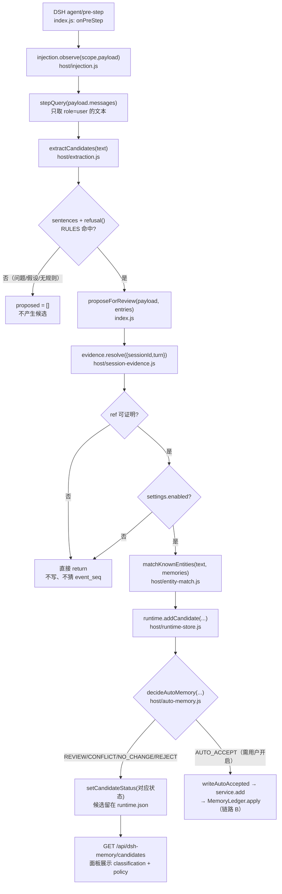
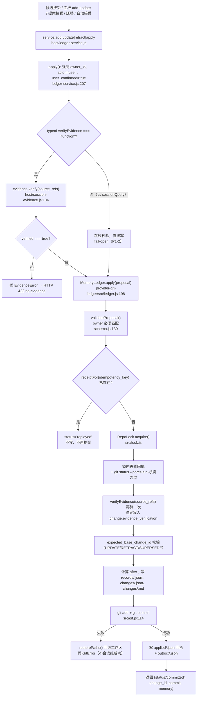
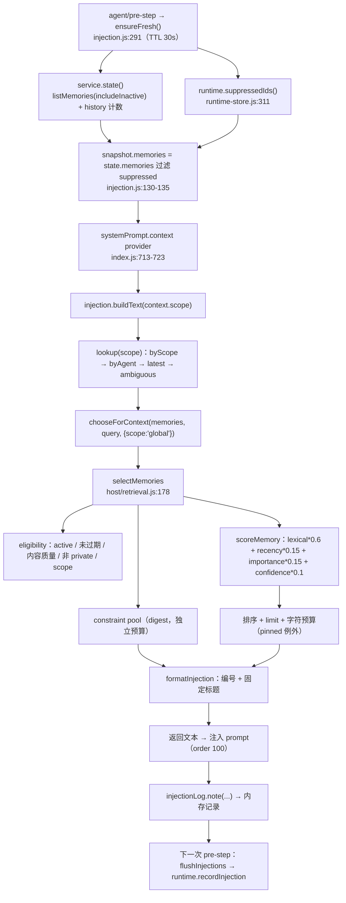
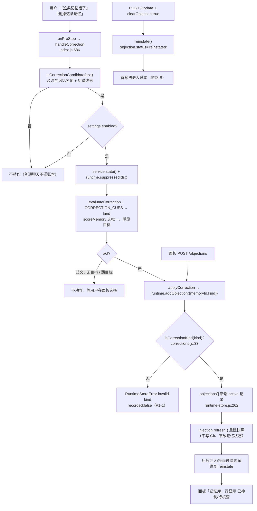
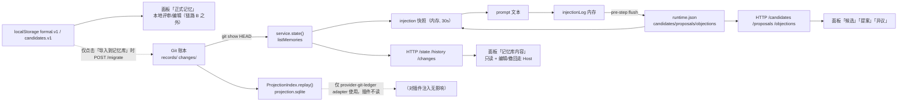
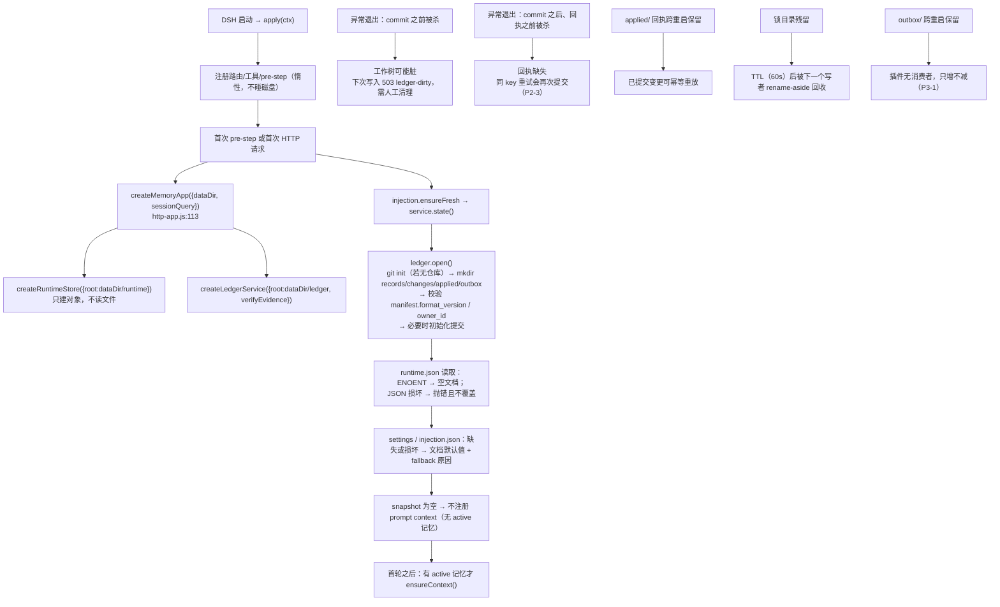

# dsh-memory 阶段 0 只读审计报告

- 归档位置：`docs/status/`。文中以审计当时路径引用的 `docs/dsh-memory-*.md`，现已分类到 `docs/design/`、`docs/status/`、`docs/ops/`。
- 审计对象：`F:\deepseek-memory`（`origin` = https://github.com/xfastres/deepseek-memory）
- 审计时间：2026-10-29
- 审计基线：分支 `main`，HEAD `1e49b42a24c99479bab38148db66ef8abc4657a0`（`origin/main` 同点）
- 工作区：审计开始时与结束时 `git status --porcelain` 均为空；本报告是唯一新增文件，未修改任何已有文件，未创建提交
- 审计方式：通读 `packages/*/src|host|test` 与 `client.js`，并以实际执行测试、离线评估作为基线
- 环境：Node `v24.16.0`，git `2.45.1.windows.1`

> 说明：本报告只记录**能从代码或实际执行结果确认**的事实。无法从仓库内代码确认的行为，统一放在第 9 节「尚未验证的风险」，不写成已确认缺陷。

---

## 1. 结论摘要

1. 项目结构清晰，设计意图（证据优先、单一 Git Writer、失败不影响对话、异议优先、AI 不批准自己）在**大部分**代码中确实落实了，不是只写在文档里。Git 账本的写入、锁、幂等、脏树拒绝、崩溃回滚都有真实实现与测试。
2. **最重要的结构事实**：`MemoryLedger.apply()` 是唯一的 Git 写入器，但它有三个层面的调用入口（Host service、HTTP 路由、未挂载的 Adapter），且「证据校验」这道闸门在 Host 层是**条件式**的：没有 `sessionQuery` 时静默关闭。
3. 发现 1 个 P0、4 个 P1、10 个 P2、9 个 P3。P0 是写路由没有调用者认证，导致「AI 不批准自己」在具备本机命令执行能力时可以被绕过；P1 集中在四处：自然语言纠错的 kind 与词汇表不一致、证据闸门 fail-open、localStorage 双权威、异议抑制 fail-open。
4. 测试基线是真实的绿灯：插件 375、账本 32、L0 7，共 414 项全部通过，0 失败 0 跳过；离线提取评估 24/24 精确匹配。这解释了为什么上述缺陷能长期存在——**它们全部落在现有测试断言之外，或已被测试固化为「预期行为」**（见各条的「现有测试」）。
5. 文档与代码存在多处不一致，其中「写接口必须带浏览器同源标记」与代码直接矛盾，属于会误导安全判断的文档缺陷。

---

## 2. 项目整体架构

### 2.1 三个包

```
packages/dsh-memory/          DSH Cordis 插件（Host + Client），本仓库的部署单元
packages/provider-git-ledger/ Git 账本内核 + Mnemon Memory Space Provider（独立产品，未被插件挂载）
packages/l0-conversation/     纯函数 L0 只读模型（事件 → 轮次时间线）
scripts/                      验收夹具准备脚本
docs/                         调查、路线图、阶段设计、API 契约、状态交接
```

### 2.2 部署形态

- `packages/dsh-memory/cordis.patch.yml` 只做一件事：把 `@local/dsh-memory` 插入 composition。
- 插件 Host 入口 `packages/dsh-memory/index.js` 的 `apply(ctx)` 注册四类能力：
  1. `webServer.register` 注册 `/api/dsh-memory/*` 路由（惰性创建 app，激活时不碰磁盘）；
  2. `tools.register` 注册 `dsh_memory_ping` / `memory_propose` / `memory_search`；
  3. `ctx.on('agent/pre-step', onPreStep)` 观察用户文本、抽取候选、处理纠错、刷新快照、注册 prompt context；
  4. `systemPrompt.context({name:'dsh-memory', order:100, text})` 把记忆文本注入模型上下文。
- Client 入口 `packages/dsh-memory/client.js` 是一个 Web 面板：会话时间线、候选、记忆库只读视图、异议、提案、设置、注入审计。
- `packages/provider-git-ledger` **没有**被 `dsh-memory` 的任何文件 import（`grep ProjectionIndex|GitLedgerAdapter` 在 `packages/dsh-memory` 内 0 命中）。它通过 `dsh-mnemon-source-memory-spaces` 的 `config.providers` 挂载，是另一条产品线；当前插件只复用了它的 `src/ledger.js`、`src/schema.js`、`src/lock.js`。

### 2.3 一次对话内的数据流（高层）

```
用户消息 ──agent/pre-step──▶ 观察文本 ──▶ 规则抽取 ──▶ 候选（runtime.json）
                                   │
                                   ├──▶ 证据解析（ctx.sessionQuery）──▶ source_refs
                                   │
                                   └──▶ 纠错识别 ──▶ 异议（runtime.json）──▶ 注入抑制

Git 账本（~/.dsh/dsh-memory/ledger）──30s 快照──▶ 内存快照 ──▶ 词法检索/预算 ──▶ prompt context
        ▲
        └── 唯一写入器 MemoryLedger.apply() ◀── Host service ◀── HTTP 路由 / 自动接受 / 迁移
```

---

## 3. 核心目录与文件职责表

### 3.1 `packages/dsh-memory`

| 路径 | 职责 | 关键实现事实 |
|---|---|---|
| `index.js` | Host 半边入口：路由表、工具、pre-step、prompt context、ping 探测 | `apply(ctx)` 在 452 行；`createProposeTool` 201 行；`createSearchTool` 294 行；`ensureContext` 702 行；pre-step 764–797 行 |
| `client.js` | Web 面板（约 2582 行） | 同时存在 **Host 客户端**（`createHostClient`，954 行）与 **localStorage 本地存储**（`loadStored` 579 行、`editMemory` 661 行、`reviewCandidate` 670 行、`importMemory` 711 行） |
| `host/http-app.js` | HTTP 应用与围栏、全部路由处理器 | `createMemoryApp` 113 行；`isTrustedRead` 52 行；`isTrustedWrite = isTrustedRead` 78 行；路由表 168–638 行 |
| `host/ledger-service.js` | Host 侧账本服务（唯一写入口） | `apply()` 205–232 行：强制 `actor:'user'`、`user_confirmed:true`，再按需 `verifyEvidence` |
| `host/runtime-store.js` | `runtime.json`：候选、提案、异议、注入记录 | `addCandidate` 217 行；`addObjection` 262 行；`suppressedIds` 311 行；原子写 163–173 行；损坏拒绝 143 行 |
| `host/extraction.js` | 从用户原话抽候选（中英规则、问题/假设过滤、置信度） | `RULES` 22–61 行；`extractCandidates` 94 行；上限 3 条/轮 |
| `host/correction-detect.js` | 自然语言纠错识别 + 目标匹配 + 记录异议 | `CORRECTION_CUES` 21–30 行（含 `incorrect`、`delete_request`）；`applyCorrection` 110 行 |
| `host/corrections.js` | 纠错词汇表 | `CORRECTION_KINDS` 8–17 行（`wrong`、`delete`，**无** `incorrect`/`delete_request`） |
| `host/session-evidence.js` | turn → 真实 `event_seq`；refs 校验；quote 哈希 | `resolve` 107 行；`verify` 134 行；无 `quote_sha256` 时只验事件存在与类型 |
| `host/policy.js` | 纯策略决策（5 种结果） | `evaluateCandidatePolicy` 38 行；auto-accept 默认关闭 |
| `host/auto-memory.js` | 受控自动接受 | `writeAutoAccepted` 69 行，幂等键 `auto:<candidate.id>` |
| `host/classification.js` | 候选 vs 账本：ADD/NO_CHANGE/CONFLICT | 只读派生，从不写 |
| `host/injection.js` | 快照、scope 查找、prompt 文本组装、注入日志 | `refresh` 116 行（**suppressed 读取失败时退化为不过滤**）；`buildText` 210 行；`ensureFresh` 291 行 |
| `host/retrieval.js` | 词法评分 + 两池预算选择 | `eligibility` 134 行；`selectMemories` 178 行；无向量、无持久索引 |
| `host/search.js` | `memory_search` 工具的实现 | 复用 eligibility，并额外隐藏被异议记忆（46 行） |
| `host/injection-log.js` | 注入记录（内存）与去重键 | 记录只在内存，pre-step 边界 flush 到 runtime.json |
| `host/settings.js` | `memory-settings.json` | 默认 `enabled:true, autoAccept:false`；写为同步临时文件 + rename |
| `host/constraints.js` | `injection.json` 常驻约束配置 | 与账本分离；摘要校验 sourceDigest |
| `host/migration.js` | localStorage → 账本的一次性迁移 | 逐条解析证据，失败则跳过并报告 |
| `host/narrowing.js` | 「太宽泛」异议能否变成新写法 | 恒返回 `propose:false`，不编造替代表述 |
| `host/scenarios.js` / `host/persona.js` | L2 场景 / L3 人设纯函数 | 未接路由、未接 UI；人设不进 prompt |
| `host/entity-match.js` | 从账本已有实体继承名字 | 不发明实体 |
| `host/condense.js` | 约束摘要 + 内容指纹 | 用于常量约束池 |
| `host/classification.js` 等 | 见上 | |
| `l0/index.js`、`l0/today.js`、`l0.js` | L0 只读模型 | 与 `packages/l0-conversation/src/*` **逐字节相同**（sha256 一致） |
| `eval/` | 提取规则离线评估 | 24 例，退出码恒 0 |
| `test/` | 30 个测试文件 | 375 项 |
| `locale/`、`icon.svg`、`cordis.patch.yml` | 面板本地化与打包 | |

### 3.2 `packages/provider-git-ledger`

| 路径 | 职责 | 关键实现事实 |
|---|---|---|
| `src/ledger.js` | **唯一 Git 写入器** `MemoryLedger` | `apply` 198 行；锁 + 幂等 + 脏树检查 + 证据记录 + 提交 + 回执/outbox |
| `src/schema.js` | 记录/提案 schema 与 ID 生成 | active 必须有 `source_refs`（119 行）；`agent-inference` 必须是 `hypothesis`（116 行）；`validateMemory` 白名单丢弃未知字段 |
| `src/git.js` | 最小 git 传输 | 无 shell、有超时、无网络；`commitPaths` 114 行返回真实 hash |
| `src/lock.js` | 跨进程仓库锁 | `mkdir` 原子性、owner 记录、TTL 回收、心跳、只允许 owner 释放 |
| `src/projection.js` | SQLite FTS5 投影（可重建） | outbox 驱动 replay；rebuild 从 HEAD；**插件不使用** |
| `src/adapter.js` | Mnemon Provider 适配器 | `remember` 128 行：只要求 `sourceRefs` 非空，然后直接 `ledger.apply` |
| `src/index.js` | Mnemon provider 定义 | 只有被 mnemon Source 挂载才生效 |
| `src/descriptor.js` | 能力真值表 | `forget:false`、`deletionMode:'unsupported'` |
| `test/` | 32 项，含并发、崩溃、锁、重建 | |

### 3.3 `packages/l0-conversation`

| 路径 | 职责 |
|---|---|
| `src/index.js` | `projectTurns` / `completedTurns` / `groupTurnsByDate` / `userFacingTurns` / `turnMessages` |
| `src/today.js` | 读取当天主会话轮次（依赖 Host `sessionQuery`） |
| `scripts/verify-live.mjs` | 真实会话只读校验 |
| `test/` | 7 项 |

### 3.4 其他

| 路径 | 职责 |
|---|---|
| `scripts/prepare-isolated-acceptance.mjs` | 生成隔离验收夹具与约束（拒绝生产数据） |
| `docs/dsh-memory-host-api.md` | HTTP 契约（部分字段已落后于代码） |
| `docs/dsh-memory-v2-status.md` | 交接状态（测试数已过期） |
| `docs/dsh-memory-roadmap-v2.md` 等 | 设计依据与进度 |
| `tmp/`（未跟踪、gitignored） | 一份旧的 `dsh-memory-package` 副本、L0 live 夹具、HTTP 测试日志 |

---

## 4. 核心类/函数之间的调用关系

```
index.apply(ctx)
├─ createRoutes({lookup,getApp,status})
│   └─ handler → getApp().routes[path](req,res)
├─ createInjectionRuntime({service:{state,suppressed}})
├─ tools.register(createPingTool / createProposeTool / createSearchTool)
└─ ctx.on('agent/pre-step', onPreStep)
    ├─ injection.observe(scope,payload)          // injection.js
    ├─ extractCandidates(text)                   // extraction.js
    ├─ proposeForReview(payload, entries)
    │   ├─ app.evidence.resolve({sessionId,turn})   // session-evidence.js
    │   ├─ app.runtime.addCandidate(...)            // runtime-store.js
    │   └─ decideAutoMemory(...) → writeAutoAccepted → service.add
    ├─ handleCorrection(text) → applyCorrection → runtime.addObjection
    ├─ injection.ensureFresh() → refresh() → service.state()
    ├─ refreshConstraints() → resolveConstraints
    ├─ flushInjections() → runtime.recordInjection
    └─ ensureContext() → systemPrompt.context(provider)

createMemoryApp({dataDir,sessionQuery})
├─ createRuntimeStore({root:dataDir/runtime})
├─ createEvidenceResolver({sessionQuery})        // 可能为 null
└─ createLedgerService({root:dataDir/ledger, verifyEvidence})
    └─ new MemoryLedger(...) → open()/apply()
        ├─ RepoLock.acquire()                    // lock.js
        ├─ GitRepo.statusPorcelain/commitPaths   // git.js
        └─ 写 records/ changes/ applied/ outbox/

GitLedgerAdapter.remember (另一条产品线，未被 dsh-memory 挂载)
└─ MemoryLedger.apply()  ← 不经过 Host 的 EvidenceError 拒绝
```

---

## 5. 数据存储与权威来源

### 5.1 位置

| 数据 | 位置 | 是否权威 | 说明 |
|---|---|---|---|
| 正式记忆记录 | `~/.dsh/dsh-memory/ledger/records/<memory_id>.json` | **权威**（Git 提交） | 读路径只读 `git show <HEAD>:path`，工作区未提交内容不可见 |
| 变更历史 | `ledger/changes/<change_id>.json` + `.md`、`git log` | **权威** | 一条变更一个 commit；commit hash 不写回 change 文件 |
| 幂等回执 | `ledger/applied/<sha256(key)>.json` | 权威的派生物（gitignored） | 丢失会导致重复提交，见 P2-3 |
| outbox | `ledger/outbox/<change_id>.json` | 派生物（gitignored） | 只由 `ProjectionIndex.replay` 消费；**插件不消费** |
| 检索投影 | `<space>/projection.sqlite` | 派生、可重建 | 仅 `provider-git-ledger` 使用；插件不使用 |
| 候选 | `~/.dsh/dsh-memory/runtime/runtime.json` | **权威**（不可从账本重建） | 含 `candidates[]` |
| 提案（AI） | 同上 `proposals[]` | **权威** | 模型只能写这里 |
| 异议 | 同上 `objections[]` | **权威** | 不是账本写入；撤回/恢复只改这里 |
| 注入审计 | 同上 `injections[]` | 权威但可丢 | 仅内存缓冲 + pre-step flush |
| 设置 | `~/.dsh/dsh-memory/memory-settings.json` | **权威** | 与账本分离 |
| 常驻约束配置 | `~/.dsh/dsh-memory/injection.json` | **权威** | 带 sourceDigest 防腐 |
| 前端记忆副本 | 浏览器 `localStorage["dsh-memory.formal.v1"]`、`["dsh-memory.candidates.v1"]` | **第二权威（问题）** | 见 P1-3 |
| 注入快照 | Host 进程内存（最多 30s） | 纯派生缓存 | 每次从账本重建 |
| L0 会话日志 | DSH `ctx.sessionQuery`（只读） | **权威证据源** | 插件从不写 |

### 5.2 权威关系图

```
DSH Session 日志（真相，只读）
        │ source_refs（session_id + event_seq + 可选 quote_sha256）
        ▼
Git 账本 records/（正式记忆唯一权威）
        │ 读：git show HEAD
        ▼
Host 内存快照（派生缓存，30s）
        ▼
prompt context（模型看到的唯一来源）

runtime.json（候选/提案/异议/注入审计）── 抑制过滤 ──▶ 快照
localStorage（面板"正式记忆"列表）── 只经 /migrate 才能进账本 ──▶ Git 账本
projection.sqlite（可重建投影）── 仅 mnemon adapter 使用，不影响插件注入
```

**结论**：正式记忆的权威来源是 Git 账本；运行时状态（候选/提案/异议）的权威是 `runtime.json`；`localStorage` 不是权威，但当前面板把它当作并列的「正式记忆」展示与编辑，这是双权威缺陷（P1-3）。

---

## 6. 六条完整调用链

### A. 记忆提取链路（用户消息 → 候选）



状态：**能从代码确认**。唯一无法从仓库内确认的是 DSH 传给 `agent/pre-step` 的 payload 形状是否始终含 `agent.id` 与整数 `turn`；代码对缺失情况是直接不产生候选（fail-safe）。

### B. 正式写入链路（候选 → 证据 → 审核 → 账本）



状态：**能从代码确认**。注意两处：`actor`/`user_confirmed` 被 Host 无条件改写（P2-5）；回执写在 commit 之后（P2-3）。

### C. 检索注入链路（Agent 请求 → 过滤 → 排序 → 注入）



状态：**能从代码确认**。关键事实：注入的 query 来自 `agent/pre-step` 观察到的**用户文本**；多会话且 scope 无法匹配时 query 被丢弃（`ambiguous`），但**记忆集合仍是全局的**，仍会按新近度/重要度注入（P2-8）。`eligible` 不看 `type` 与 `source_kind`，只排除 `status!=='active'`、过期、private、低质量、scope 不符。

### D. 纠错链路（用户纠正 → 识别目标 → 异议 → 抑制 → 修订）



状态：**能从代码确认，且存在断点**。`incorrect`、`delete_request` 两个 cue 的 kind 不在 `CORRECTION_KINDS` 中，`addObjection` 抛 `invalid-kind`，`applyCorrection` 返回 `recorded:false`；`handleCorrection` 不刷新快照。也就是说：**「这条记忆错了」「删掉这条记忆」这类最自然的说法，系统实际什么都没做**（面板按钮直接传 `wrong`/`delete`，是好的）。

### E. 数据一致性链路（账本 / 运行时 / 索引 / 前端缓存）



状态：**能从代码确认**。这里有三套「记忆」在同时存在：Git 账本（模型实际使用的）、runtime 候选/异议（抑制模型输入的）、localStorage 正式记忆（只给人看、可本地编辑）。三者之间没有自动同步，只有显式 `/migrate`。

### F. 启动恢复链路（启动 / 异常退出 / 重启）



状态：**能从代码确认**。无法从仓库内确认的是 DSH 进程被杀时 `git commit` 的确切中断点（这决定工作树是否脏），因此该条只描述代码的两种处理分支，不宣称概率。

---

## 7. 测试基线（实际执行）

### 7.1 命令与结果

| # | 命令 | 结果 | 耗时 |
|---|---|---|---|
| 1 | `node --test --test-force-exit packages/dsh-memory/test/*.test.mjs` | **tests 375 / pass 375 / fail 0 / cancelled 0 / skipped 0 / todo 0** | 59.4s |
| 2 | `node --test packages/provider-git-ledger/test/*.js` | **tests 32 / pass 32 / fail 0 / skipped 0**（3 suites；`helpers.js` 被当作测试文件加载但无用例） | 38.8s |
| 3 | `node --test packages/l0-conversation/test/*.js` | **tests 7 / pass 7 / fail 0 / skipped 0** | 0.2s |
| 4 | `node packages/dsh-memory/eval/run-extraction-eval.mjs` | **cases 24 · expected 15 · extracted 15 · precision 100% · recall 100% · exact-count 24/24**（退出码恒 0） | 即时 |

合计：**414 项测试全部通过**。命令 1 中出现的 `[dsh-memory] registration failed (...)` 是测试故意破坏注册后验证「单条注册失败不影响其它注册」的预期告警，不是失败。

### 7.2 构建、静态检查、安装

| 项 | 状态 |
|---|---|
| 构建 | **无构建步骤**：全部为 ESM JavaScript，Host 用 Electron 自带 Node 直接加载 |
| 静态检查 | 仓库根**没有** `package.json`、`eslint.config.js`、`tsconfig.json`；无 lint/typecheck 可跑 |
| 安装 | 按 README：Profile `package.json` 用 `link:` 指向 `packages/dsh-memory`，加入 `dsh.profile.bundles`，安装后重启 DSH；本审计未做安装或重启 |
| 运行时依赖 | `dsh-memory` 零 npm 依赖；账本要求本机 `git`；`provider-git-ledger` 依赖 `@deepseek-ai/cordis` 与 `dsh-mnemon-source-memory-spaces`（已装） |
| Node 版本 | 本机 v24.16.0；包声明 `>=22.5`（仅 provider 声明 engines） |

### 7.3 无法执行的检查

- 无 lint / typecheck / build 可执行（仓库未提供）。
- 未在真实 Electron + DSH 里做端到端注入验证（本阶段只读审计，且不重启用户的 DSH）。
- 未对 `provider-git-ledger` 的 mnemon 挂载做真实进程验证（需要 mnemon Source，本阶段不安装）。

---

## 8. 缺陷清单

> 说明：严重级别按「对核心不变式/数据完整性/安全的影响」判定，而不是按修复难度。
> 现有测试一栏写「覆盖」或「未覆盖」，并给出具体文件行；「覆盖」也可能意味着**测试把缺陷固化成了预期行为**。

### 8.1 总表

| 编号 | 级别 | 一句话 | 主要位置 |
|---|---|---|---|
| P0-1 | P0 | 写路由无调用者认证，本机任意进程/具备 shell 的 agent 可直接改账本，绕过「AI 不批准自己」 | `host/http-app.js:78, 261-345, 402-458` |
| P1-1 | P1 | 自然语言纠错的 `incorrect`/`delete_request` 不在词汇表，最强两种说法静默失败 | `host/correction-detect.js:21-30`、`host/corrections.js:8-17` |
| P1-2 | P1 | 证据闸门在 `sessionQuery` 缺失时静默关闭（fail-open），且未声明依赖 | `host/http-app.js:117-129`、`host/ledger-service.js:212-220` |
| P1-3 | P1 | localStorage 与 Git 账本双重权威，面板把本地副本标为「正式记忆」 | `client.js:26, 579-586, 661-758, 2265-2277` |
| P1-4 | P1 | 异议抑制 fail-open：`suppressedIds()` 失败时注入放弃过滤；runtime.json 损坏则异议全失效 | `host/injection.js:116-135`、`host/runtime-store.js:131-161` |
| P2-1 | P2 | 证据只验事件存在/类型/可选哈希，不验正文与事件一致；`quote_sha256` 可省略 | `host/session-evidence.js:134-174`、`host/http-app.js:261-293` |
| P2-2 | P2 | UPDATE/RETRACT 不带新证据，`verify([])` 恒真；变更说明仍称「来源已核验」 | `host/ledger-service.js:257-282`、`ledger.js:480-515` |
| P2-3 | P2 | commit 成功后回执/outbox 写失败：调用方见失败但记忆已提交；无回执可重复提交 | `provider-git-ledger/src/ledger.js:382-403` |
| P2-4 | P2 | commit 后 `setCandidateStatus` 失败 + 两套幂等键（`auto:` / `candidate:`）→ 可产生两条 | `host/auto-memory.js:69-85`、`host/http-app.js:420-439` |
| P2-5 | P2 | 所有写入强制 `actor='user'`、`user_confirmed=true`；自动接受/迁移被记成用户确认 | `host/ledger-service.js:207` |
| P2-6 | P2 | `review accept` 不校验 classification/policy，NO_CHANGE/CONFLICT 候选可被接受成重复记忆 | `host/http-app.js:402-458`、`host/classification.js` |
| P2-7 | P2 | 第二条正式写入口 `GitLedgerAdapter.remember` 不执行 Host 的 EvidenceError 拒绝 | `provider-git-ledger/src/adapter.js:128-174`、`ledger.js:243-244` |
| P2-8 | P2 | 无 workspace 隔离；多会话歧义时丢弃 query 仍注入全局记忆 | `host/injection.js:53-65, 210-227`、`host/retrieval.js:134-143` |
| P2-9 | P2 | 文档与代码不一致（写围栏、`/state` 字段、存储布局、测试数、提取描述、FTS） | `docs/dsh-memory-host-api.md:27,89,108,143` 等 |
| P2-10 | P2 | 自动接受开启时候选以「用户已确认的长期记忆」注入（候选→事实的标签问题） | `host/retrieval.js:343-351`、`host/auto-memory.js:69` |
| P3-1 | P3 | outbox 无消费者（插件不挂 ProjectionIndex），文件只增不减 | `provider-git-ledger/src/ledger.js:401, 407-427` |
| P3-2 | P3 | `sensitivity`/`pinned` 被 schema 白名单丢弃，私有与置顶控制是死代码 | `provider-git-ledger/src/schema.js:90-123`、`host/retrieval.js:137,152` |
| P3-3 | P3 | `/add` 丢 `scope`/`reason`；`/update` 丢 `reason`/`sourceRefs`，变更理由永久缺失 | `host/http-app.js:279-288, 304-310` |
| P3-4 | P3 | `recentChanges` 捕获 git 错误返回空，面板显示「没有提交」而非错误 | `host/ledger-service.js:86-95` |
| P3-5 | P3 | `writeSettings` 临时文件名仅用 pid，并发 POST /settings 可能互相覆盖 | `host/settings.js:87-94` |
| P3-6 | P3 | 插件 `l0/` 与 `l0-conversation/src/` 逐字节重复（sha256 相同） | `packages/dsh-memory/l0/*` |
| P3-7 | P3 | 注入审计日志仅在内存，崩溃会丢失未 flush 的记录 | `host/injection.js:112-114, 307-308` |
| P3-8 | P3 | commit 前崩溃留下脏工作树 → 后续写入 503，直到人工清理 | `provider-git-ledger/src/ledger.js:234-241`、`git.js:120-130` |
| P3-9 | P3 | `/state` 对每条记忆调用一次 `history()`（N 次 git），随账本线性变慢 | `host/ledger-service.js:71-80`、`ledger.js:168-177` |

### 8.2 详细证据与最小修复

#### P0-1 写路由无调用者认证，可绕过审批直接修改正式记忆

- **文件/函数**：`packages/dsh-memory/host/http-app.js` 的 `isTrustedRead`（52）、`isTrustedWrite = isTrustedRead`（78），路由 `/add`（261）、`/update`（295）、`/retract`（329）、`/review`（402）、`/proposals`（558）。
- **代码证据**：
  - `isTrustedWrite = isTrustedRead`，写请求只需要「回环 socket + 回环 Host + 非 cross-site」，没有任何调用者身份、token 或浏览器同源标记。
  - `test/http-app.test.mjs:72-98` 明确断言：**无 Origin、无 Sec-Fetch-Site 的裸请求也能写入成功**，并注释「A local client with no Origin and no Sec-Fetch-Site still reaches the handler」。
  - `POST /update` 只要求 `memoryId` + `content`；`expectedBaseChangeId` 可选，省略时 ledger 跳过基线校验（`ledger-service.js:268` → `ledger.js:252`）。
  - 文档自己确认：`docs/dsh-memory-v2-status.md:14`「插件路由绕过认证层，回环防护是唯一的一道门」。
- **触发条件**：调用方能在本机向 `127.0.0.1:<DSH web 端口>` 发 HTTP。DSH agent 的 shell 工具通常满足；任意本机脚本也满足。
- **后果**：
  1. 模型可以 `GET /state` 读到 `last_change_id` 与全部记忆，再 `POST /update` 改写任意正文，**不需要用户批准**，也不产生提案记录；
  2. `POST /retract` 可直接撤回；
  3. `POST /add` 可凭一个格式合法的 `sourceRef` 写入任意内容（若 `sessionQuery` 存在，只校验事件存在/类型，不校验正文；若不存在，完全不校验，见 P1-2）。
  这直接违反 README 的设计约束 5「AI 不批准自己」和路线图 D9。
- **现有测试**：测试**覆盖并固化了**「裸请求可写」这一行为（`http-app.test.mjs:72-98`）；没有认证/授权测试。
- **最小修复**：
  1. 给写路由加一个**每次 Host 启动生成、只注入到页面**的随机 token（`GET /state` 时下发或由 DSH 注入 `window` 变量），写请求必须带 `x-dsh-memory-token`；或复用 DSH web server 的会话认证；
  2. 至少恢复文档承诺的写围栏（要求 `Origin`/`Sec-Fetch-Site` 之一），但这**不能**阻止本机 shell，只能防浏览器跨站；
  3. `/update` 强制 `expectedBaseChangeId`（去掉 `null` 放行），把「无基线覆盖」变成 409；
  4. 修完后必须同步改 `http-app.test.mjs` 中固化裸写成功的断言。

#### P1-1 自然语言纠错 kind 失配，最强两种说法静默失败

- **文件/函数**：`host/correction-detect.js` `CORRECTION_CUES`（21–30）、`applyCorrection`（110–127）；`host/corrections.js` `CORRECTION_KINDS`（8–17）、`isCorrectionKind`（33）。
- **代码证据**：
  - cue 表包含 `kind: 'delete_request'`（22）与 `kind: 'incorrect'`（29）。
  - 词汇表只有 `wrong` / `delete`，**没有** `incorrect` / `delete_request`。
  - `applyCorrection` 把 `decision.kind` 原样传给 `runtime.addObjection`；`runtime-store.js:267-269` 对未知 kind 抛 `RuntimeStoreError(..., 'invalid-kind')`；`applyCorrection` 捕获后返回 `{recorded:false, reason:'failed:invalid-kind'}`。
  - 对应说法在测试里被确认会命中：`test/correction-detect.test.mjs:27` 断言 `correctionKinds('这条记忆错了') === ['incorrect']`，`:29` 断言 `'删掉这条记忆' → ['delete_request']`；但**记录路径的测试只用 `outdated`/`too_broad`**（`:82`、`:101`）。
- **触发条件**：用户在对话里说「这条记忆错了」「删掉这条记忆」「delete that memory」等，而不是点面板按钮。
- **后果**：系统识别出了纠错、找到了目标，却在最后一步被词汇表拒绝；异议没有落盘，记忆继续参与检索与注入。`contextState.lastCorrection.recorded === false`，但 UI 不会主动提示失败。越权/隐私类纠错（删除请求）完全无效。
- **现有测试**：**未覆盖**（只测了 `correctionKinds`，没测这两个 kind 的 `applyCorrection` 持久化）。
- **最小修复**（二选一，推荐前者）：
  1. 在 `corrections.js` 增加别名映射 `incorrect → wrong`、`delete_request → delete`，在 `applyCorrection` 写库前归一化；
  2. 或把 `incorrect`/`delete_request` 直接加入 `CORRECTION_KINDS`（需同时决定面板是否展示这两个词）。
  并补测试：`applyCorrection({text:'这条记忆错了'})` 必须 `recorded:true` 且 `suppressedIds()` 含目标。

#### P1-2 证据闸门在 `sessionQuery` 缺失时静默关闭（fail-open）

- **文件/函数**：`host/http-app.js` `createMemoryApp`（113–129）、`host/ledger-service.js` `apply`（205–232）。
- **代码证据**：
  - `createMemoryApp`：`evidence = sessionQuery && typeof sessionQuery.listEvents === 'function' ? createEvidenceResolver(...) : null`；随后 `verifyEvidence: evidence === null ? undefined : (refs) => evidence.verify(refs)`。
  - `ledger-service.apply`：`if (typeof verifyEvidence === 'function') { ... verified !== true 才抛 }`。**不是函数就整段跳过**。
  - `MemoryLedger` 的默认 `verifyEvidence` 是 `acceptAllEvidence`（`ledger.js:67-68`），返回 `{verified:false}` 但**从不拒绝**，只把结果写进 change 记录。
  - `index.js` 的 `inject` 只声明 `['webServer','tools']`（430 行），`sessionQuery` 是可选 `lookup('sessionQuery')`（480 行）。
  - 文档承认这一点：`docs/dsh-memory-host-api.md:108`「没有 `sessionQuery` 的环境（纯账本单元测试）不做该校验」。
- **触发条件**：运行时 `ctx.get('sessionQuery')`/`ctx.sessionQuery` 不可用（服务名变化、插件加载顺序、精简 profile、测试/脚本环境）。
- **后果**：所有正式写入路径（`/add` 的显式 `sourceRef`、`/review` 接受、`/proposals` 接受、迁移）**静默失去证据校验**；candidate 路径仍会先 `resolve()`，但 HTTP `/add` 自带 `sourceRef` 时不经过 resolver。任何格式合法的 `{session_id,event_seq}` 都能成为「官方证据」。这违反 README 第 5 行「正式记忆必须能指回会话证据」与「不可伪造引用」。
- **现有测试**：`ledger-service.test.mjs` 全部在无 `verifyEvidence` 下运行（等于覆盖了「跳过」分支）；`http-app.test.mjs` 无 sessionQuery 的用例也直接提交 `sourceRef` 成功（`:77-80`、`:115-137`）。**没有**测试断言「无 resolver 时应拒绝写入」。
- **最小修复**：
  1. `createMemoryApp` 在 `sessionQuery` 缺失时**显式失败关闭**：写路由返回 `503 evidence-unavailable`（或仅在 `DSH_MEMORY_ALLOW_UNVERIFIED=1` 时允许测试）；
  2. 把 `sessionQuery` 加入 `inject` 声明（若宿主允许），让缺失成为加载期可见问题；
  3. `MemoryLedger` 增加 `requireVerifiedEvidence` 选项，默认拒绝 `verified!==true`，把「记录结果」变成「门禁」。
  4. 同步调整依赖「无证据也能写」的测试夹具。

#### P1-3 localStorage 与 Git 账本双重权威

- **文件/函数**：`client.js` `loadStored`（579）、`editMemory`（661）、`reviewCandidate`（670）、`importMemory`（711）、`migrateToHost`（1741）、`formal` 文案（26）、本地正式列表渲染（2265–2277）。
- **代码证据**：
  - localStorage 键：`dsh-memory.formal.v1`、`dsh-memory.candidates.v1`（175–176）。
  - 面板顶部状态有「Host 已连接/本地模式」（34–35），但本地 `memories` 列表的标题是 `formal: '正式记忆（{count}）'`，**没有**「未进账本」的警示；只有候选区有 `localCandidates` 说明（20）。
  - 本地接受候选 → `reviewCandidate` 直接 `localStorage.setItem(FORMAL_KEY, ...)`（670–699），**不经过**证据校验、不写 Git；`MemoryCard` 的保存走 `editMemory`（916 → 661），同样只写 localStorage。
  - 本地正式记忆与 Host 账本只在用户点「导入到记忆库」时经 `POST /migrate` 单向流入（1746），且迁移按证据逐条跳过。
  - `docs/dsh-memory-v2-status.md:34-35` 自己把这列为「还没做：客户端读路径切换 / 候选评审走 Host」。
- **触发条件**：任何使用面板本地候选/编辑/导入功能的用户。
- **后果**：
  1. 用户看到的「正式记忆」与模型实际注入的记忆是两套；本地接受的新记忆**永远不会进入 prompt**，因为注入只读账本（`injection.refresh` → `service.state()`）；
  2. 本地编辑「正式记忆」不会改变账本；用户以为改掉了，模型仍看到旧内容；
  3. 本地副本无证据、无版本历史、无审计；与 Git 账本分叉后没有自动对账手段；
  4. 迁移是手动的，且不可逆（本地副本不删除）。
- **现有测试**：`client.test.mjs` 大量用例**覆盖并认可**本地 ADD/UPDATE/merge/编辑（如 133、147、184、336 行）；`client-panels.test.mjs:393` 甚至断言本地存储被标为「unledgered and stays migratable」。没有测试检查「本地正式记忆不会进入注入」这一事实对用户是否可见。
- **最小修复**（分两步，避免一次重构太大）：
  1. **先改文案与视觉**：本地列表改名为「浏览器本地副本（未进账本）」，并逐行标注；Host 在线时默认只展示账本，本地副本折叠到「迁移」区；
  2. **再改架构**：面板的接受/编辑/拒绝全部走 Host 路由（需要补 `POST /add` 的客户端方法、把 `reviewCandidate` 改为 `client.review`），localStorage 降级为纯缓存/离线草稿，并加「本地副本与账本不一致」检测。
  依赖：必须先完成 P0-1 的认证，否则把写能力搬到 Host 只会扩大暴露面。

#### P1-4 异议抑制 fail-open

- **文件/函数**：`host/injection.js` `refresh`（116–137，尤其 121–128）；`host/runtime-store.js` `read`（131–161）、`suppressedIds`（311–321）。
- **代码证据**：
  - `refresh()` 中 `try { suppressed = await service.suppressed() } catch { suppressed = [] }`；随后 `memories.filter(m => !suppressed.includes(m.id))`。**读取失败 = 不过滤**。
  - `runtime-store.read()` 对损坏 JSON 抛 `RuntimeStoreError('corrupt')`，不覆盖、不修复；`suppressedIds()` 因此也会抛。
  - 与之矛盾：`host/search.js` 的调用方 `index.js:337-346` 在 `suppressedIds()` 失败时返回 `{ok:false,error:'suppressed-unavailable'}`（fail-closed），并注释「A failing objection lookup must not silently widen the search」。
  - 测试**明确固化**了 fail-open：`test/injection.test.mjs:230`「a failing suppressed lookup drops the filter instead of breaking the turn」。
- **触发条件**：`runtime.json` 损坏/不可读/被并发写坏；或 `runtime.suppressedIds()` 因锁超时、磁盘错误抛异常；或 `dataDir` 权限变化。
- **后果**：用户已声明「这条记忆是错的/不该保存」，但在下一次刷新失败时，该记忆**重新进入 prompt**；如果 runtime.json 持续损坏，异议永久失效且每次刷新都 fail-open。这与 README 设计约束 4「异议优先：用户标记有误后，该记忆立即退出普通检索和注入」相反。
- **现有测试**：**覆盖但方向相反**（`injection.test.mjs:203` 正常抑制、`:230` 失败时放行）。没有「失败时保持旧快照/拒绝注入」的测试。
- **最小修复**：
  1. `refresh()` 失败时**保留上一次快照**（含其 suppressed 集合），并标记 `snapshot.degraded = 'suppression-unavailable'`；首次加载失败则快照为空（宁可不注入）；
  2. `runtime-store` 对损坏文件提供「只读恢复」：备份损坏文件 + 从 `injection`/日志重建最小文档，或至少让 `suppressedIds()` 返回一个**拒绝式错误**，由注入层 fail-closed；
  3. 把 `search` 与 `injection` 的失败语义统一，并改掉 `injection.test.mjs:230` 的断言。

#### P2-1 证据只验「存在/类型」，不验正文一致

- **文件/函数**：`host/session-evidence.js` `verify`（134–174）、`resolve`（107–132）、`withQuote`（83–95）；`host/http-app.js` `/add`（261–293）。
- **代码证据**：
  - `verify` 只做：`records.find(seq)` → 存在；`target.type === ref.event_type`；**仅当 `ref.quote_sha256` 是字符串时**才读事件文本比对哈希（155–168）。
  - `quote_sha256` 在 `validateSourceRef` 中是可选字段（`schema.js:82-85`）。
  - `resolve()` 会附带 `quote_sha256`（`withQuote`），但 `/add` 直接使用调用方传入的 `body.sourceRef`，不会补哈希，也不会比对正文。
- **触发条件**：调用方直接 `POST /add {content, sourceRef:{session_id,event_seq}}`（或 `/candidate` 带 `sourceRef` 后接受）。
- **后果**：可以把任意正文挂到一条真实存在、类型为 `user/message` 的事件上，账本记录会显示「来源已对照 DSH Session 日志核验」，但正文并非该事件说的话。审计链看起来完整，实际是伪归属。结合 P0-1，这是可被模型利用的伪造路径。
- **现有测试**：`session-evidence.test.mjs` 覆盖「事件消失/类型不符/哈希不符」；`http-app.test.mjs:115-137` 覆盖显式 `sourceRef` 成功写入。**没有**测试「正文必须与事件文本一致」。
- **最小修复**：
  1. `/add` 只接受 `{sessionId, turn}`（由 Host 解析）或要求 `sourceRef` 必须带 `quote_sha256`；
  2. 在 `verify`/写入前增加「正文必须出现在事件文本中（或至少哈希匹配）」的校验；
  3. 若短期不做语义校验，至少把 change 记录的 `evidence_verification` 明确标为 `existence-only`，不要输出「已核验」的句子。

#### P2-2 UPDATE/RETRACT 无新证据，变更说明仍称「来源已核验」

- **文件/函数**：`host/ledger-service.js` `update`（257–271）、`retract`（273–282）；`host/http-app.js` `/update`（295–327）、`/retract`（329–345）；`provider-git-ledger/src/ledger.js` `renderChangeNote`（480–515）。
- **代码证据**：
  - `/update`、`/retract` 路由**不传** `sourceRefs`；`service.update/retract` 的 `source_refs` 因此是 `undefined` → `validateProposal` 归一为 `[]` → `evidence.verify([])` 返回 `{verified:true}`（循环不执行）。
  - UPDATE 记录合并旧 `source_refs`（`ledger.js:303`），新正文不附带任何新证据。
  - `renderChangeNote`：`ev.verified ? '来源已对照 DSH Session 日志核验。' : ...`（503–504），即使 `source_refs` 为空也打印「已核验」。
- **触发条件**：面板编辑保存、`POST /update`、`POST /retract`、review merge、proposal update/retract。
- **后果**：
  1. 正文可以被改写成与证据无关的内容，而账本仍显示有证据；
  2. 变更说明对「空证据」给出肯定的核验声明，属于审计文本失真；
  3. 如果原始事件被删除，更新仍会成功（不校验旧 refs），记忆继续 active。
- **现有测试**：`http-app.test.mjs:380-425` 断言「update 不新增 ref 时保留旧 ref」——**覆盖了行为**，但没有断言「这一路径没有证据校验」；`renderChangeNote` 的空证据文案无测试。
- **最小修复**：
  1. 明确产品决策：用户手工编辑是否需要新证据。若需要，`/update` 必须带 `sessionId+turn` 或 `sourceRef`，由 Host 解析；
  2. 若不需要，在 `change.evidence_verification` 加 `scope:'carried-over'`，并让 `renderChangeNote` 对空 `source_refs` 打印「本次变更未引入新证据；沿用旧引用」，不打印「已核验」；
  3. 若旧 refs 已无法验证，写记录时标记 `stale_evidence:true`。

#### P2-3 commit 成功后回执/outbox 写失败

- **文件/函数**：`provider-git-ledger/src/ledger.js` `applyUnderLock`（226–403，尤其 382–403）。
- **代码证据**：`git.commitPaths` 成功后，才 `writeFile(applied/<sha>.json)` 与 `writeFile(outbox/<change>.json)`。这两个写失败会**直接抛出**，调用方看到失败，但 Git 提交已经落地。`receiptFor` 在下次以**同一 idempotency_key** 调用时找不到回执 → 不返回 `replayed`，会继续走完整写入流程（ADD 会生成新的 `memory_id`）。
- **触发条件**：磁盘满、权限变化、杀进程恰好落在 commit 与回执之间、文件系统错误。
- **后果**：一次用户操作可能产生**两条内容相同、id 不同**的正式记忆；或调用方报错但记忆其实已存在，用户重复操作。
- **现有测试**：`hardening.test.js:322`「H4 an exceptional repository state never reports a successful write」覆盖的是**commit 失败**；`ledger.test.js:152`「T5 commit succeeded but indexing failed」覆盖的是**投影失败**（outbox 已写、replay 修复）。**没有**覆盖「commit 成功、回执写失败」。
- **最小修复**：
  1. 把「意图」前置：commit 前先写 `applied/<sha>.intent`（或把 idempotency_key 写进 change 文件内容），使重试能检测到「已提交但回执缺失」；
  2. 或让 ADD 的 `memory_id` 由 `idempotency_key` 派生（确定性 ID），重复提交自然幂等；
  3. 回执写失败时不要再抛「未记录」，而是返回 `committed_unreceipted` 并让调用方按幂等键重试；
  4. 给 outbox 写失败降级为「警告 + 启动时扫描 changes/ 修复」而不是抛错。

#### P2-4 commit 后 `setCandidateStatus` 失败 + 两套幂等键

- **文件/函数**：`host/auto-memory.js` `writeAutoAccepted`（69–85）；`host/http-app.js` `/review` accept（420–439）。
- **代码证据**：
  - 自动接受：`service.add(... idempotencyKey: auto:<id>)` 成功后，才 `runtime.setCandidateStatus(candidate.id,'auto_accepted',{memoryId})`；后者失败则整个 Promise 失败，`index.js:570` 的 `.catch(()=>undefined)` 吞掉错误，候选停留 `proposed`。
  - 人工接受：`service.add(... idempotencyKey: candidate:<id>)`。两套键不同。
  - 候选没有 `memory_id` 时，人工接受会再写一条。
- **触发条件**：自动接受成功后 runtime.json 写失败（磁盘/锁）；或进程在 commit 与状态更新之间被杀。
- **后果**：账本里已有一条，候选仍显示待审；用户点「接受」→ 第二条同内容记忆（不同 `memory_id`、不同幂等键）。`auto:` 与 `candidate:` 的差异让幂等完全失效。
- **现有测试**：`auto-memory.test.mjs:80`「a failing write surfaces instead of claiming success」只覆盖 `service.add` 失败；没有覆盖「add 成功、状态更新失败」。
- **最小修复**：
  1. 让两种路径共用同一个幂等键前缀（例如统一 `candidate:<id>`），从根上消除双写；
  2. 先写候选状态为 `accepting`（persist），再写账本，最后 `accepted`；或接受「账本已写」为事实，启动时用 `memory_id`/内容回填候选状态；
  3. `writeAutoAccepted` 失败时把候选标为 `failed` 或保留 `memory_id`，不要静默留在 `proposed`。

#### P2-5 所有写入被记成「用户已确认」

- **文件/函数**：`host/ledger-service.js` `apply`（207）。
- **代码证据**：`const full = { ...proposal, owner_id: ownerId, actor: 'user', user_confirmed: true }`。自动接受（`writeAutoAccepted`）、迁移（`applyMigration`）、提案接受（`/proposals`）全部经过这里；账本 `changes/*.md` 会写「执行者：user（用户已确认）」。
- **触发条件**：用户开启 autoAccept 后自动写入；执行 `/migrate`；接受 AI 提案（后者用户确实点了接受，但 actor 仍是 user）。
- **后果**：审计无法区分「用户逐条确认」「策略自动写入」「迁移导入」。自动接受的内容从未被用户看过，却被记录为用户确认；这与 README「默认不自动写入账本；自动接受需用户打开」的谨慎定位不匹配。
- **现有测试**：`ledger-service.test.mjs:140` 断言用户写入 `source_kind:'user-explicit'`；没有测试自动接受/迁移的 `actor`/`user_confirmed`。
- **最小修复**：把 `actor`/`user_confirmed` 变成调用方参数（默认 `user`），自动接受传 `actor:'system', user_confirmed:true` 但 `source_kind:'session-extraction'`，迁移传 `actor:'system'`；`source_kind` 由调用方决定，不再在 `add()` 里硬编码 `user-explicit`。

#### P2-6 `review accept` 不校验 classification/policy

- **文件/函数**：`host/http-app.js` `/review` accept（420–439）；`host/classification.js` `classifyCandidate`；`host/policy.js`。
- **代码证据**：accept 分支只找 candidate、取内容与类型，然后 `service.add`；不读 `classification`，也不看 policy 的 `REJECT`/`NO_CHANGE`/`CONFLICT`。`/candidates` 只是把 `classification`/`policy` 作为展示字段返回（346–367）。
- **触发条件**：用户在面板对 `NO_CHANGE`（重复）或 `CONFLICT` 候选点「接受」；或直接 `POST /review`。
- **后果**：重复内容被写成第二条正式记忆（账本 ADD 没有内容去重）；`REJECT`（无证据/类型不允许）在候选阶段已被 schema/类型拦截，但 `NO_CHANGE`/`CONFLICT` 不受限。自动接受路径反而遵守 classification（`decideAutoMemory` → `NO_CHANGE` 不写），形成「机器更严格、人更宽松」的不一致。
- **现有测试**：`http-app.test.mjs:465-515` 只验证分类字段；没有「NO_CHANGE 候选被接受会重复」的测试。
- **最小修复**：accept 前重新 `classifyCandidate`；`NO_CHANGE` 要求显式 `force:true` 或直接 409；`CONFLICT` 要求走 merge（`/review action:'merge'`）而不是 add。

#### P2-7 第二条正式写入口 `GitLedgerAdapter.remember`

- **文件/函数**：`provider-git-ledger/src/adapter.js` `remember`（128–174）；`provider-git-ledger/src/ledger.js` `apply`（243–244）。
- **代码证据**：adapter 只要求 `justification.sourceRefs.length > 0`，随后 `ledger.apply(proposal)`。`MemoryLedger` 对 `verifyEvidence` 的返回值只记录、不拒绝（`ledger.js:243-244`，`acceptAllEvidence` 返回 `verified:false` 也照写）。Host 的 EvidenceError 拒绝只在 `ledger-service.apply` 里。
- **触发条件**：`dsh-mnemon-source-memory-spaces` 挂载该 provider，且 evidence hook 返回 refs 但 `verifyEvidence` 结果不可信/未配置。
- **后果**：同一个 Git 账本内核存在两套写入语义：Host 路径「验证失败即拒绝」，Adapter 路径「验证失败也写」。如果两条产品线共用 `dataDir`，审计口径不一致；adapter 写入的记忆会被插件 `service.state()` 读到并注入。
- **现有测试**：`adapter.test.js:32` 只覆盖「无证据 → candidate 回执」；没有「verifyEvidence=false 仍提交」的测试。
- **最小修复**：把「是否拒绝未验证证据」下沉到 `MemoryLedger`（选项 `requireVerifiedEvidence`，默认 true），Host 与 Adapter 共用；Adapter 的 evidence hook 返回 refs 时也跑同一个 verifier。

#### P2-8 无 workspace 隔离，多会话时仍注入全局记忆

- **文件/函数**：`host/injection.js` `chooseForContext`（53–65，硬编码 `scope:'global'`）、`lookup`（172–202）；`host/retrieval.js` `eligibility`（134–143）。
- **代码证据**：`chooseForContext` 固定传 `scope:'global'`；`eligibility` 对 `memory.scope !== 'global'` 且 `!== scope` 的返回 `other-scope`，所以非 global 记忆**永远不会被注入**；反过来，global 记忆在**所有**会话/项目可见。多会话且 scope 无法匹配时 `lookup` 返回 `ambiguous` + 空 query，但 `snapshot.memories` 仍是全局集合，`selectMemories` 在空 query 下按 recency/importance/confidence 选（`retrieval.js:260-263`）。
- **触发条件**：同一 DSH 实例有多个项目/多个会话；记忆默认都是 global。
- **后果**：项目 A 的记忆会注入项目 B 的上下文；多会话时即使丢弃 query，也会注入「最近/重要」的全局记忆。README 与 status 文档都承认这一点（README:135、status:54-55），但代码没有 workspace 字段，无法在现有 schema 上做隔离。
- **现有测试**：`retrieval.test.mjs`「the same workspace scope and global scope are both eligible」只测函数级 scope；没有跨项目/多会话注入测试（因为需要真实 Host）。
- **最小修复**：在账本 schema 增加 `workspace_id`（或复用 `scope` 为 `workspace:<hash>`），写入时由 Host 从 `context.scope` 解析；`eligibility` 变为「global 或同 workspace」；`chooseForContext` 传真实 scope。这是产品级改动，必须在 P1-3 之前定方案。

#### P2-9 文档与代码不一致

- **文件/位置**：
  1. `docs/dsh-memory-host-api.md:27` 声称写接口必须存在浏览器同源标记（`sec-fetch-site:same-origin` 或 `Origin` 或认证 Cookie），「裸 curl 即使来自本机也写不进去」；实际 `isTrustedWrite = isTrustedRead`（`http-app.js:78`），且测试证明裸请求可写（`http-app.test.mjs:72-98`）。
  2. 同文件 `:89` 声称 `/state` 返回 `revision`、`candidates`、`settings`、`ledger`；实际只返回 `{ok, head, memories}`（`http-app.js:169-178`）。
  3. 同文件 `:40-45` 的目录布局写 `index.sqlite`/`runtime.sqlite`；实际运行时是 `runtime.json`（`runtime-store.js:24`），插件没有 `index.sqlite`。
  4. `docs/dsh-memory-v2-status.md:73` 写「154 项通过」；实际 414 项。
  5. `README.md:134` 写「提取主要认中文显式说法；英文和隐式偏好会漏」；实际 `extraction.js` 已有英文规则（29–48），测试也覆盖英文。
  6. `README.md:35` 写「检索探测 node:sqlite 的 FTS5 trigram」；实际插件检索是 `retrieval.js` 的内存词法，sqlite 只是 ping 探测 + 未使用的投影。
  7. `docs/dsh-memory-host-api.md:143` 自己承认「实现现状与本文档早期规划的差异」，但上面几条没有同步。
- **触发条件**：读者按文档判断安全边界或接口能力。
- **后果**：最危险的是第 1 条——运维/开发者会以为写路由有浏览器来源保护，实际任何本机进程可写；第 2、3 条会让前端/集成方按不存在的字段开发。
- **现有测试**：无文档测试。
- **最小修复**：按代码重写第 1、2、3 条并标注「已实现/未实现」；更新测试计数；修正 README 的提取与检索描述；把「设计文档」与「实现契约」分成两份，避免同一文件两种状态。

#### P2-10 自动接受开启时候选以「用户已确认」注入

- **文件/函数**：`host/retrieval.js` `formatInjection`（343–351）；`host/auto-memory.js`（69）。
- **代码证据**：注入固定标题「以下是用户已确认的长期记忆，仅作背景参考：」；自动接受把规则抽取的句子直接写成 active 记忆，没有用户逐条确认；`renderChangeNote` 也记为「用户已确认」（P2-5）。
- **触发条件**：用户在设置里同时打开 `enabled` 与 `autoAccept`（默认关闭）。
- **后果**：模型把自动抽取的句子当作「用户确认过的事实」，降低了模型对内容不确定性的警惕；用户也可能不知道某条已被写入。属于标签/信任级别问题，不是数据错误。
- **现有测试**：`auto-memory.test.mjs` 覆盖策略；`injection` 测试使用固定标题，没有校验「自动接受」的标签差异。
- **最小修复**：给注入条目附带来源标签（`user-confirmed` / `auto-accepted` / `session-extraction`），或对 auto-accepted 记忆使用不同标题；`formatInjection` 从 `memory.source_kind`/`actor` 派生，而不是写死。

#### P3-1 outbox 无消费者

- **文件/函数**：`provider-git-ledger/src/ledger.js`（401 写 outbox；407–427 `pendingOutbox`/`ackOutbox`）；`src/projection.js`（唯一消费者）。
- **证据**：插件不 import `ProjectionIndex`；`dsh-memory` 的读取路径是 `git show`，不读 outbox。每次提交都会新增一个 outbox 文件，永不删除。
- **后果**：`~/.dsh/dsh-memory/ledger/outbox/` 随写入次数无限增长（小文件，但长期）。
- **现有测试**：`ledger.test.js` T5 覆盖 replay 消费；插件侧无。
- **最小修复**：插件启动/刷新时做一次 `ackOutbox`（或干脆不写 outbox，直到接入投影）；或让 `ledger` 在无消费者时跳过 outbox 写入（选项）。

#### P3-2 `sensitivity`/`pinned` 是死代码

- **文件/函数**：`provider-git-ledger/src/schema.js` `validateMemory`（90–123）；`host/retrieval.js`（137 private、152 pinned）。
- **证据**：`validateMemory` 只保留白名单字段，`sensitivity` 与 `pinned` 不在其中；`toUiMemory` 里 `sensitivity` 永远 `null`；`eligibility` 的 private 分支、`scoreMemory` 的 pinned 分支永远不会触发。
- **后果**：未来想用「私有/置顶」时，会以为已经支持；实际写入即丢。
- **现有测试**：`ledger-service.test.mjs:168` 断言 `sensitivity === null`（固化了缺失）。
- **最小修复**：要么把两个字段加入 schema 并端到端接通，要么删除死分支并在文档标注「未实现」。

#### P3-3 `/add` 丢 `scope`/`reason`，`/update` 丢 `reason`

- **文件/函数**：`host/http-app.js` `/add`（279–288）、`/update`（304–310）；`host/ledger-service.js` `add`/`update` 的参数。
- **证据**：`/add` 只传 `content,type,sourceRefs,idempotencyKey,tags,entities`；`service.add` 支持 `scope`、`reason` 但没有来源。`/update` 不传 `reason` 与 `sourceRefs`。
- **后果**：通过 HTTP 写入的记忆无法设置 scope（永远 global），变更说明永远「未提供理由」；与面板/提案路径不一致。
- **现有测试**：无。
- **最小修复**：路由透传 `scope`/`reason`，并在 schema 校验。

#### P3-4 `recentChanges` 静默返回空

- **文件/函数**：`host/ledger-service.js` `recentChanges`（86–95）。
- **证据**：`catch { return { head, changes: [] } }`。
- **后果**：git 读取失败时面板显示「账本还没有提交」，把故障伪装成空状态。
- **现有测试**：`http-app.test.mjs:426` 只测正常路径。
- **最小修复**：返回 `{ok:false,error}` 或 `changes:null`，让路由映射 503。

#### P3-5 `writeSettings` 并发覆盖

- **文件/函数**：`host/settings.js`（87–94）。
- **证据**：临时文件名 `${path}.${process.pid}.tmp`，同一进程并发两个 POST /settings 会写同一个临时文件；rename 无锁。
- **后果**：设置更新可能丢失或读到半写文件（小概率）。
- **现有测试**：`settings.test.mjs` 只测单次保存。
- **最小修复**：临时文件名加随机后缀；用 `runtime-store` 的锁或串行队列包住读改写。

#### P3-6 L0 代码重复

- **证据**：`packages/dsh-memory/l0/index.js` 与 `packages/l0-conversation/src/index.js` sha256 相同；`today.js` 也相同（实际核对过）。
- **后果**：两份副本会漂移；插件实际 re-export 的是自己那份（`l0.js`）。
- **最小修复**：插件改为依赖 `@dsh-memory/l0-conversation`（或删掉插件内副本），保留单一实现。

#### P3-7 注入审计日志崩溃丢失

- **证据**：`createInjectionLog` 只在内存（`injection.js:112`）；`flushInjections` 在 pre-step 才写 `runtime.recordInjection`。
- **后果**：进程在返回文本后、flush 前被杀，审计记录丢失（记忆本身不丢）。审计不完整。
- **最小修复**：接受这个取舍并在文档标注；或把 flush 提前到 provider 返回前（会阻塞 prompt，不推荐）。

#### P3-8 commit 前崩溃留下脏工作树

- **证据**：`ledger.js` 捕获 commit 失败会 `restorePaths`；但如果进程被强杀，没有机会回滚。`applyUnderLock` 下次会 `git status --porcelain !== ''` → `LedgerConflictError` → 503 `ledger-dirty`。
- **后果**：所有写入被阻断，直到人工清理；读不受影响（读 HEAD）。
- **现有测试**：`hardening.test.js:92` 覆盖「崩溃残留不可读」；`ledger.test.js:126` 覆盖「失败回滚」；没有覆盖「强杀后如何自动恢复」。
- **最小修复**：启动时检测脏树并只清理 `records/`、`changes/` 中未提交的路径（需谨慎），或提供显式 `POST /repair`；至少把 503 错误映射成可操作提示。

#### P3-9 `/state` 的 N+1 git 调用

- **证据**：`listMemories` 对每条记录调用 `history(record.memory_id)`（`ledger-service.js:75-77`），`history` 每次 `git log`（`ledger.js:168-177`）。
- **后果**：账本有 N 条记忆时 `/state` 发起 N+1 次 git 进程；大账本下明显变慢，且每次注入刷新都会走这条路径（30s TTL）。
- **最小修复**：一次 `git log --name-only` 批量算版本数；或把版本数缓存在内存快照里。

---

## 9. 推荐的修复顺序与依赖关系

> 原则：先收安全边界，再修「用户能感知的错误行为」，最后做一致性与架构；每一步都要先补失败用例再改代码（TDD），且不能破坏现有 414 项绿灯（除非测试本身固化了缺陷，已逐条注明）。

| 阶段 | 内容 | 依赖 | 说明 |
|---|---|---|---|
| 1 | **P0-1 写路由认证 + `/update` 强制基线** | 无 | 最小、最高收益；修完立刻缩小所有后续写入风险。需要同步改 `http-app.test.mjs` 的裸写断言与 `docs/dsh-memory-host-api.md:27`。 |
| 2 | **P1-1 纠错 kind 归一化** | 无 | 改动极小（别名表），补 2 个测试；建议紧随 P0 之后，因为它是「用户说错话系统装没听见」的直接体验缺陷。 |
| 3 | **P1-4 异议抑制 fail-closed** | 无（与 1 独立） | 改 `injection.refresh` 的 catch 分支 + 保留旧快照；同步改 `injection.test.mjs:230`。 |
| 4 | **P1-2 证据闸门 fail-closed + `sessionQuery` 声明** | 可与 3 并行 | 先决定「生产环境缺 sessionQuery 时是否允许写」；推荐拒绝。会迫使多个测试夹具改为显式 `verifyEvidence`。 |
| 5 | **P2-1 证据正文绑定 + P2-2 update/retract 证据语义** | 依赖 4 | 先有「闸门」，再谈「闸门验什么」。P2-2 需要产品决策（手工编辑是否要新证据）。 |
| 6 | **P2-3 回执/outbox 顺序 + P2-4 统一幂等键** | 可与 5 并行 | 属于账本内核；改动风险中等，需新增「commit 后回执失败」注入测试。 |
| 7 | **P2-5 actor/source_kind 透传 + P2-6 review accept 重新分类** | 依赖 4 | 都是 Host 层小改动，可同一 PR。 |
| 8 | **P2-7 Adapter 与 Host 共用证据门禁** | 依赖 4/5 | 若 mnemon 线暂不启用，可延后，但要在文档标注「第二条入口未加固」。 |
| 9 | **P1-3 前端去双权威** | 依赖 1、4、7 | 最大的一块；先改文案与默认视图，再把接受/编辑搬到 Host。需要补 `POST /add` 客户端方法与离线草稿策略。 |
| 10 | **P2-8 workspace 隔离** | 产品决策；依赖 9 | 需要 schema 迁移（新增字段）与历史数据回填；建议单独阶段。 |
| 11 | **P2-9 文档同步** | 所有代码改动之后 | 逐条对照本报告修正；把「设计」与「实现」拆文件。 |
| 12 | **P3-1…P3-9** | 机会性 | 可随手修（P3-4/P3-5/P3-6 很小）；P3-8/P3-9 需要设计。 |

**不推荐**先做 P1-3（前端）或 P2-8（workspace）：它们会大面积改 UI/schema，而 P0-1 未修时等于在无认证的写接口上继续加功能。

---

## 10. 尚未验证的风险

以下项目在仓库内无法确认，或本阶段未执行，**不作为已确认缺陷**：

1. **真实 DSH `context.scope` 的形状**：`injection.lookup` 依赖 `scopeShape` 的启发式（`id/key/sessionId/name/agent.id` 前缀匹配）。status 文档说真实环境里 `observed:'scope'`、`last_turn` 正确，但仓库内只有测试夹具；多会话下 `byAgent` 的前缀匹配是否唯一命中未验证。
2. **生产环境是否总有 `ctx.sessionQuery`**：status 文档称已在真实 Electron 验证过，但当前 `inject` 未声明它；如果某个 profile 的加载顺序导致它晚到，P1-2 会静默生效。
3. **DSH web server 的认证层**：status 文档称插件路由绕过认证；本审计只读了文档与插件代码，没有在真实运行中的 DSH 上验证「未认证请求是否真的能到达插件路由」。
4. **进程被强杀时 `git commit` 的中断点**：只从代码分支推断「可能脏树/可能缺回执」，未做故障注入（SIGKILL 窗口）验证。
5. **Windows 文件系统语义**：`runtime.json` 用 `rename` 覆盖既有文件；本机测试通过，但未在 NTFS 大小写不敏感/杀毒软件锁定场景下验证。`writeSettings` 的并发覆盖同样未实测。
6. **git 版本/配置差异**：`git.statusPorcelain` 对大小写、autocrlf、文件锁的行为只在本机 git 2.45 验证；`GIT_CONFIG_*` 只固定了 `core.autocrlf=false`。
7. **Electron 44 自带 Node 的 `node:sqlite` FTS5**：`ping` 探测代码存在，status 文档称已实测 `ok+trigram`；本审计未重启 DSH 验证。
8. **真实会话日志被压缩/清理后的行为**：`session-evidence.verify` 会拒绝「事件已不存在」的**新写入**；但对**已存在**记忆的读取不做重验（`listMemories` 不校验 refs），因此「证据被删除后旧记忆仍会被注入」是设计现状，未列为缺陷（路线图未要求读取时重验）。
9. **跨进程并发**：账本的 `RepoLock` 与 runtime 的锁都有测试；但 settings/injection.json 无锁，且 `applied/` 回执目录没有锁保护（只有写者串行）。多 DSH 窗口共用同一 dataDir 时的行为未做端到端验证。
10. **注入预算与真实模型上下文**：`DEFAULT_BUDGET=800` 字符、约束池 240 的实际效果未在真实模型上评估；离线 retrieval eval 只有 10 条语料。
11. **`tmp/` 下的未跟踪副本**：`tmp/dsh-memory-package/` 是一个旧的插件副本（gitignored），`tmp/l0-live-sessions/` 有会话快照。它们不在 composition 里，但若有人手工指向 `tmp/` 会加载旧代码；本审计未清理（遵守只读）。
12. **`client.js` 的 React 运行时假设**：测试用假模块加载器；未在真实 DSH Web 页面验证本轮改动（本阶段无改动）后的渲染。

---

## 附录 A：用户 12 项风险逐条对照

| # | 风险 | 结论 | 对应条目 |
|---|---|---|---|
| 1 | 正式写入绕过证据验证 | **存在**：无 `sessionQuery` 时整段跳过；`/add` 自带 ref；UPDATE/RETRACT 空 refs 恒真 | P1-2、P2-1、P2-2 |
| 2 | 多个正式写入入口 | **存在**：Host service 的 add/update/retract/apply + 6 条 HTTP 路由 + 自动接受 + 迁移 + 未挂载的 Adapter | P2-7、本节第 2 条 |
| 3 | 模型绕过审批直接改正式记忆 | **存在（条件）**：本机写路由无认证；`/update` 无需基线；agent 有 shell 即可 | P0-1 |
| 4 | 证据解析器/校验器是否接入 | **部分接入**：candidate 路径接入且失败不写；HTTP `/add` 的显式 ref 只做存在性校验；无 resolver 时完全绕过 | P1-2、P2-1 |
| 5 | Git 写失败是否仍报成功 | **未发现**：commit 失败会 restore + 抛 GitError；但 commit 成功后回执失败会「报失败而实际已写」 | P2-3 |
| 6 | localStorage / runtime / 账本双权威 | **存在**：localStorage 有独立正式记忆与候选，面板并列展示 | P1-3 |
| 7 | 并发/重复请求/异常退出丢数据 | **部分存在**：账本锁与幂等较好；回执/状态更新非原子；强杀可脏树 | P2-3、P2-4、P3-8 |
| 8 | 异议/撤回/失效记忆仍进检索 | **撤回/失效否**（eligibility 过滤）；**异议在读取失败时会**（fail-open） | P1-4 |
| 9 | 重启后异议与抑制仍有效 | **正常重启有效**（runtime.json）；损坏/丢失时失效且 fail-open | P1-4 |
| 10 | 候选被当正式事实注入 | **不会直接注入**；但自动接受后以「用户已确认」注入 | P2-10 |
| 11 | 不同项目/会话记忆混用 | **存在**（设计缺口）：全局 scope，无 workspace | P2-8 |
| 12 | 文档与代码不一致 | **存在多处**，其中写围栏一条影响安全判断 | P2-9 |

---

## 附录 B：本报告用到的关键证据索引

- 写入闸门：`packages/dsh-memory/host/ledger-service.js:205-232`；`host/http-app.js:113-129`；`provider-git-ledger/src/ledger.js:67-68, 198-224, 243-244, 382-403`
- 纠错 kind：`packages/dsh-memory/host/correction-detect.js:21-30, 110-127`；`host/corrections.js:8-17`；`host/runtime-store.js:262-284`
- 抑制 fail-open：`packages/dsh-memory/host/injection.js:116-137`；`test/injection.test.mjs:230`
- 双权威：`packages/dsh-memory/client.js:175-176, 579-586, 661-700, 711-758, 2265-2277`
- 模板化审计文案：`provider-git-ledger/src/ledger.js:480-515`（尤其 503–504）
- 测试基线：第 7 节；`packages/dsh-memory/eval/run-extraction-eval.mjs` 输出
- 文档矛盾：`docs/dsh-memory-host-api.md:27, 40-45, 89, 108, 143`；`docs/dsh-memory-v2-status.md:14, 34-36, 73`；`README.md:35, 131-136`

---

**本阶段到此停止。** 未修改任何业务代码、配置或现有文档，未创建 Git 提交；仅新增本审计文件。等待阶段 1 指令。
